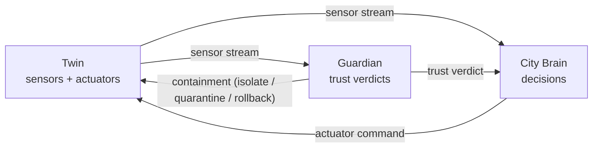

# Integration

How the three layers connect. Agreed jointly by all three teams; keep it in sync with each `INTERFACE.md`.

## 1. Architecture

Exported diagrams go in [`docs/diagrams/`](docs/diagrams/).

## 2. Protocol and formats

- Twin exposes every sensor reading and actuator action as a callable MCP-style tool.
- Transport: _TBD (e.g. HTTP/REST + SSE, MQTT, WebSocket)_
- Data format: _TBD (e.g. JSON, schema reference)_
- Authentication: _TBD (see each `INTERFACE.md`)_
- Partner addresses and secrets: environment variables only (see `.env.example`).

## 3. Message contract

| From → To | Message | Defined in |
|-----------|---------|-----------|
| Twin → Brain / Guardian | sensor reading | `twin/INTERFACE.md` |
| Guardian → Brain | trust verdict on a reading | `guardian/INTERFACE.md` |
| Brain → Twin | actuator command | `brain/INTERFACE.md` |
| Guardian → Twin | containment action | `guardian/INTERFACE.md` |

## 4. One scenario end to end

_Trace one scenario across the layers, with timestamps and the exact messages exchanged: reading → Guardian verdict → Brain decision → actuator action._

## 5. Failure behaviour

_What each layer does when a partner is down or sends invalid input._
