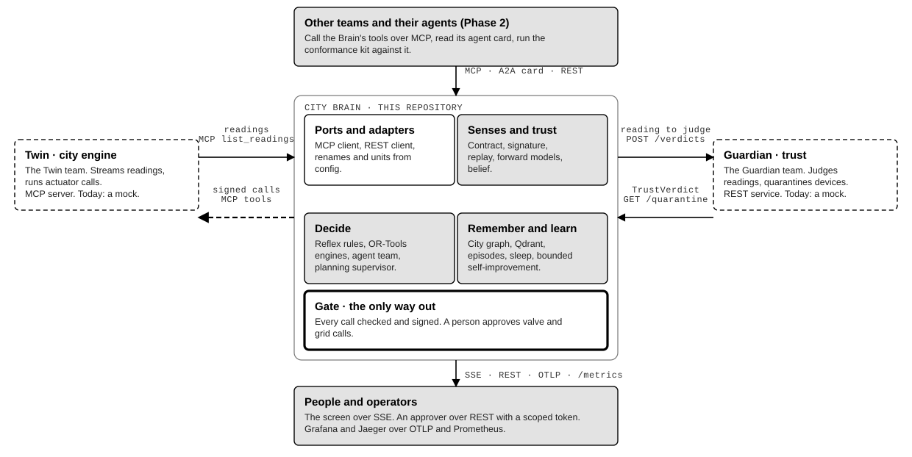
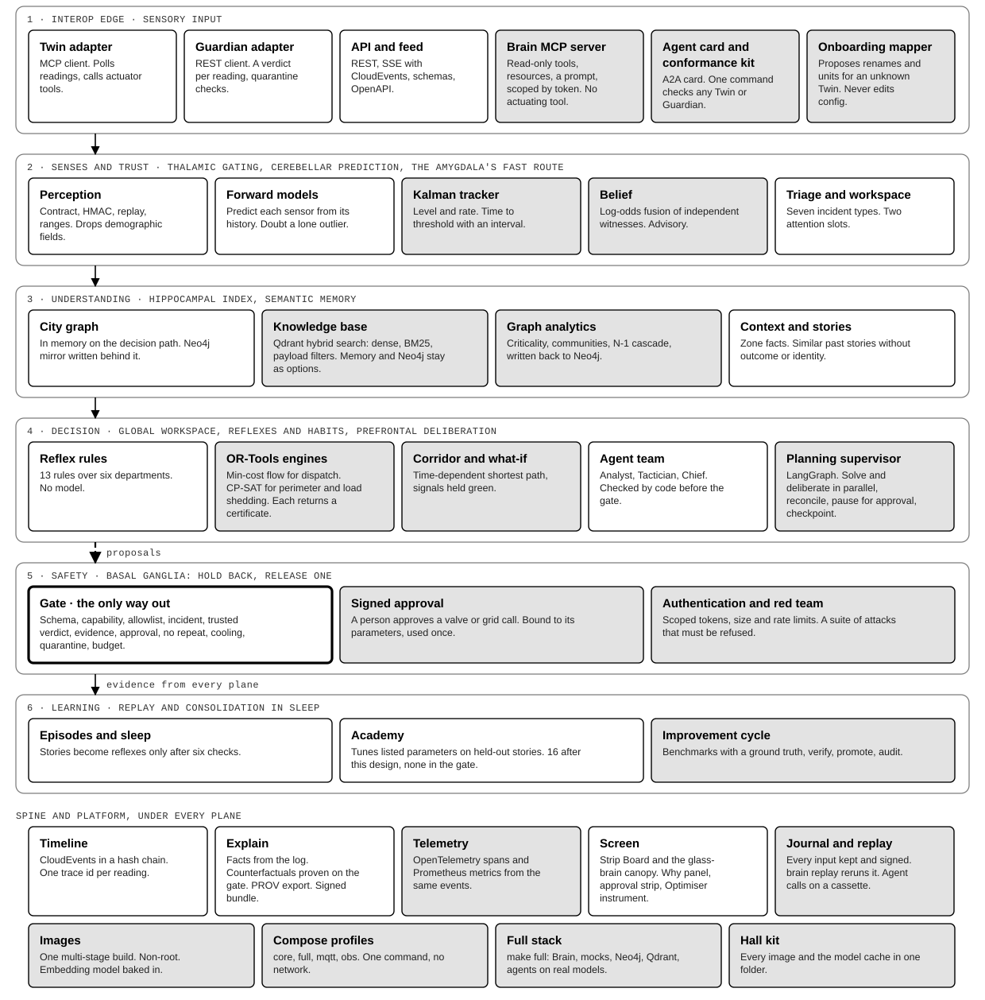
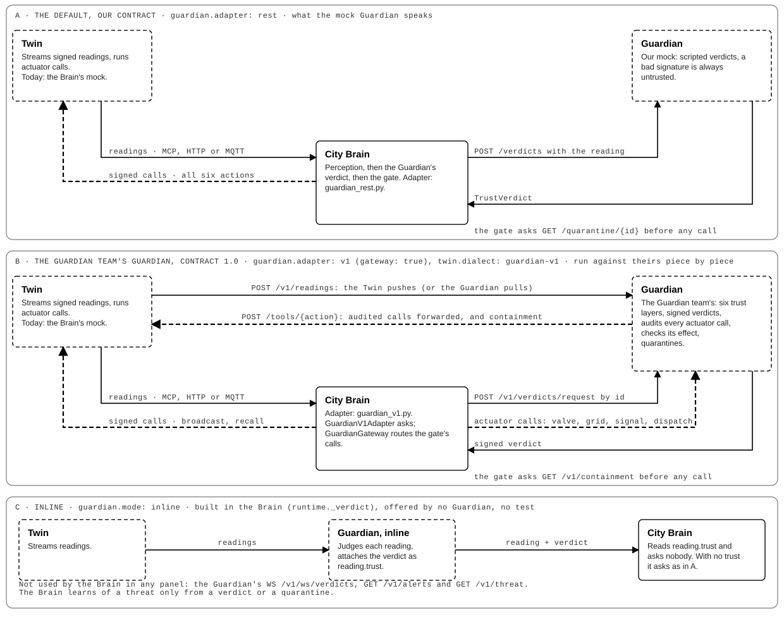
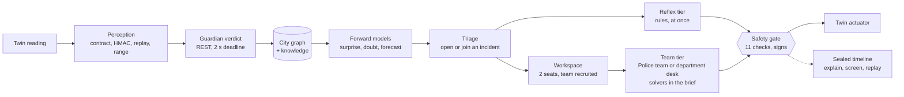
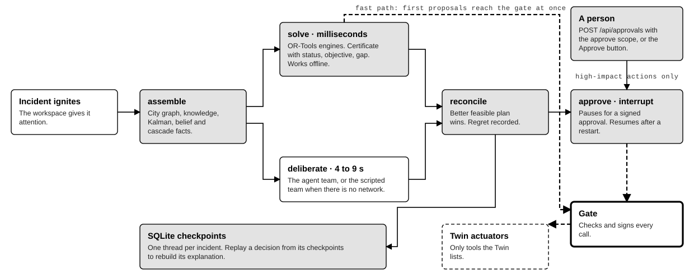
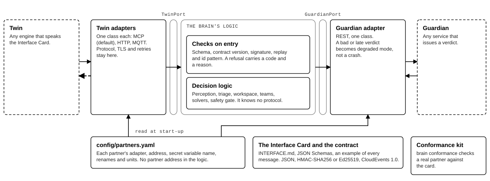
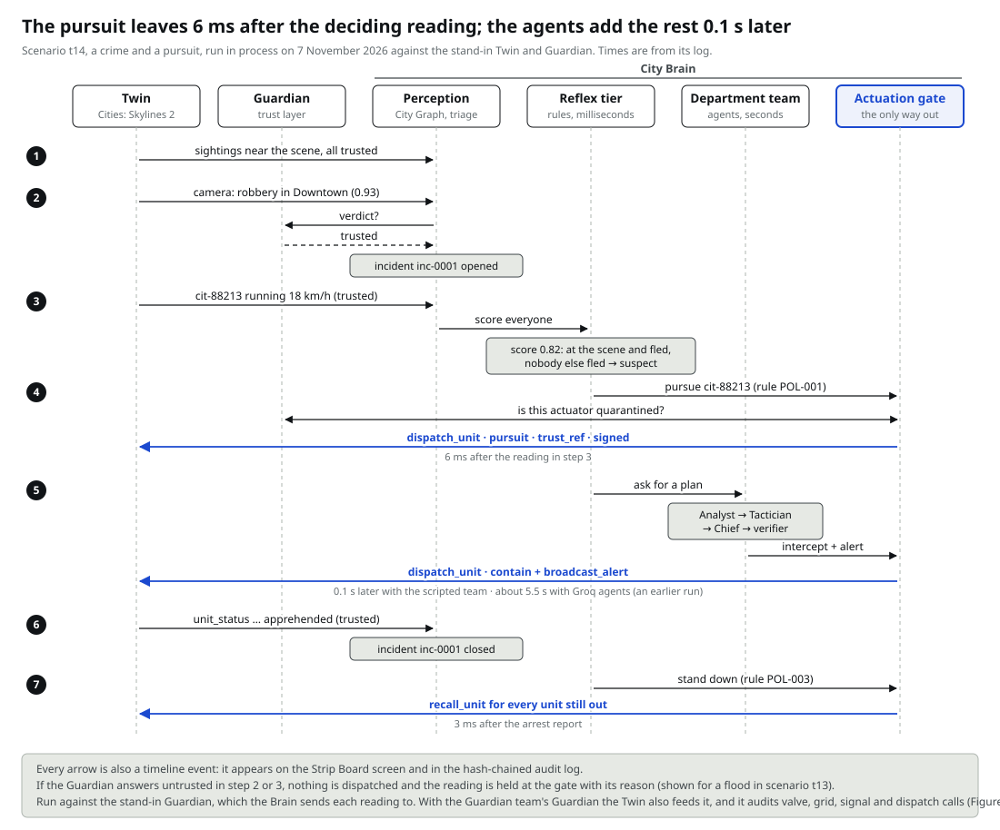

# brain (Tatsu)

The City Brain: it detects real incidents (accidents, fires, jams, floods, crimes) from the Twin's live readings, waits for the Guardian's trust verdict on each reading, decides the response, and acts through the Twin's actuators. Every actuator call leaves through one checked door, the **Safety gate**: no trusted verdict, no action.

Python 3.12 with uv, FastAPI, LangGraph, MCP. It is **brain-inspired**: attention, prediction error, sleep and habit are modelled as engineering, nothing more.

**Where it stands (final Phase 1 report, 8 Nov 2026).** The triplet's report is [`../docs/report.pdf`](../docs/report.pdf); this layer is Part 2 (pages 9 to 13), and Parts 0 and 4 are shared with the Twin and Guardian teams. All five Brain scenarios (T12 to T16) pass with their logs in `logs/`; 1,114 tests; 60 of 60 held-out variants decide as their base scenario; `brain redteam` refuses 24 of 24 attacks. Against the Guardian team's live Guardian the Brain has run the fake flood, a real flood and T16; it has not yet run with the Twin team's real Twin, and no run yet joins all three teams' layers ([Known limitations](#known-limitations)).

**Contents:** [Architecture](#architecture) · [Run this layer alone](#run-this-layer-alone-r1) · [How we test with mocks](#how-we-test-with-mocks) · [Scenarios and logs](#scenarios-and-logs-r2) · [Phase 1 map: requirement to source](#phase-1-map-requirement-to-source) · [Configuration](#configuration) · [Layout](#layout)

## Architecture

Four rules explain most of the design:

1. **Trust before action.** Every call carries a `trust_ref` naming a trusted Guardian verdict that covers the evidence.
2. **The gate is the only way out.** Rules, agents and solvers only *propose*; the gate checks, signs and sends.
3. **Code disposes.** A model may reason, but deterministic checks run before the gate; a scripted team passes every scenario with no network.
4. **Nothing is silent.** A held action, a refused reading or an outage each produce a named event with its reason.

**The Brain between its partners.** The Twin sends readings to the Brain. The Guardian does not sit in that path: it judges readings and returns a verdict per reading, which the Brain asks for. The Brain sends signed actuator calls back to the Twin. Every link names its protocol. The two lines under the Brain exist only with the Guardian team's Guardian, which the Twin also feeds and which audits valve, grid, signal and dispatch calls on their way to the Twin.



**Six planes** from the interoperability edge to learning (a grey box is new in the Convergence design):



**The Guardian, wired the ways that exist.** Our contract (the default, what the mock speaks), the Guardian team's contract 1.0 (`guardian.adapter: v1`, with `GuardianV1Adapter` and `GuardianGateway`) and the inline mode that the Brain supports and no Guardian offers. The Brain does not read the Guardian's alert feed. Detail: [`docs/HOW-IT-WORKS.md`](docs/HOW-IT-WORKS.md#where-the-guardian-sits) and [`docs/GUARDIAN-COMPAT.md`](docs/GUARDIAN-COMPAT.md).



**One reading, end to end** (`BrainService._handle` in [`src/brain/runtime.py`](src/brain/runtime.py)):



The team deliberation is a planning graph; the gate follows it, and a person can pause it for high-impact actions:



**Where logic ends and partners begin.** Decision code never imports a protocol; two small ports (`ports.py`) and the adapters outside them are all that touch a partner. A new Twin or Guardian is a `config/partners.yaml` edit (`guardian.adapter: rest` or `v1`) (enforced by `tests/test_layering.py`).



**Scenario t14 traced across the three layers**, with times from its log:



More figures: the memory plane (`fig3`), Compose deployment (`fig4`), improvement loop (`fig6`) and the 3D "glass brain" (`fig7`) are in [`docs/diagrams/print/`](docs/diagrams/print/) (captions and legibility in [`FIGURES.md`](docs/diagrams/print/FIGURES.md), all in one PDF: [`City-Brain-architecture-v2.pdf`](docs/City-Brain-architecture-v2.pdf)). Twenty plain-language icon diagrams, one per feature, are in [`docs/simple-diagrams.html`](docs/simple-diagrams.html). Redraw with `uv run python docs/diagrams/print_figures.py`. The long explanation is [`docs/HOW-IT-WORKS.md`](docs/HOW-IT-WORKS.md); the analogy to a real brain, and where it stops, is [`docs/BRAIN-MAPPING.md`](docs/BRAIN-MAPPING.md).

## Run this layer alone (R1)

It runs with no partner, using the stand-ins in [`mocks/`](mocks/) (a mock Twin over MCP, a mock Guardian over REST). Requires [uv](https://docs.astral.sh/uv/), which installs Python and the dependencies.

```bash
uv run brain serve                            # the live timeline screen (R3) at http://127.0.0.1:8080 ; press 1 to 4 to run a scenario, C for the 3D view
uv run brain scenario t14 --inproc --speed 0   # one Test Book scenario in a second: pass/fail verdict and a log
uv run pytest tests -q                        # the test suite (tests that need Neo4j, Qdrant or a broker skip)
```

Or in containers, with both mocks, Neo4j and Qdrant: `scripts/up.sh` (Docker Compose, profile `core`; it builds the image and waits for health).

With the Guardian team's real Guardian (contract 1.0) and their Twin mock instead of our mocks: `make guardian-up` (a separate stack, `docker-compose.guardian.yml`; what runs and what it does not show: [`docs/GUARDIAN-COMPAT.md`](docs/GUARDIAN-COMPAT.md#run-it-against-the-real-guardian-compose)).

**Two databases are on by default, each for one job** (`graph.backend: neo4j`):
- **Neo4j keeps the City Graph:** every reading, verdict, incident, decision and action, linked, so a run can be explored as a graph at http://127.0.0.1:7474 ("why was this unit sent?" is one query, in [`docs/graph-queries.md`](docs/graph-queries.md)). Start it alone with `make neo4j`.
- **Qdrant keeps the knowledge vectors:** the playbooks, rules and past incidents the agent teams search by similarity. Embedded (a folder, no server) for `uv run`; a server in Compose.

Why both, and what happens when one is down: [`docs/decisions/0005-databases.md`](docs/decisions/0005-databases.md). Decisions never wait on either: an unreachable store is reported once and the Brain keeps going from memory.

The first run downloads a 65 MB embedding model once. The agent teams run on a real model only with `--llm` and a `GROQ_API_KEY` in `.env` (copy `.env.example`); without it, scripted agents answer the same way every time and every scenario still passes.

## How we test with mocks

The Brain is built and checked without the other two teams. Two stand-ins in [`mocks/`](mocks/) speak the shared contract, so the same Brain code runs against them and against the real layers.

| Mock | Files | Speaks | What it does |
| --- | --- | --- | --- |
| **Twin** | [`mocks/twin/`](mocks/twin/) (`engine.py`, `server.py`, `http_server.py`, `mqtt_publisher.py`) | MCP tools by default; plain HTTP or MQTT as alternates | Replays a scenario's `events` as HMAC-signed readings (`list_readings`, `get_topology`) and accepts the six actuator calls (`dispatch_unit`, `broadcast_alert`, `recall_unit`, `set_signal_phase`, `set_valve_state`, `set_grid_connection`). It checks signature, clock skew and one-time nonce, answers `duplicate` to a repeat, frees a recalled unit, and records every call (`admin_actuator_log`). |
| **Guardian** | [`mocks/guardian/`](mocks/guardian/) (`engine.py`, `server.py`) | REST: `POST /verdicts`, `GET /quarantine/{id}`, `/admin/config` | Returns scripted verdicts from the scenario's `guardian` block: a default, per-sensor overrides (`untrusted`), a `down` switch and a `quarantined` list. One real check stays on: a bad HMAC is always `untrusted`. |

A scenario file ([`scenarios/t12.json` to `t16.json`](scenarios/)) holds the whole script: the topology, the timed `events` the Twin emits, the `guardian` behaviour, optional `faults` (the Guardian goes silent after N verdicts, the Twin drops, the vector index fails; counted in operations, not seconds, so every run fails at the same point), and the `expect` block that decides pass or fail.

**Four ways to run against them**, from fastest to most realistic:

| Command | Mocks | What it proves |
| --- | --- | --- |
| `uv run brain scenario t14 --inproc --speed 0` | in the same process, no ports (`inproc_partners` in `src/brain/scenario.py`), virtual clock | the Brain's decisions, in about a second |
| `uv run brain scenario t14` | spawned as two subprocesses on the addresses in `config/partners.yaml` | the real wire: MCP and REST over sockets |
| `scripts/up.sh` / `make full` | containers with Neo4j and Qdrant (Docker Compose) | the deployed shape |
| `uv run brain scenario t14 --llm` | as above | the agent teams on a real model instead of the scripted team |

**What is checked, and by what:**

| Question | Check | Command |
| --- | --- | --- |
| Does each scenario do what the Test Book says? | the `expect` block: actions taken, actions never taken, blocked reasons, event counts, event order, forbidden events | `uv run brain scenario <id> --inproc` (all in `tests/test_scenarios.py`, `tests/test_demo_scenarios.py`) |
| Does the log keep the temporal promises? (trust before action, nothing after close, every unit home) | `mind/specs.py`, specs `TS-01` onward | `uv run brain verify-log --scenarios` |
| Is a run reproducible? | `replay.py` plays the input journal back and compares decisions; `repro.py` reports what changed level by level | `uv run brain replay logs/canonical/t14.inputs.jsonl` |
| Has a decision drifted? | frozen baselines in [`docs/baseline/`](docs/baseline/) | `uv run brain baseline --check` |
| Does it still decide the same when the city is shifted, reseeded or decoyed? | held-out variants | `uv run brain variants --seeds 1000-1004` |
| Do the mocks follow the contract, so a partner can run the same check on theirs? | the conformance kit, `src/brain/conformance/`: 19 checks on a Twin, a Guardian and a Brain ([latest report](docs/conformance/2026-11-04.md)) | `uv run brain conformance` |
| Can the Brain be talked into acting without trust? | 24 attacks, each must be refused | `uv run brain redteam` |
| Does the Brain survive the mocks failing? | `faults:` in scenarios `t15` and `t16`, and `tests/test_guardian_fault.py`, `test_restart.py`, `test_reliability.py` | `uv run brain reliability t15` |
| Does the adapter bridge the Guardian team's real contract 1.0? | their payloads from their Interface Card, over `httpx.MockTransport` | `tests/test_guardian_v1.py`, `tests/test_perception_guardian_v1.py` |
| Everything at once | scenarios, baselines, variants, interop, red team in one table | `make check` (about 30 s) or `uv run brain bench` |

The test suite (`uv run pytest tests -q`, 1,114 tests in 120 files, named as sentences) runs with no server; the tests that need Neo4j, Qdrant or a broker skip, and `make test-all` starts all three in Docker and runs them with none skipped.

**What the mocks do not prove.** The Brain has run end to end against its own mocks, and against the Guardian team's live Guardian for the fake flood, a real flood and T16 (8 Nov, [`docs/GUARDIAN-COMPAT.md`](docs/GUARDIAN-COMPAT.md)). Nothing here proves a joint run with the Twin team's real Twin. The Guardian mock is scripted, not a trust engine, so t13 and t16 show how the Brain behaves *given* a verdict, not whether a real Guardian would produce it.

## Scenarios and logs (R2)

| ID | Name | Trigger |
| --- | --- | --- |
| t12 | A calm day | `scenarios/triggers/t12.sh` |
| t13 | A fake flood | `scenarios/triggers/t13.sh` |
| t14 | A crime and a pursuit | `scenarios/triggers/t14.sh` |
| t15 | A flood, an attack and a layer down | `scenarios/triggers/t15.sh` |
| t16 | A quarantined police station | `scenarios/triggers/t16.sh` |

Each run writes a hash-chained log to `logs/<id>-<time>.jsonl` with its input journal beside it. One verified, replayable log per scenario is kept in [`logs/canonical/`](logs/canonical/) (`uv run brain replay logs/canonical/t14.inputs.jsonl` plays it back). Fields and expected outputs: [`docs/TESTBOOK-brain.md`](docs/TESTBOOK-brain.md).

## Phase 1 map: requirement to source

Each line of the Phase 1 requirements, the code that carries it, and the test that keeps it true. The same table by requirement, in prose: [`docs/PHASE1-COMPLIANCE.md`](docs/PHASE1-COMPLIANCE.md). Paths are under `src/brain/` unless they start with another folder.

### What the jury looks for (Phase 1 book, "Interoperability: your ticket to the finals")

| The jury looks for | Where the Brain does it | Proof |
| --- | --- | --- |
| A clear separation between the layer's logic and the way it talks to partners | `ports.py` (two ports, `TwinPort` and `GuardianPort`); all protocol code in `adapters/`; only `adapters/`, `api/`, `commands/` and `scenario.py` may name an adapter | `tests/test_layering.py` fails the build if decision code imports a protocol |
| A complete Interface Card with message formats and examples | [`INTERFACE.md`](INTERFACE.md): five messages, one JSON example each; long form in [`docs/INTEGRATION-brain.md`](docs/INTEGRATION-brain.md); schemas in `contracts/schemas/` | `tests/test_phase1_requirements.py` (one page, an example of every message) |
| Partner addresses and settings in configuration, not hard-coded | `config/partners.yaml` (adapter, URL, secret variable names, renames, units); `TWIN_URL` and `GUARDIAN_URL` override | `tests/test_layering.py`, `tests/test_onboard.py` |
| Standard, well-known protocols and data formats | MCP, REST, plain HTTP, MQTT (Twin side); REST (Guardian side); Server-Sent Events with CloudEvents 1.0 out; JSON Schema 2020-12, OpenAPI 3.1, AsyncAPI 3 ([`docs/asyncapi.yaml`](docs/asyncapi.yaml)); HMAC-SHA256 over canonical JSON; TLS and mutual TLS (`adapters/tls.py`). Why each: [`docs/decisions/0003-protocols.md`](docs/decisions/0003-protocols.md) | `tests/test_twin_http.py`, `tests/test_twin_mqtt.py`, `tests/test_mcpserver.py`, `tests/test_tls.py` |
| Input validation and clear error messages when a partner sends something unexpected | `perception/` raises a `ContractError` with a code and a sentence: `schema_invalid`, `signature_missing`, `signature_invalid`, `reading_stale` (seconds off the Brain's clock), `replay_or_out_of_order` (the sequence numbers it compares), `value_invalid` (which field, what type). The runtime emits it as `brain.reading.rejected` on the timeline; the API answers `422` with the reason (`api/routes/events.py`) | `tests/test_perception.py`, `tests/test_api.py`, `brain conformance` (B2, B3) |
| A layer that runs on its own with mocks (R1) | `mocks/`; see [How we test with mocks](#how-we-test-with-mocks) | `tests/test_mock_twin.py`, `tests/test_scenarios.py` |

A partner can also check *itself* against the same card: `uv run brain conformance` runs 19 checks on a Twin, a Guardian and a Brain, and `uv run brain onboard --sample readings.json` proposes the config edits for a Twin that names things differently. That is the Phase 2 argument: a new partner is a configuration change, not a code change ([`docs/PARTNER-GUIDE.md`](docs/PARTNER-GUIDE.md)).

### Test Book: every interaction, with the book's own fields

The book requires scenarios that, taken together, test all three layers and every interaction between them, each described with ID, Name, Layers involved, Description, Trigger, Expected: Twin / Guardian / Brain and How to verify, with *concrete, observable* outputs. [`docs/TESTBOOK-brain.md`](docs/TESTBOOK-brain.md) is generated from the scenario files in the book's fields (`scripts/gen_testbook.py`, and a test fails if it drifts).

| Interaction (from the book) | Brain-team scenarios | Source of the behaviour shown |
| --- | --- | --- |
| Twin → Brain: the city runs normally and the Brain reacts correctly to real events | **T12** a calm day (must not overreact), **T14** a crime and a pursuit | `triage/`, `mind/workspace.py`, `departments/` |
| Twin → Guardian: healthy and unhealthy data | **T13** a fake flood (the reading is untrusted, nothing is opened) | `perception/`, `adapters/guardian_rest.py` |
| Brain → Guardian: trust verdicts change decisions, and decisions stay safe | **T13**, **T14**, **T16** a quarantined police station (the gate refuses calls to it with reason `quarantine`, a different station is used) | `gate/__init__.py` (checks 5, 6, 10) |
| All three: a real incident and an attack at once, one layer goes down and the city keeps running | **T15** a flood, an attack and the Guardian going silent | `runtime.py` (degraded mode), `mind/forward.py`, `engines/kalman.py` |

The Guardian team's own scenarios (T1 to T11) are in the shared root [`TESTBOOK.md`](../TESTBOOK.md), with their logs in the root `logs/` folder.

**"A team whose layer behaves correctly is not penalized for a partner's failure, provided it shows this with its mocks."** Each such failure is a scripted fault in a scenario, not a claim: the Guardian goes silent (`faults.guardian.after_verdicts` in T15; the Brain emits `brain.guardian.unavailable`, acts on no reading it has not judged and dispatches no police), the Guardian quarantines a device (T16), a sensor lies (T13), the Twin drops (`faults.twin`), the vector index dies (`faults.knowledge`). The `expect` block of each names what must happen and what must never happen, and the canonical log is the evidence.

### Demo day (the 2-minute pitch and 8-minute live demo)

| The book says | Here |
| --- | --- |
| Set up before the slot; the timeline screen shows live data | `make up` or `scripts/up.sh` starts the Brain, both mocks, Neo4j and Qdrant and waits for health; `uv run brain serve` is the screen |
| Run the Test Book scenarios of your choice live; the rest are checked through logs | number keys `1` to `5` on the screen, or `POST /api/scenarios/{id}/run`; the rest are in `logs/canonical/` and replay with `brain replay` |
| Do not rely on the venue Wi-Fi; keep a local fallback; nothing is installed on stage | the default run needs no network and no key (scripted agents); `scripts/hall_kit.sh save` (online, once) packs the image and the embedding model, `load` restores them offline with a checksum check |
| If the live connection fails, 2 minutes to recover, then the jury relies on code and logs | `uv run brain scenario <id> --inproc --speed 0` reproduces any scenario in a second with no ports; `brain verify-log --scenarios` re-checks every saved log |

### R1: the layer runs on its own

| Requirement | Source | Kept true by |
| --- | --- | --- |
| Mocks of the other two layers | `mocks/twin/`, `mocks/guardian/`; `scenario.py` (`inproc_partners`, `spawned_partners`) | `tests/test_mock_twin.py`, `tests/test_scenarios.py` |
| Run it alone with one command | `cli.py`, `commands/run.py` (`cmd_serve`, `cmd_scenario`); `scripts/up.sh`; `Makefile` | `tests/test_phase1_requirements.py` (README names `uv run brain serve` and `scenario t14`) |
| One-page Interface Card | [`INTERFACE.md`](INTERFACE.md); schemas and one example per message in `contracts/` (models in `contracts/models.py`) | `tests/test_phase1_requirements.py` (one page, has the headings, an example of every message), `tests/test_contracts.py` |
| Configuration, never hard-coded | `config/partners.yaml`, `config/policy.yaml`, `config.py`; `onboard.py` proposes mappings for a renamed Twin | `tests/test_phase1_requirements.py`, `tests/test_onboard.py`, `tests/test_layering.py` |
| Clean separation of logic from partner protocols | `ports.py` (two ports); `adapters/` (`twin_mcp.py`, `twin_http.py`, `twin_mqtt.py`, `guardian_rest.py`, `guardian_v1.py`, `tls.py`) | `tests/test_layering.py` (decision code never imports an adapter) |

### R2: one trigger, one log

| Requirement | Source | Kept true by |
| --- | --- | --- |
| One command per scenario | `scenarios/triggers/t12.sh` to `t16.sh` (generated by `scripts/gen_triggers.py`); `commands/run.py` (`cmd_scenario`); `api/routes/control.py` (`POST /api/scenarios/{id}/run`) | `tests/test_phase1_requirements.py` |
| A log per run, in the repository | `timeline.py` (`Timeline`, `JsonlSink`, hash chain, `verify_chain`); `journal.py` (input journal) | `tests/test_timeline_snapshot.py`, `tests/test_journal.py` |
| Checkable after the event | `logs/canonical/`; `replay.py`; `mind/specs.py` (`verify_log`); `explain/` (why a decision, signed bundle) | `tests/test_replay.py`, `tests/test_chain_anchor.py`, `tests/test_explain_bundle.py` |
| The Test Book fields for each scenario | `scenarios/t12.json` to `t16.json`; `scripts/gen_testbook.py` writes [`docs/TESTBOOK-brain.md`](docs/TESTBOOK-brain.md) | `tests/test_phase1_requirements.py` (committed file equals the generated one) |

### R3: a live timeline screen

| Requirement | Source | Kept true by |
| --- | --- | --- |
| Reading, verdict, decision and action in one row | `api/static/` (`index.html`, `brainshell.js`, `story.js`); `timeline.py`; `api/routes/events.py` (`GET /events`, server-sent events) | `tests/test_story_js.py`, `tests/test_api.py` |
| Held actions as visible as taken ones | `gate/` records every refusal with its check; `brain.action.blocked` events in the strip | `tests/test_gate.py` |
| A "why" for each step | `explain/` (`build.py`, `bundle.py`, `prov.py`); `api/routes/explain.py` | `tests/test_explain.py`, `tests/test_prov.py` |
| Partners can push their own events | `api/routes/events.py` (`POST /api/events`, CloudEvents, token; a forged `brain.*` type is refused) | `tests/test_security_invariants.py`, `brain conformance` (B2, B3) |
| The 3D view | `api/static/canopy3d.js` | `scripts/canopy_smoke.py` |

### The decision path: what the Brain does with a reading

| Stage | Source | Kept true by |
| --- | --- | --- |
| Perception: contract, HMAC, replay, range checks | `perception/`; `contracts/signing.py` | `tests/test_perception.py`, `tests/test_perception_guardian_v1.py` |
| Guardian verdict, 2 s deadline, degraded mode | `adapters/guardian_rest.py`, `adapters/guardian_v1.py`; `runtime.py` (`brain.guardian.unavailable`) | `tests/test_guardian_fault.py`, `tests/test_guardian_v1.py` |
| City graph and knowledge | `citygraph/` (memory and Neo4j); `knowledge/` (hybrid search, Qdrant) | `tests/test_neo4j.py`, `tests/test_knowledge.py`, `tests/test_qdrant.py` |
| Forward models, level forecast, early alert | `mind/forward.py`, `engines/kalman.py`, `runtime.py` (`_prewarn`) | `tests/test_kalman.py`, `tests/test_belief.py` |
| Triage: open or join an incident | `triage/`; `departments/detectors.py` | `tests/test_triage.py`, `tests/test_detectors.py` |
| Scarce attention: two seats | `mind/workspace.py`, `mind/salience.py`, `mind/bids.py` | `tests/test_workspace.py`, `tests/test_salience.py` |
| Reflex tier | `graph/` (`incident_graph.py`, `condition.py`, `actuation.py`); rules in `departments/rules/` | `tests/test_plan_graph.py` |
| Team tier: six departments, three agents for Police | `departments/` (`team.py`, `desk.py`, `builder.py`, `manifests/`, `playbooks/`) | `tests/test_team.py`, `tests/test_desk.py`, `tests/test_departments.py` |
| Solvers: dispatch, perimeter, shed, forecast, corridor | `engines/` (`dispatch.py`, `perimeter.py`, `shed.py`, `kalman.py`, `corridor.py`) | `tests/test_perimeter.py`, `tests/test_shed.py`, `tests/test_corridor.py`, `tests/test_optimise_bench.py` |
| **Safety gate**: 11 checks, then sign and send | `gate/__init__.py` (`ActuationGate.check`, `execute`); `approval.py` (signed human approval) | `tests/test_gate.py`, `tests/test_approval.py`, `tests/test_security_invariants.py` |
| Learning: episodes, sleep, academy | `mind/episodes.py`, `mind/sleep.py`, `mind/academy.py`, `mind/improve.py` | `tests/test_sleep.py`, `tests/test_academy.py`, `tests/test_improve.py` |

### Repository structure

| Phase 1 layout | Here |
| --- | --- |
| `brain/README.md` | this file |
| `brain/INTERFACE.md` | [`INTERFACE.md`](INTERFACE.md) |
| `brain/src/` | `src/brain/` (map of every module: [`docs/codebase/CODEBASE.md`](docs/codebase/CODEBASE.md)) |
| `brain/mocks/` | `mocks/twin/`, `mocks/guardian/` |
| `brain/tests/` | `tests/` |
| Root `INTEGRATION.md`, `TESTBOOK.md`, `docker-compose.yml`, `scenarios/`, `logs/`, `docs/` | shared by the triplet; ours: `docs/TESTBOOK-brain.md`, `docker-compose.yml` here (written to be included by the root file), `scenarios/`, `logs/`, `docs/report/` |

### Report and scoring

The final report is the triplet's [`../docs/report.pdf`](../docs/report.pdf) (20 pages): Part 0 overview and integration and Part 4 Test Book with the other two teams, Part 2 The City Brain (pages 9 to 13) by us, in the six shared subheadings. Our source for Part 2 is [`docs/report/report-part2-city-brain.pdf`](docs/report/report-part2-city-brain.pdf) (rebuild: `docs/report/build.py`); the root `docs/build_report.py` joins the parts.

| Scoring line | Points | Where it is carried |
| --- | --- | --- |
| Individual prototype functionality | 10 | the pipeline above, the five scenarios, the decision engines (`engines/`, `departments/`) |
| Technical implementation and features | 5 | [`docs/decisions/`](docs/decisions/) (eight records), [`docs/HOW-IT-WORKS.md`](docs/HOW-IT-WORKS.md), `docs/baseline/` |
| Interoperability between the 3 teams | 15 | `adapters/` behind `ports.py`, `conformance/`, `onboard.py`, [`docs/GUARDIAN-COMPAT.md`](docs/GUARDIAN-COMPAT.md), [`docs/PARTNER-GUIDE.md`](docs/PARTNER-GUIDE.md) |
| Security and trust | 10 | `gate/`, `contracts/signing.py` and `contracts/keyring.py`, `security.py` (scoped tokens), `approval.py`, `redteam.py` (24 attacks), [`docs/SECURITY.md`](docs/SECURITY.md), [`docs/SECURITY-MITRE.md`](docs/SECURITY-MITRE.md) |
| Documentation and code quality | 5 | this README, the Interface Card, the Test Book, tests named as sentences, lint |
| Demonstration and presence | 5 | the timeline screen and the 3D view (`api/static/`) |

### Known limitations

As stated in the report (2.6 and 0.3), each with the next step:

| Limitation | Next |
| --- | --- |
| **No joint run with the real Twin yet**, and no run joins all three teams' layers. Against the live Guardian we ran the fake and real flood and T16. | run T12 to T16 against the Twin team's Twin |
| **The mock Guardian is scripted.** T13 and T16 show what the Brain does with a given verdict, not whether a real Guardian would issue it. | rerun both with `docker-compose.guardian.yml` |
| **Tuned on stand-ins.** Which sensors move together, and whether sensors in one zone are independent, waits for the real Twin's data. | record a normal day from it ([`docs/TWIN-HANDOVER.md`](docs/TWIN-HANDOVER.md)) |
| **TLS and the freshness limit are off by default.** Signatures still protect readings and calls. | set `guardian.tls` and `twin.max_age_s` on the live stack |
| **Guardian alerts are not read.** An actuator the Guardian flags as unreliable appears in its containment list, which the gate obeys; a `compromised_twin` alert does not reach the Brain. | read `WS /v1/ws/verdicts` in the adapter |

Before a three-layer run the teams still have to align how the Brain gets readings (the Twin notifies, the Brain reads the Twin directly), the path for actuator calls, the actuator list and the transport (the integration status table in Part 0.3).

## Configuration

Partner addresses, protocols and the names of the secret variables are in [`config/partners.yaml`](config/partners.yaml); pointing the Brain at a different Twin or Guardian is an edit there (or `--config <file>`), never a code change. Secrets come from the environment (`.env`, git-ignored). A Twin that names its sensors differently is mapped with `twin.type_aliases` and `twin.profiles`; `uv run brain onboard` proposes them. Details: [`INTERFACE.md`](INTERFACE.md).

## Layout

| Path | Content |
|------|---------|
| [`INTERFACE.md`](INTERFACE.md) | The Interface Card (R1) |
| `src/brain/` | Layer code (map: [`docs/codebase/CODEBASE.md`](docs/codebase/CODEBASE.md)) |
| `mocks/` | Stand-ins for twin + guardian, and `guardian_twin/`, the bridge that lets the Brain read the Guardian team's Twin mock |
| `tests/` | Tests, named as sentences |
| `scenarios/` | The Test Book scenarios (`t12` to `t16`), city topologies, one trigger script per scenario |
| `logs/canonical/` | One verified log per scenario |
| `config/`, `contracts/` | Partner settings and policy; JSON schemas and one example of every message |
| `docs/` | Our report part, how it works, security, decisions, diagrams ([`docs/README.md`](docs/README.md)) |
| `Dockerfile`, `docker-compose.yml`, `docker-compose.guardian.yml`, `deploy/`, `scripts/`, `Makefile` | Containers (the mock stack, and the stack with the real Guardian) and helpers (`make help` lists every target) |

## Members

_Listed by the team._
