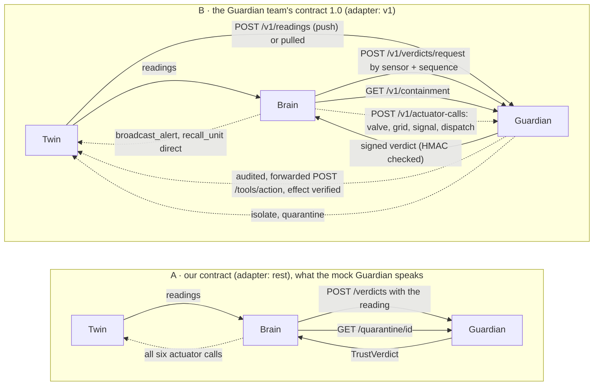

# How the City Brain works

Written 6 Nov 2026 from the code as it stands and from real runs of the four demo scenarios (`t12` to `t15`); every event name, number and file in the worked flows was read from a run. For where each symbol lives, use `codebase/CODEBASE.md`; for the region-by-region brain analogy, `BRAIN-MAPPING.md`; for the message formats, `../INTERFACE.md` and `INTEGRATION-brain.md`. This file is the one that explains how the parts fit.

## 1. What it is, in one page

The Brain is the decision layer of a three-layer system. The **Twin** is a simulated city (sensors in, actuators out). The **Guardian** says whether each sensor reading can be trusted. The **City Brain** reads the Twin's readings, waits for the Guardian's verdict on each, decides the response, and calls the Twin's actuators: send a unit, broadcast an alert, hold a signal green, close a valve.

Four rules hold everywhere and explain most of the design:

1. **Trust before action.** Every call carries a `trust_ref` naming a trusted Guardian verdict that covers the evidence. An untrusted reading is compared and reported, never acted on and never learned from.
2. **The gate is the only way out.** Rules, agents and solvers only *propose* (`ProposedAction`). The Safety gate checks, signs and sends every call. Agents get read-only tools.
3. **Code disposes.** A model may reason, but its answer passes deterministic checks (`verify_case`, `verify_plan`, `verify_desk`) before the gate, and a scripted team that needs no network passes every scenario. A model outage changes who reasons, never what is allowed.
4. **Nothing is silent.** A held action, a refused reading, a doubted value, an unknown alarm and a model outage each produce a named event with its reason, and the screen shows it.

The Brain is *brain-inspired*: it models functions of a brain (senses, prediction error, attention, reflex and deliberation, memory, sleep) as engineering. It is not described as conscious.

## 2. The big picture

```
                    ┌────────────────────────── the Brain ─────────────────────────────┐
  Twin ── reading ─▶│ Perception ─▶ Guardian verdict ─▶ Store (city graph, knowledge)  │
 (MCP/HTTP/MQTT)    │   checks:        (REST, 2 s)         │                           │
                    │   contract,                          ▼                           │
                    │   HMAC, replay,        Forward models + level forecast           │
                    │   ranges                  │ surprise / doubt / early alert       │
                    │                           ▼                                      │
                    │            Triage: opens or joins an incident                    │
                    │                           │                                      │
                    │          ┌────────────────┴───────────────┐                      │
                    │          ▼                                ▼                      │
                    │   Reflex tier (rules)         Workspace: salience, 2 seats       │
                    │   acts at once                 packs bid, a team is recruited    │
                    │          │                                │                      │
                    │          │            ┌───────────────────┴──────────┐           │
                    │          │            ▼                              ▼           │
                    │          │   Police team (Analyst,        Department desks       │
                    │          │   Tactician, Chief)            (Analyst, Chief)       │
                    │          │            ▲   solvers' answers go into the brief     │
                    │          │            │   (dispatch, perimeter, shed, forecast…) │
                    │          ▼            ▼                              ▼           │
                    │        ┌───────────── Safety gate ─────────────────┐             │
  Twin ◀─ signed ───│        │ 11 checks, signs, sends, remembers keys   │             │
  actuator call     │        └───────────────────────────────────────────┘             │
                    │   Memory: episodes ─▶ Sleep (learned reflexes) ─▶ Academy (tuning)│
                    │   Timeline (sealed log) ─▶ Explain · Screen · API · MCP · Metrics │
                    └───────────────────────────────────────────────────────────────────┘
```

Three loops run at different speeds (the vocabulary of agentic-systems writing):

| Loop | What it is here | Speed |
| --- | --- | --- |
| **Inner** (sense, plan, act) | one reading through perception, trust, forward models, triage, reflex, gate (`runtime.py`) | milliseconds |
| **Task** | one incident's team deliberation: brief, tools, answer, verify, propose, with a 30 s budget as its termination gate | seconds |
| **Meta** | `brain sleep` (learn reflexes from stored episodes) and `brain academy` (tune 13 parameters inside a fence) | between runs |

### Where the Guardian sits

The Guardian does **not** sit between the Twin and the Brain, and it forwards no readings: the Brain always reads the Twin directly (`adapters/twin_*.py`) and asks the Guardian about each reading. What differs is the Guardian. Two wirings are built (`adapters/guardian_rest.py`, `adapters/guardian_v1.py`, chosen by `guardian.adapter`); the figure with every link is [Figure 9](diagrams/print/fig9-guardian-wiring.svg).



| | A: `rest` (default) | B: `v1` |
| --- | --- | --- |
| Who gives the Guardian the reading | the Brain, in the request | the Twin (push) or the Guardian (pull); the Brain sends only `sensor_id` and `sequence_no` |
| Verdict | `TrustVerdict`, not signed | signed with `GUARDIAN_HMAC_KEY`; an `unknown` answer is asked again until the 2 s deadline |
| Quarantine | `GET /quarantine/{id}` | `GET /v1/containment` |
| Actuator calls | the gate calls the Twin | valve, grid, signal and dispatch go through the Guardian (`GuardianGateway`, `guardian.gateway: true`), which checks the trust reference, applies its safety rules and verifies the effect on an independent sensor; broadcast and recall, which it does not know, go to the Twin |
| Names translated | none | `adapters/guardian_v1.py`: `set_grid_connection` ↔ `set_grid_state`, `set_signal_phase` ↔ `set_signal`, status `suspect` ↔ `suspicious` |

A third mode, `guardian.mode: inline`, is built in the Brain (`runtime._verdict` reads `reading.trust` and asks nobody) for a Guardian that annotates readings itself. No Guardian offers it and no test covers it. The Guardian's own alert feed (`WS /v1/ws/verdicts`, `GET /v1/alerts`, `GET /v1/threat`) is **not read** by the Brain: it learns of a threat only from a verdict or a quarantine. What was run against the team's Guardian, and what is still open: [GUARDIAN-COMPAT.md](GUARDIAN-COMPAT.md).

## 3. The path of one reading

`BrainService._handle` (`runtime.py`) runs this for every reading, in order:

1. **Perception** (`perception/`). Checks the contract version, the HMAC signature, the sequence number (a replay or out-of-order reading is refused) and the value ranges; drops every field outside an allowlist (demographic fields never enter); applies renames and units from config only after the signature check. A bad reading becomes `brain.reading.rejected` with a stable code (`signature_invalid`, `replay_or_out_of_order`, `value_invalid`…).
2. **Guardian verdict** (`adapters/guardian_rest.py`, or `guardian_v1.py` for the Guardian team's). `POST /verdicts` with the reading (v1: `POST /v1/verdicts/request` by sensor and sequence number) with a 2 s deadline. If the Guardian is silent the Brain says so once (`brain.guardian.unavailable`) and acts on no reading it has not judged: every call still needs a trusted, unexpired verdict, and only a low-impact call backed by an earlier verdict can pass, and a score built on unvouched evidence is damped to near zero.
3. **Store** (`citygraph/`). The reading and its verdict become nodes in the city graph (in memory, and mirrored to Neo4j by default; the knowledge vectors are in Qdrant).
4. **Forward models and the level forecast** (`mind/forward.py`, `mind/neighbours.py`, `engines/kalman.py`). Each sensor learns its own normal. A reading far outside it is a *surprise*; the first one is *doubted* and the reflex that would act on it is held. A level tracker also forecasts when a water level crosses the flood line.
5. **Early alert** (`runtime._prewarn`). If a trusted forecast says the line is within 10 minutes (and no forward model doubts the reading and no coupled sensor disagrees), one low-impact alert goes to the zone through the gate, before the line is crossed.
6. **Triage** (`triage/`). The packs' detectors decide whether the reading opens or joins an incident. Alarms no pack recognises are named (`unknown_type`); an open incident with no new evidence is named (`stalled`).
7. **Workspace** (`mind/workspace.py`, `mind/salience.py`). Scores the incident (severity, trust, corroboration, novelty, clustering, freshness, surprise, urgency), keeps at most two seats, and asks every pack to bid.
8. **Reflex tier** (`graph/`). Rules from the packs answer at once. A rule never decides whether an action is allowed: it proposes.
9. **Team tier** (`departments/`). A recruited team deliberates in the background: the Police team of three, or a department desk of two. Solvers' answers are already in its brief.
10. **Gate** (`gate/`). Every proposal from steps 5, 8 and 9 meets the same checks.
11. **Twin** (`adapters/`). The signed call is sent; the result returns as `brain.action.result` and, for units, later `unit_status` readings close the loop.

## 4. The components

### 4.1 The edge: contracts, adapters, security

| Part | Job | Where |
| --- | --- | --- |
| Contracts | the message models, signing (HMAC with key ids and rotation), JSON Schemas, examples | `contracts/`, `contracts/examples/` |
| Adapters | the Twin over MCP, HTTP or MQTT; the Guardian over REST (ours) or its v1 contract, which also routes four kinds of actuator call through the Guardian (`GuardianGateway`); TLS and mutual TLS | `adapters/`, `ports.py` |
| Security | scoped tokens off loopback, signed human approvals, forged `brain.*` pushes refused, 24 attacks tried by `brain redteam` | `security.py`, `approval.py`, `redteam.py` |
| Onboarding | proposes renames and profiles for a Twin that names things differently, never edits config | `onboard.py` |

The Twin is a partner: everything about it (names, units, which sensors move together) is configuration, not code, agreed with the partners in `INTERFACE.md`.

### 4.2 Forward models: prediction error

`mind/forward.py` keeps a running mean and spread per sensor and field. Only trusted readings teach it; a retracted reading is forgotten and the baseline rebuilt. `mind/effects.py` expects the change the Brain's own actions cause, so it is not a surprise. `mind/neighbours.py` follows the *difference* between two sensors that should move together, so a slow creep one of them makes is caught even though its own history follows it. The level forecast (`engines/kalman.py`) is a constant-velocity tracker that says when a level will cross the flood line, with an interval.

### 4.3 Triage and the six teams

The packs are data: `departments/manifests/*.yaml` (what each subscribes to, its detectors, actuators, severity, agents), `rules/*.yaml` (reflexes), `playbooks/*.yaml` (procedures the teams cite). Adding a department is adding three files.

| Team | Incident types | Acts through | Reasoning |
| --- | --- | --- | --- |
| **Police** | crime | `dispatch_unit` (pursuit, contain), `broadcast_alert`, `recall_unit` | Analyst, Tactician, Chief |
| **Fire** | fire | `dispatch_unit` (fire), `broadcast_alert` | desk: Analyst, Chief |
| **Ambulance and medical** | accident | `dispatch_unit` (ambulance), `broadcast_alert` | desk |
| **Traffic control** (code `MOBILITY`) | jam | `set_signal_phase` | desk |
| **Disaster response** | flood | `broadcast_alert`, `set_valve_state` (a person approves) | desk |
| **Utilities** | overload, smog | `broadcast_alert`, `set_grid_connection` (a person approves) | desk |

A desk can only advise neighbouring zones: it picks zone ids, never words (`desks.messages` in `config/policy.yaml`), and `verify_desk` checks the zones before anything is sent.

### 4.4 The workspace: scarce attention

Two seats. An incident takes a free seat when its salience is high enough, or displaces the weakest seat-holder when it beats it by a margin. An incident of a type no agent team handles is lit without a seat. Incidents without a seat still get their reflex response; they only wait for a model. When an incident ignites, every pack bids (`mind/bids.py`: fit to the incident type, scaled by the share of the actuators it needs that the Twin really offers, and by free units); a pack bidding 0.5 or more joins.

### 4.5 The reflex tier and the two teams' paths

`graph/incident_graph.py` is a LangGraph graph per incident; `graph/condition.py` runs `condition` rules once per open incident; `graph/actuation.py` turns a rule's action into a `ProposedAction` and picks the station (nearest, or the dispatch solver's choice when incidents compete). A reflex acts in milliseconds, so the first response never waits for a model.

The team path (`departments/builder.py`, `team.py`, `desk.py`) runs as a background task with a 30 s budget:

```
brief  ─▶  Analyst ─▶ (Tactician) ─▶ Chief  ─▶  verify  ─▶  propose  ─▶  gate
 ▲            tools: read-only          typed handoffs      code checks
 │
 └ facts from the solvers, computed in code (departments/facts.py)
```

Each role has a scripted stand-in that gives the same answer every time and passes every scenario with no network. With `--llm` each role is a model agent (Groq by default: `gpt-oss-120b` for judgement, `gpt-oss-20b` for speed); if a role fails the stand-in takes over (`brain.agent.fallback`). `llm_health.py` makes that fallback instant when the key is rejected, the day's quota is spent, a rate limit is hit or the network is gone.

### 4.6 The solvers

All five are on by default and carry a `Certificate` (status, objective, bound, a hash of the inputs, time taken). Each is asked by the part of the Brain it serves, and its answer reaches the team in the brief (not only as an optional tool, because a model may never call one).

| Solver | Library | Asked when | The team reads | If it fails |
| --- | --- | --- | --- | --- |
| Dispatch | OR-Tools min-cost flow | two or more incidents compete for the same kind of unit; never differs from nearest-first without a saving | Fire and Ambulance desks: `allocation` | nearest-first |
| Perimeter | CP-SAT | the Police Tactician has offered options | Police Chief: `perimeter_optimum`; a plan more than 1 unit above it goes back once (a critic, not a veto) | the team's plan stands |
| Shed | CP-SAT | an overload on a known feeder that is over target | Utilities desk: `shed` and what a cut would darken | the substation's own rule |
| Level forecast | Kalman tracker | every trusted water reading | Disaster desk: `forecast`; workspace urgency; the early alert | no forecast |
| Corridor | Dijkstra over zones | after a confirmed fire or ambulance dispatch | Traffic control desk: `corridors` | no corridor |

### 4.7 The gate

`gate/__init__.py`. Every proposal meets these checks in order, and the first that fails stops it and records why:

1. schema; 2. the Twin really exposes the action; 3. the department's allowlist permits it; 4. the incident is still open (a recall is always allowed); 5. `trust_ref` names a trusted, unexpired verdict covering a cited reading; 6. enough independent trusted sources for the impact level (low 1, medium 2, high 2); 7. for high impact (a valve, the grid), a person's signed, single-use approval; 8. not issued before (idempotency); 9. the actuator was not driven a moment ago (cooling gap, off by default); 10. the Guardian has not quarantined the device; 11. the action budget (6 per incident, 20 a minute). Then the call is signed and sent.

A call the Twin never answered frees its idempotency key (`gate.retry_unreached`), so it can be tried again; a Twin that did act answers `duplicate`.

### 4.8 Memory and learning

- **Knowledge** (`knowledge/`): 39 playbook procedures (six teams), rules and the Twin's actuators, retrieved by hybrid search (keyword plus vectors, optionally Qdrant) that filters before it cuts and says how it chose (`RetrievalTrace`).
- **Episodes** (`mind/episodes.py`): each closed incident, kept when `brain.episodes_dir` is set.
- **Sleep** (`mind/sleep.py`): finds plans the team made the same way more than once, rehearses each as a candidate reflex, and promotes it only if it passes. A learned reflex is a *cache of a verified deliberation*; it never reads whether a dispatch worked. A lesson is retired when the team plans the pattern differently or it stops recurring.
- **Academy** (`mind/academy.py`): moves one of 13 listed parameters one step, scores it on synthetic streams and held-out seeds, promotes it only if every hard constraint holds. The gate, tactics, suspect scoring and contracts are not on the list.

### 4.9 Evidence, explanation and the screen

- **Timeline** (`timeline.py`): every event is hash-chained into a sealed JSONL log, one per run, with a replayable input journal (`brain replay`).
- **Explain** (`explain/`): why one decision, held action or incident, with counterfactuals proved by changing one input on the real gate, the knowledge cited, and now the solver's certificate; a signed bundle fails if one fact changes.
- **API and screen** (`api/`): FastAPI; `GET /events` streams the timeline; the Strip Board shows one reading's chain per strip; the 3D canopy shows the regions inside a transparent brain with a rack of instruments (including the solvers). Bars show when a person may be needed, when a call waits for approval (`brain serve --approvals`) and whether the model is answering (key `M` forces the scripted team).
- **Also served**: read-only MCP tools at `/mcp` and an agent card, `/metrics`, OpenTelemetry spans.

## 5. How the parts interplay

| When this happens | …this part | …tells this part | …which changes this |
| --- | --- | --- | --- |
| a reading is untrusted | Guardian verdict | salience and the gate | the incident scores near zero and the gate refuses what it proposes (`t13`) |
| a reading jumps | forward models | the reflex (held) and the workspace (surprise boost) | a lying gauge cannot trigger a flood response alone (`t13`) |
| the water is rising | level forecast | the early alert, the Disaster desk's brief, workspace urgency | the zone is warned before the line (`t15`) |
| two incidents want one unit | workspace and dispatch solver | the station choice and the desks' briefs | the far ambulance goes to the first call so the close one is free for the second (unit tests; no demo scenario) |
| an ambulance is dispatched | gate, then corridor planner | Traffic control | signals are held green along its road (unit tests) |
| an overload shares a feeder | cascade and shed solver | the Utilities desk and the gate | the cheapest cut is proposed, a person approves it (unit tests) |
| the Twin stops answering | adapter | the runtime | `brain.degraded` once, state kept, `brain.recovered`, nothing sent twice (unit tests) |
| the model's key runs out | `llm_health` | every team | the scripted team answers at once; the chip says why |
| nothing in the playbook fits | desk or triage | a person | `brain.human.needed` (no playbook, unknown alarm, stalled incident) |
| an incident closes | triage | memory | an episode is kept; sleep may promote its plan to a reflex |

## 6. Worked flows

Event names and values below come from real runs (`uv run brain scenario dN --inproc --speed 0`; the logs are in `logs/canonical/`).

### 6.1 One reading becomes an action: a crime and a pursuit (`t14`)

```
Twin ─▶ cctv_anomaly "robbery (0.93)" in zone-07 (signed)
Guardian ─▶ verdict trusted
brain.incident.opened      inc-0001  crime in zone-07
brain.workspace.ignited    inc-0001  salience 0.677, a seat
brain.suspect.assessed     cit-88213 score 0.82, "suspect" (loitering, then running at 18 km/h)
brain.decision.made        reflex    dispatch_unit police-dispatch-05 (pursuit)
brain.action.result        dispatched unit-p-01                                  ← the gate signed and sent it
brain.deliberation.started the Police team starts in the background
brain.case.reviewed        Analyst: "pursue", medium confidence
brain.perimeter.checked    the team holds 2 zones; a solver says 2 would hold
brain.plan.verified        Chief: tight-perimeter, zones 04 and 08
brain.decision.made        deliberate: dispatch_unit ×2 (contain) and broadcast_alert zone-07
brain.action.result        dispatched unit-p-02, unit-p-03; alert broadcast
… unit_status readings … brain.incident.closed "apprehended" … recall_unit ×2 … brain.units.released
```

The reflex acted first, in milliseconds; the team's plan arrived later and went through the same gate. If the team had failed, the pursuit would still have gone ahead.

### 6.2 A message, end to end

A reading from the Twin (`contracts/examples/reading.water_level.json`):

```json
{"contract_version": "2026-09-17", "sensor_id": "wl-01-01", "type": "water_level", "zone_id": "zone-01",
 "timestamp": "2026-10-12T19:41:57.054Z", "sequence_no": 1, "value": {"level_m": 1.35, "flow_rate_m3s": 2.4},
 "provenance": {"signed_by": "twin", "hmac": "a44c35…"}}
```

The Guardian's verdict on it (`verdict.json`): `{"verdict_id": "verdict-000004", "status": "trusted", "confidence": 0.97, "expires_at": …}`.

A rule or agent turns the incident into a proposal, which the gate checks:

```json
{"department": "DISASTER", "tier": "reflex", "incident_id": "inc-0001", "action": "set_valve_state",
 "actuator_id": "valve-01-01", "params": {"valve_id": "valve-01-01", "state": "closed"},
 "justification": "Flood reported in zone-01 (wl-01-01#6). Rule UTL-002.", "trust_ref": "verdict-000004",
 "evidence_reading_ids": ["wl-01-01#5", "wl-01-01#6"], "rule_id": "UTL-002"}
```

A valve is high impact, so the gate needs two independent trusted sources and a person's approval. With one source it records `brain.action.blocked` ("high-impact action needs 2 independent trusted sources, found 1"); with two and `--approvals` on, `brain.approval.requested` puts an Approve and Deny strip on the screen. After a grant the gate checks everything again and sends the signed call (`actuator_call.set_valve_state.json`, `provenance.signed_by: city_brain`).

### 6.3 A river that rises, a forged report, a layer down (`t15`)

```
water_level readings every second: 0.28, 0.31, 0.32 …
cctv_anomaly "robbery (0.93)" in zone-07  ─▶ Guardian: untrusted          ← the forged report; no police are sent
brain.math.estimated       wl-01-01  rising 3.4 m/min, about 10 s to the 1.0 m line
brain.forecast.warned      wl-01-01  early alert: the forecast is trusted, undoubted
brain.decision.made        DISASTER broadcast_alert "Water is rising near Harbor and may reach the flood line in about 1 minute…"
brain.action.result        broadcast                                      ← sent through the gate, before the line
… the level crosses 1.0 m …
brain.incident.opened      inc-0001  flood in zone-01
brain.action.blocked       evidence  the valve request needs 2 independent trusted sources, found 1 (wl-01-01)
brain.action.result        broadcast "Flooding reported. Avoid low-lying roads."
brain.guardian.unavailable the Guardian stops answering; one event, then degraded mode
… a camera floods the Brain with readings, each now "unavailable" …  brain.scenario.finished passed
```

The early alert is skipped on a doubted gauge: a public message gets the same safeguards as the reflex. The valve waits because one trusted source is not enough, not because the Guardian went away; after it goes away nothing new is sent, because no new reading has a verdict.

### 6.4 Two collisions, one close ambulance (unit tests)

No demo scenario shows this any more; `tests/test_engines_dispatch.py` does. With two incidents the solver may send the far ambulance to the first call so the close one is free for the second. With one incident the solver is not consulted at all (nearest-first is the optimum). It changes an answer only when the saving is real, and the explanation of the decision cites the certificate.

### 6.5 Holding back: a lying gauge, a forged report, a silent Guardian

- **`t13`, a fake flood.** A second gauge reads 1.8 m while the honest one reads 0.3 m. The Guardian marks it untrusted. The Brain still opens a flood incident, but `brain.action.blocked` twice (check `trust_ref`: no Guardian verdict stands behind the order), once for the warning and once for the valve. Nothing is sent. The incident closes when the honest gauge reads on.
- **`t15`, the forged robbery.** The camera reading is untrusted; the incident opens with `evidence_verdict: untrusted` and no police are sent.
- **`t15`, the Guardian goes down.** `brain.guardian.unavailable` once; every later verdict is `unavailable`, so nothing new is sent: the log shows no action after that point.

### 6.6 A person is needed

Three different causes, one event (`brain.human.needed`, red bar on the screen):

| Cause | Example | `why` |
| --- | --- | --- |
| an alarm no department recognises | a camera "riot" at 0.9, or an emergency call "other" | `unknown_type` |
| a department has no procedure for the incident type | the playbook has nothing for it | `no_playbook` |
| an incident stays open with no new evidence | `triage.stall_s` seconds | `stalled` |

### 6.7 The model stops answering

```
Groq returns 401 / "per day" 429 / 429 per minute / a lost connection
llm_health classifies it  ─▶  brain.llm.status {state: down, reason: key_rejected | quota_exhausted | rate_limited | unreachable}
every later team call raises LLMDown at once  ─▶  the scripted stand-in answers (brain.agent.fallback)
after a cool-down (15 s to 5 min) one call is let through; success ─▶ brain.llm.status {state: live}
the header chip shows the state; M forces the scripted team; `brain llm-check` tests the key before going on stage
```

### 6.8 Learning from experience

```
a closed incident ─▶ an episode (state/episodes) ─▶ brain sleep: the same plan made more than once
   ─▶ rehearsed as a candidate reflex against the real team ─▶ promoted only if it passes every check
   ─▶ next time the pattern recurs a learned reflex answers: team runs 1 → 0, time to last action 74.6 ms → 35.3 ms,
      decisions identical (brain learning-curve t14)
```

## 7. The switches that matter

| Setting | Default | Effect |
| --- | --- | --- |
| `team.llm` / `--llm` | off | model agents instead of the scripted team |
| `team.departments` | on in `scenario`, `serve`, `run`; off in the library | the five department desks |
| `optimiser.dispatch`, `shed`, `perimeter`; `math.kalman`; `orchestration.planner` | on | the solvers |
| `math.prewarn_s` | 600 | the early flood alert (0 off) |
| `workspace.urgency_boost` | 0.2 | a rising flood outranks a calm incident |
| `desks.escalate_to_person` | on | no playbook: ask for a person |
| `triage.stall_s` | 0 (off) | a stalled incident asks for a person |
| `gate.retry_unreached` | on | a call the Twin never answered may be tried again |
| `approval.mode` / `serve --approvals` | off | high-impact calls wait for a signed approval |
| `brain.tuned_dir` | null | whether the Academy's tuning takes effect |

`brain baseline --plain` and `tests/plain.py` run the Brain with the solvers off, to check the older frozen baselines.

## 8. Run it and look at it

```bash
uv run brain serve --approvals            # the screen at :8080; number keys run scenarios; C canopy; M model; G a guided tour
uv run brain scenario t15 --inproc --speed 0   # one scenario in a second (t12 to t16)
uv run brain explain …                    # why a decision was taken, with counterfactuals
uv run brain replay logs/<run>.inputs.jsonl    # play a run back; exit 0 if identical
uv run brain llm-check                    # is the key good, how much quota is left
uv run brain baseline --check docs/baseline/2026-11-06-engines-frozen.json
```

Every scenario is a Test Book entry in `scenarios/` with expectations; `docs/TESTBOOK-brain.md` lists them (generated), `logs/canonical/` holds one verified log per scenario.
