# City Brain codebase map

Generated from the code by `docs/codebase/graph.py`; rebuild it after moving or adding modules, events, endpoints, rules or scenarios (`uv run python docs/codebase/graph.py`, then `... graph.py check` passes). The same graph, with every edge, is in `graph.json`; `uv run python docs/codebase/graph.py query <word>` prints any node and its links. Paths are relative to `brain/`.

## Package dependencies

An arrow means "imports". Tests and the CLI are left out to keep the picture readable.

```mermaid
flowchart LR
  brain_adapters[brain.adapters] --> brain_config[brain.config]
  brain_adapters[brain.adapters] --> brain_contracts[brain.contracts]
  brain_adapters[brain.adapters] --> brain_ports[brain.ports]
  brain_api[brain.api] --> brain_adapters[brain.adapters]
  brain_api[brain.api] --> brain_backends[brain.backends]
  brain_api[brain.api] --> brain_config[brain.config]
  brain_api[brain.api] --> brain_contracts[brain.contracts]
  brain_api[brain.api] --> brain_explain[brain.explain]
  brain_api[brain.api] --> brain_knowledge[brain.knowledge]
  brain_api[brain.api] --> brain_llm_health[brain.llm_health]
  brain_api[brain.api] --> brain_mcpserver[brain.mcpserver]
  brain_api[brain.api] --> brain_mind[brain.mind]
  brain_api[brain.api] --> brain_observability[brain.observability]
  brain_api[brain.api] --> brain_persistence[brain.persistence]
  brain_api[brain.api] --> brain_runtime[brain.runtime]
  brain_api[brain.api] --> brain_scenario[brain.scenario]
  brain_api[brain.api] --> brain_security[brain.security]
  brain_api[brain.api] --> brain_telemetry[brain.telemetry]
  brain_api[brain.api] --> brain_timeline[brain.timeline]
  brain_approval[brain.approval] --> brain_clock[brain.clock]
  brain_approval[brain.approval] --> brain_contracts[brain.contracts]
  brain_backends[brain.backends] --> brain_citygraph[brain.citygraph]
  brain_backends[brain.backends] --> brain_config[brain.config]
  brain_backends[brain.backends] --> brain_knowledge[brain.knowledge]
  brain_baseline[brain.baseline] --> brain_config[brain.config]
  brain_baseline[brain.baseline] --> brain_contracts[brain.contracts]
  brain_baseline[brain.baseline] --> brain_mind[brain.mind]
  brain_baseline[brain.baseline] --> brain_scenario[brain.scenario]
  brain_bench[brain.bench] --> brain_api[brain.api]
  brain_bench[brain.bench] --> brain_baseline[brain.baseline]
  brain_bench[brain.bench] --> brain_config[brain.config]
  brain_bench[brain.bench] --> brain_conformance[brain.conformance]
  brain_bench[brain.bench] --> brain_engines[brain.engines]
  brain_bench[brain.bench] --> brain_knowledge[brain.knowledge]
  brain_bench[brain.bench] --> brain_mind[brain.mind]
  brain_bench[brain.bench] --> brain_redteam[brain.redteam]
  brain_bench[brain.bench] --> brain_scenario[brain.scenario]
  brain_bench[brain.bench] --> brain_variants[brain.variants]
  brain_bench[brain.bench] --> mocks_guardian[mocks.guardian]
  brain_bench[brain.bench] --> mocks_twin[mocks.twin]
  brain_cassette[brain.cassette] --> brain_contracts[brain.contracts]
  brain_cassette[brain.cassette] --> brain_journal[brain.journal]
  brain_citygraph[brain.citygraph] --> brain_contracts[brain.contracts]
  brain_citygraph[brain.citygraph] --> brain_engines[brain.engines]
  brain_citygraph[brain.citygraph] --> brain_knowledge[brain.knowledge]
  brain_commands[brain.commands] --> brain_adapters[brain.adapters]
  brain_commands[brain.commands] --> brain_api[brain.api]
  brain_commands[brain.commands] --> brain_backends[brain.backends]
  brain_commands[brain.commands] --> brain_baseline[brain.baseline]
  brain_commands[brain.commands] --> brain_bench[brain.bench]
  brain_commands[brain.commands] --> brain_config[brain.config]
  brain_commands[brain.commands] --> brain_conformance[brain.conformance]
  brain_commands[brain.commands] --> brain_contracts[brain.contracts]
  brain_commands[brain.commands] --> brain_engines[brain.engines]
  brain_commands[brain.commands] --> brain_envprint[brain.envprint]
  brain_commands[brain.commands] --> brain_explain[brain.explain]
  brain_commands[brain.commands] --> brain_knowledge[brain.knowledge]
  brain_commands[brain.commands] --> brain_llm_health[brain.llm_health]
  brain_commands[brain.commands] --> brain_mind[brain.mind]
  brain_commands[brain.commands] --> brain_onboard[brain.onboard]
  brain_commands[brain.commands] --> brain_persistence[brain.persistence]
  brain_commands[brain.commands] --> brain_redteam[brain.redteam]
  brain_commands[brain.commands] --> brain_rehearse[brain.rehearse]
  brain_commands[brain.commands] --> brain_reliability[brain.reliability]
  brain_commands[brain.commands] --> brain_replay[brain.replay]
  brain_commands[brain.commands] --> brain_repro[brain.repro]
  brain_commands[brain.commands] --> brain_runtime[brain.runtime]
  brain_commands[brain.commands] --> brain_scenario[brain.scenario]
  brain_commands[brain.commands] --> brain_security[brain.security]
  brain_commands[brain.commands] --> brain_securityreport[brain.securityreport]
  brain_commands[brain.commands] --> brain_timeline[brain.timeline]
  brain_commands[brain.commands] --> brain_variants[brain.variants]
  brain_commands[brain.commands] --> mocks_guardian[mocks.guardian]
  brain_commands[brain.commands] --> mocks_twin[mocks.twin]
  brain_config[brain.config] --> brain_contracts[brain.contracts]
  brain_conformance[brain.conformance] --> brain_contracts[brain.contracts]
  brain_conformance[brain.conformance] --> brain_scenario[brain.scenario]
  brain_contracts[brain.contracts] --> brain_clock[brain.clock]
  brain_departments[brain.departments] --> brain_cassette[brain.cassette]
  brain_departments[brain.departments] --> brain_citygraph[brain.citygraph]
  brain_departments[brain.departments] --> brain_clock[brain.clock]
  brain_departments[brain.departments] --> brain_config[brain.config]
  brain_departments[brain.departments] --> brain_contracts[brain.contracts]
  brain_departments[brain.departments] --> brain_engines[brain.engines]
  brain_departments[brain.departments] --> brain_graph[brain.graph]
  brain_departments[brain.departments] --> brain_knowledge[brain.knowledge]
  brain_departments[brain.departments] --> brain_llm_health[brain.llm_health]
  brain_departments[brain.departments] --> brain_mind[brain.mind]
  brain_departments[brain.departments] --> brain_timeline[brain.timeline]
  brain_departments[brain.departments] --> brain_tools[brain.tools]
  brain_engines[brain.engines] --> brain_contracts[brain.contracts]
  brain_engines[brain.engines] --> brain_graph[brain.graph]
  brain_envprint[brain.envprint] --> brain_clock[brain.clock]
  brain_envprint[brain.envprint] --> brain_config[brain.config]
  brain_envprint[brain.envprint] --> brain_knowledge[brain.knowledge]
  brain_explain[brain.explain] --> brain_config[brain.config]
  brain_explain[brain.explain] --> brain_contracts[brain.contracts]
  brain_explain[brain.explain] --> brain_timeline[brain.timeline]
  brain_faults[brain.faults] --> brain_config[brain.config]
  brain_faults[brain.faults] --> brain_knowledge[brain.knowledge]
  brain_faults[brain.faults] --> brain_ports[brain.ports]
  brain_gate[brain.gate] --> brain_citygraph[brain.citygraph]
  brain_gate[brain.gate] --> brain_clock[brain.clock]
  brain_gate[brain.gate] --> brain_config[brain.config]
  brain_gate[brain.gate] --> brain_contracts[brain.contracts]
  brain_gate[brain.gate] --> brain_departments[brain.departments]
  brain_gate[brain.gate] --> brain_ports[brain.ports]
  brain_graph[brain.graph] --> brain_citygraph[brain.citygraph]
  brain_graph[brain.graph] --> brain_config[brain.config]
  brain_graph[brain.graph] --> brain_contracts[brain.contracts]
  brain_graph[brain.graph] --> brain_departments[brain.departments]
  brain_graph[brain.graph] --> brain_gate[brain.gate]
  brain_graph[brain.graph] --> brain_timeline[brain.timeline]
  brain_graph[brain.graph] --> brain_tools[brain.tools]
  brain_journal[brain.journal] --> brain_contracts[brain.contracts]
  brain_journal[brain.journal] --> brain_ports[brain.ports]
  brain_journal[brain.journal] --> brain_timeline[brain.timeline]
  brain_knowledge[brain.knowledge] --> brain_citygraph[brain.citygraph]
  brain_knowledge[brain.knowledge] --> brain_config[brain.config]
  brain_knowledge[brain.knowledge] --> brain_contracts[brain.contracts]
  brain_knowledge[brain.knowledge] --> brain_departments[brain.departments]
  brain_knowledge[brain.knowledge] --> brain_mind[brain.mind]
  brain_knowledge[brain.knowledge] --> brain_scenario[brain.scenario]
  brain_mcpserver[brain.mcpserver] --> brain_config[brain.config]
  brain_mcpserver[brain.mcpserver] --> brain_explain[brain.explain]
  brain_mcpserver[brain.mcpserver] --> brain_knowledge[brain.knowledge]
  brain_mcpserver[brain.mcpserver] --> brain_security[brain.security]
  brain_mcpserver[brain.mcpserver] --> brain_tools[brain.tools]
  brain_mind[brain.mind] --> brain_baseline[brain.baseline]
  brain_mind[brain.mind] --> brain_citygraph[brain.citygraph]
  brain_mind[brain.mind] --> brain_config[brain.config]
  brain_mind[brain.mind] --> brain_contracts[brain.contracts]
  brain_mind[brain.mind] --> brain_departments[brain.departments]
  brain_mind[brain.mind] --> brain_engines[brain.engines]
  brain_mind[brain.mind] --> brain_graph[brain.graph]
  brain_mind[brain.mind] --> brain_scenario[brain.scenario]
  brain_mind[brain.mind] --> brain_timeline[brain.timeline]
  brain_mind[brain.mind] --> brain_variants[brain.variants]
  brain_observability[brain.observability] --> brain_contracts[brain.contracts]
  brain_perception[brain.perception] --> brain_clock[brain.clock]
  brain_perception[brain.perception] --> brain_config[brain.config]
  brain_perception[brain.perception] --> brain_contracts[brain.contracts]
  brain_plan[brain.plan] --> brain_engines[brain.engines]
  brain_plan[brain.plan] --> brain_graph[brain.graph]
  brain_ports[brain.ports] --> brain_contracts[brain.contracts]
  brain_redteam[brain.redteam] --> brain_api[brain.api]
  brain_redteam[brain.redteam] --> brain_approval[brain.approval]
  brain_redteam[brain.redteam] --> brain_config[brain.config]
  brain_redteam[brain.redteam] --> brain_conformance[brain.conformance]
  brain_redteam[brain.redteam] --> brain_contracts[brain.contracts]
  brain_redteam[brain.redteam] --> brain_perception[brain.perception]
  brain_redteam[brain.redteam] --> brain_tools[brain.tools]
  brain_rehearse[brain.rehearse] --> brain_baseline[brain.baseline]
  brain_rehearse[brain.rehearse] --> brain_config[brain.config]
  brain_rehearse[brain.rehearse] --> brain_mind[brain.mind]
  brain_rehearse[brain.rehearse] --> brain_reliability[brain.reliability]
  brain_rehearse[brain.rehearse] --> brain_scenario[brain.scenario]
  brain_rehearse[brain.rehearse] --> brain_timeline[brain.timeline]
  brain_rehearse[brain.rehearse] --> brain_variants[brain.variants]
  brain_reliability[brain.reliability] --> brain_baseline[brain.baseline]
  brain_reliability[brain.reliability] --> brain_config[brain.config]
  brain_reliability[brain.reliability] --> brain_departments[brain.departments]
  brain_reliability[brain.reliability] --> brain_scenario[brain.scenario]
  brain_replay[brain.replay] --> brain_clock[brain.clock]
  brain_replay[brain.replay] --> brain_config[brain.config]
  brain_replay[brain.replay] --> brain_contracts[brain.contracts]
  brain_replay[brain.replay] --> brain_journal[brain.journal]
  brain_replay[brain.replay] --> brain_ports[brain.ports]
  brain_replay[brain.replay] --> brain_repro[brain.repro]
  brain_replay[brain.replay] --> brain_runtime[brain.runtime]
  brain_replay[brain.replay] --> brain_scenario[brain.scenario]
  brain_replay[brain.replay] --> brain_timeline[brain.timeline]
  brain_repro[brain.repro] --> brain_baseline[brain.baseline]
  brain_repro[brain.repro] --> brain_config[brain.config]
  brain_repro[brain.repro] --> brain_contracts[brain.contracts]
  brain_repro[brain.repro] --> brain_departments[brain.departments]
  brain_repro[brain.repro] --> brain_scenario[brain.scenario]
  brain_runtime[brain.runtime] --> brain_approval[brain.approval]
  brain_runtime[brain.runtime] --> brain_citygraph[brain.citygraph]
  brain_runtime[brain.runtime] --> brain_clock[brain.clock]
  brain_runtime[brain.runtime] --> brain_config[brain.config]
  brain_runtime[brain.runtime] --> brain_contracts[brain.contracts]
  brain_runtime[brain.runtime] --> brain_departments[brain.departments]
  brain_runtime[brain.runtime] --> brain_engines[brain.engines]
  brain_runtime[brain.runtime] --> brain_gate[brain.gate]
  brain_runtime[brain.runtime] --> brain_graph[brain.graph]
  brain_runtime[brain.runtime] --> brain_journal[brain.journal]
  brain_runtime[brain.runtime] --> brain_knowledge[brain.knowledge]
  brain_runtime[brain.runtime] --> brain_llm_health[brain.llm_health]
  brain_runtime[brain.runtime] --> brain_mind[brain.mind]
  brain_runtime[brain.runtime] --> brain_perception[brain.perception]
  brain_runtime[brain.runtime] --> brain_persistence[brain.persistence]
  brain_runtime[brain.runtime] --> brain_plan[brain.plan]
  brain_runtime[brain.runtime] --> brain_ports[brain.ports]
  brain_runtime[brain.runtime] --> brain_timeline[brain.timeline]
  brain_runtime[brain.runtime] --> brain_triage[brain.triage]
  brain_scenario[brain.scenario] --> brain_adapters[brain.adapters]
  brain_scenario[brain.scenario] --> brain_api[brain.api]
  brain_scenario[brain.scenario] --> brain_citygraph[brain.citygraph]
  brain_scenario[brain.scenario] --> brain_clock[brain.clock]
  brain_scenario[brain.scenario] --> brain_config[brain.config]
  brain_scenario[brain.scenario] --> brain_departments[brain.departments]
  brain_scenario[brain.scenario] --> brain_envprint[brain.envprint]
  brain_scenario[brain.scenario] --> brain_faults[brain.faults]
  brain_scenario[brain.scenario] --> brain_journal[brain.journal]
  brain_scenario[brain.scenario] --> brain_knowledge[brain.knowledge]
  brain_scenario[brain.scenario] --> brain_runtime[brain.runtime]
  brain_scenario[brain.scenario] --> brain_timeline[brain.timeline]
  brain_scenario[brain.scenario] --> mocks_guardian[mocks.guardian]
  brain_scenario[brain.scenario] --> mocks_twin[mocks.twin]
  brain_security[brain.security] --> brain_config[brain.config]
  brain_telemetry[brain.telemetry] --> brain_contracts[brain.contracts]
  brain_timeline[brain.timeline] --> brain_clock[brain.clock]
  brain_timeline[brain.timeline] --> brain_contracts[brain.contracts]
  brain_timeline[brain.timeline] --> brain_ports[brain.ports]
  brain_tools[brain.tools] --> brain_citygraph[brain.citygraph]
  brain_tools[brain.tools] --> brain_config[brain.config]
  brain_tools[brain.tools] --> brain_contracts[brain.contracts]
  brain_tools[brain.tools] --> brain_departments[brain.departments]
  brain_triage[brain.triage] --> brain_citygraph[brain.citygraph]
  brain_triage[brain.triage] --> brain_config[brain.config]
  brain_triage[brain.triage] --> brain_contracts[brain.contracts]
  brain_triage[brain.triage] --> brain_departments[brain.departments]
  brain_variants[brain.variants] --> brain_baseline[brain.baseline]
  brain_variants[brain.variants] --> brain_config[brain.config]
  brain_variants[brain.variants] --> brain_scenario[brain.scenario]
  mocks_guardian[mocks.guardian] --> brain_contracts[brain.contracts]
  mocks_twin[mocks.twin] --> brain_clock[brain.clock]
  mocks_twin[mocks.twin] --> brain_contracts[brain.contracts]
```

## Modules

### brain

- **`src/brain/__init__.py`** (1 lines): City Brain layer: consumes the Twin's sensor stream, decides, and acts through the Twin's actuators.

### brain.adapters

- **`src/brain/adapters/__init__.py`** (19 lines): 
    - `open_twin(config, stop_when_done)` `src/brain/adapters/__init__.py:10`: The Twin adapter `twin.adapter` names (`mcp`, `http` or `mqtt`), pointed at `twin.url`, with the TLS settings if any.
- **`src/brain/adapters/guardian_rest.py`** (43 lines): GuardianPort over REST.
    - class `RestGuardianAdapter` `src/brain/adapters/guardian_rest.py:20` Methods: `__init__`, `aclose`, `get_verdict`, `is_quarantined`.
- **`src/brain/adapters/tls.py`** (48 lines): TLS and mutual TLS for the Brain's two connections and its own listener.
    - `client_context(tls)` `src/brain/adapters/tls.py:18`: Trust `ca` (or the system's authorities when none is named) and present `cert` and `key` when given.
    - `guardian_client(url, tls)` `src/brain/adapters/tls.py:26`: The Guardian adapter's HTTP client: verifies the Guardian against `ca`, and presents `cert` when mutual TLS is on.
    - `twin_target(url, tls)` `src/brain/adapters/tls.py:31`: What `McpTwinAdapter` connects to: the URL as it is, or (for https with TLS settings) a transport that carries them.
    - `uvicorn_options(tls)` `src/brain/adapters/tls.py:41`: The `ssl_*` options for the listener. With `ca` set, a client without a certificate from that authority is refused.
- **`src/brain/adapters/twin_http.py`** (71 lines): A Twin that speaks plain HTTP instead of MCP: the likeliest alternative a partner brings.
    - class `HttpTwinAdapter` `src/brain/adapters/twin_http.py:24`: Everything above the carrier (the cursor, resuming, the stream, the calls) is the MCP adapter's; only `call_tool` and the listing differ. Methods: `__init__`, `call_tool`, `list_capabilities`.
- **`src/brain/adapters/twin_mcp.py`** (108 lines): TwinPort over MCP: the Twin exposes each reading feed and each actuator as a tool.
    - class `McpTwinAdapter` `src/brain/adapters/twin_mcp.py:26` Methods: `__init__`, `call_actuator`, `call_tool`, `get_topology`, `list_capabilities`, `position`, `resume`, `stream_readings`.
- **`src/brain/adapters/twin_mqtt.py`** (201 lines): A Twin that publishes its readings to an MQTT broker: the proof that the partner link is replaceable.
    - class `AioMqttTransport` `src/brain/adapters/twin_mqtt.py:47`: The real broker client (`aiomqtt`, optional). On Windows it needs the selector event loop; Linux and the containers need nothing. Methods: `__init__`, `messages`, `subscribe`.
    - class `MqttTransport` `src/brain/adapters/twin_mqtt.py:38`: The part of a broker client the adapter needs: subscribe to some filters, then receive (topic, payload) pairs. Methods: `messages`, `subscribe`.
    - class `MqttTwinAdapter` `src/brain/adapters/twin_mqtt.py:127` Methods: `__init__`, `_decode`, `_mock_twin_is_done`, `position`, `resume`, `stream_readings`.
    - class `ReorderBuffer` `src/brain/adapters/twin_mqtt.py:83`: Holds readings per sensor and releases them in `sequence_no` order. Methods: `__init__`, `add`, `held`, `next_deadline`, `release`.

### brain.api

- **`src/brain/api/__init__.py`** (294 lines): The Brain's HTTP surface: a live event stream for the timeline screen, and read-only views of what the Brain knows and decided.
    - class `Broadcaster` `src/brain/api/__init__.py:50`: A timeline sink that keeps recent events and fans them out to connected screens. Methods: `__init__`, `publish`, `reset`, `stream`, `write`.
    - class `Hub` `src/brain/api/__init__.py:99`: Owns the running Brain behind the API: one scenario at a time, or a live connection. Methods: `__init__`, `_attach`, `_probe_target`, `_say`, `check_llm`, `folder`, `llm_report`, `narrator`, `run_live`, `start_scenario`, `start_sleep`, `wait`, `wait_sleep`, `watch_llm`.
    - `create_app(hub)` `src/brain/api/__init__.py:261`
- **`src/brain/api/routes/__init__.py`** (1 lines): The Brain's HTTP routes, one module per kind. Each `register` adds its routes to the app; `brain.api.create_app` calls them all.
- **`src/brain/api/routes/control.py`** (131 lines): What a person or a partner does to a running Brain: answer an approval, log in, start Sleep, take back a verdict, run a scenario.
    - `register(app, hub, service, security)` `src/brain/api/routes/control.py:28`
- **`src/brain/api/routes/events.py`** (49 lines): The live event stream and the route partners push their own events through.
    - `register(app, hub, service)` `src/brain/api/routes/events.py:18`
- **`src/brain/api/routes/explain.py`** (59 lines): "Why was that done?": explanations of a decision, a held action or an incident, built from the run's own events.
    - `register(app, hub, service)` `src/brain/api/routes/explain.py:20`
- **`src/brain/api/routes/pages.py`** (78 lines): The page, its scripts, and the discovery routes: the agent card, the keys, the metrics and the health check.
    - `register(app, hub, service, tool_registry)` `src/brain/api/routes/pages.py:22`
- **`src/brain/api/routes/views.py`** (83 lines): Read-only views of what the Brain holds: the city, incidents, decisions, and the contract schemas.
    - `register(app, hub, service)` `src/brain/api/routes/views.py:24`

### brain.approval

- **`src/brain/approval.py`** (137 lines): A person's approval of a high-impact call: a valve, a grid cut.
    - class `ApprovalStore` `src/brain/approval.py:44` Methods: `__init__`, `_row`, `_say`, `consume`, `deny`, `find`, `grant`, `hold`, `pending`, `proposal`, `status`.
    - `proposal_hash(proposal)` `src/brain/approval.py:27`: What an approval covers: the action, the actuator, the parameters and the incident. The prose of the justification is not part of it.
    - `verify(approval, proposal, secret)` `src/brain/approval.py:33`: None when the approval is good for this proposal now; otherwise why not.

### brain.backends

- **`src/brain/backends.py`** (103 lines): Open the graph and knowledge backends named in the configuration.
    - class `Backends` `src/brain/backends.py:27`
    - `async open_backends(graph, models, run_id, on_error)` `src/brain/backends.py:58`

### brain.baseline

- **`src/brain/baseline.py`** (106 lines): Baseline harness: what the Brain does on the Test Book, recorded so later changes can be compared.
    - `differences(saved, current)` `src/brain/baseline.py:91`: One line per scenario field that changed. Timings and counts are ignored on purpose.
    - `dump(results)` `src/brain/baseline.py:105`
    - `async measure(scenario_id, policy, partners)` `src/brain/baseline.py:34`: Run one Test Book scenario and summarise what the Brain read, decided and refused.
    - `async measure_all(ids, policy, partners)` `src/brain/baseline.py:85`
    - `async measure_scenario(scenario, policy, partners, models, llm_crew, speed, timeout_s)` `src/brain/baseline.py:39`: The same for a scenario already in hand (sleep rehearses replayed episodes this way).

### brain.bench

- **`src/brain/bench.py`** (149 lines): `brain bench`: one command, one table of what the Brain does and how well, for the report and for the day before the demo.
    - `default_steps(root, quick)` `src/brain/bench.py:30`
    - `markdown(report)` `src/brain/bench.py:143`
    - `async run(steps, root)` `src/brain/bench.py:130`

### brain.cassette

- **`src/brain/cassette.py`** (132 lines): The agent cassette: every call to a language model, kept, so a run can be played again with no model.
    - class `Cassette` `src/brain/cassette.py:51` Methods: `__init__`, `_flush`, `record`, `replay`.
    - class `CassetteMiss` `src/brain/cassette.py:33`: The cassette has no recorded answer for this request.
    - class `CassetteModel` `src/brain/cassette.py:84`: A chat model that records its inner model's answers or plays them back. Methods: `_agenerate`, `_answer`, `_generate`, `_keep`, `_llm_type`, `bind_tools`.
    - `request_hash(role, spec, messages, offered)` `src/brain/cassette.py:46`

### brain.citygraph

- **`src/brain/citygraph/__init__.py`** (3 lines): 
- **`src/brain/citygraph/analytics.py`** (37 lines): Which zones matter most: graph measures computed on the city, ready to be written back to the graph database.
    - class `Criticality` `src/brain/citygraph/analytics.py:19`
    - `criticality(store, deps)` `src/brain/citygraph/analytics.py:25`
    - `write_back_query(results)` `src/brain/citygraph/analytics.py:34`: One parameterised Cypher statement for the whole batch (idempotent: it sets, never adds).
- **`src/brain/citygraph/neo4j.py`** (254 lines): Neo4j as the durable City Graph.
    - class `MirroredGraphStore` `src/brain/citygraph/neo4j.py:116`: The in-memory store, with every write copied to Neo4j. Methods: `__init__`, `add_action`, `add_decision`, `add_incident`, `add_reading`, `add_sighting`, `close_incident`, `link_evidence`, `load_topology`, `mark_at_scene`, `mark_quarantined`.
    - class `Neo4jMirror` `src/brain/citygraph/neo4j.py:42` Methods: `__init__`, `_apply`, `_flush_loop`, `close`, `connect`, `flush`, `query`, `uid`, `write`.
- **`src/brain/citygraph/store.py`** (382 lines): The City Graph: topology, live state and provenance in one graph.
    - class `MemoryGraphStore` `src/brain/citygraph/store.py:43` Methods: `__init__`, `_by_actuator`, `_public`, `_record`, `_targets`, `add_action`, `add_decision`, `add_incident`, `add_reading`, `add_sighting`, `close_incident`, `commit_unit`, `entities_seen`, `facilities`, `hop_distance`, `incident`, `incident_subgraph`, `link_evidence`, `load_topology`, `mark_at_scene`, `mark_quarantined`, `nearest_facility`, `provenance`, `reading`, `release_unit`, `replay`, `restore`, `retract_verdict`, `scenes_attended`, `sightings`, `snapshot`, `topology`, `units_out`, `verdict`, `verdict_of`, `zones_within`.
    - class `Sighting` `src/brain/citygraph/store.py:34`

### brain.cli

- **`src/brain/cli.py`** (289 lines): Command line: `brain scenario d3`, `brain run`, `brain sleep`, `brain export-schemas`, `brain audit verify <log>`.
    - `build_parser()` `src/brain/cli.py:40`
    - `main()` `src/brain/cli.py:280`

### brain.clock

- **`src/brain/clock.py`** (84 lines): The clock and the id source: real by default, repeatable when a run asks for it.
    - class `Clock` `src/brain/clock.py:22` Methods: `new_id`, `now`, `observe`.
    - class `DeterministicClock` `src/brain/clock.py:47` Methods: `__init__`, `advance_to`, `new_id`, `now`, `observe`.
    - class `SystemClock` `src/brain/clock.py:34` Methods: `new_id`, `now`, `observe`.
    - `current()` `src/brain/clock.py:72`
    - `use(replacement)` `src/brain/clock.py:77`: Make `replacement` the clock for the duration; the previous one comes back even if the run fails.

### brain.commands

- **`src/brain/commands/__init__.py`** (1 lines): One module per kind of command; `brain.cli` builds the parser and hands each command its function.
- **`src/brain/commands/common.py`** (79 lines): Shared by the commands: the model config with its flags applied, the log folder, the serve config, and the seed list.
    - `serve_partners(args)` `src/brain/commands/common.py:57`: The partners config for `serve`, with the folders from the command line laid over it.
- **`src/brain/commands/evidence.py`** (274 lines): Commands that produce evidence: baselines, variants, benchmarks, temporal checks and explanations.
    - `cmd_attention(args)` `src/brain/commands/evidence.py:73`
    - `cmd_baseline(args)` `src/brain/commands/evidence.py:17`
    - `cmd_bench(args)` `src/brain/commands/evidence.py:246`: One table of what the Brain does and how well. Exit 1 if any step fails.
    - `cmd_explain(args)` `src/brain/commands/evidence.py:151`
    - `cmd_forward_bench(args)` `src/brain/commands/evidence.py:58`
    - `cmd_optimise_bench(args)` `src/brain/commands/evidence.py:261`
    - `cmd_rag_eval(args)` `src/brain/commands/evidence.py:207`
    - `cmd_reliability(args)` `src/brain/commands/evidence.py:98`
    - `cmd_variants(args)` `src/brain/commands/evidence.py:39`
    - `cmd_verify_bundle(args)` `src/brain/commands/evidence.py:197`
    - `cmd_verify_log(args)` `src/brain/commands/evidence.py:124`
- **`src/brain/commands/learning.py`** (159 lines): Commands for learning: sleep, the learning curve, ablations, improvement and the Academy.
    - `cmd_ablate(args)` `src/brain/commands/learning.py:67`
    - `cmd_academy(args)` `src/brain/commands/learning.py:130`
    - `cmd_improve(args)` `src/brain/commands/learning.py:82`: Measure, ask the Academy, verify, and (with --apply) write its overlay only if every check passes.
    - `cmd_learning_curve(args)` `src/brain/commands/learning.py:49`
    - `cmd_sleep(args)` `src/brain/commands/learning.py:20`
- **`src/brain/commands/run.py`** (275 lines): Commands that run the Brain: a scenario, the live loop, the screen, a replay, a repeatability check, and the schemas.
    - `cmd_env(args)` `src/brain/commands/run.py:227`
    - `cmd_export_schemas(args)` `src/brain/commands/run.py:234`
    - `cmd_llm_check(args)` `src/brain/commands/run.py:255`: Is the hosted model reachable, is the key good and is there quota left? One one-token call per distinct Groq model. Exit 1 if any fails.
    - `cmd_rehearse(args)` `src/brain/commands/run.py:244`
    - `cmd_replay(args)` `src/brain/commands/run.py:195`
    - `cmd_repro(args)` `src/brain/commands/run.py:216`
    - `cmd_run(args)` `src/brain/commands/run.py:96`
    - `cmd_scenario(args)` `src/brain/commands/run.py:47`
    - `cmd_serve(args)` `src/brain/commands/run.py:138`
- **`src/brain/commands/trust.py`** (186 lines): Commands for interoperability and security: onboarding a new Twin, conformance, the red team, tokens, and checking a log's seal.
    - `cmd_audit_verify(args)` `src/brain/commands/trust.py:179`
    - `cmd_conformance(args)` `src/brain/commands/trust.py:52`: Check a Twin, a Guardian and a Brain against the contract. No arguments: the shipped mocks and this Brain, in process.
    - `cmd_onboard(args)` `src/brain/commands/trust.py:20`: Propose the `twin.type_aliases` and `twin.profiles` for a Twin that names things differently. Prints; never edits a file.
    - `cmd_redteam(args)` `src/brain/commands/trust.py:107`: Attack the Brain 22 ways. No URL: a Brain in process with tokens required. Exit 1 if any attack got through.
    - `cmd_security_check(args)` `src/brain/commands/trust.py:129`: Run the security tests: the invariants (only the gate actuates, no dangerous calls, constant-time secret checks) and the API's edge.
    - `cmd_security_report(args)` `src/brain/commands/trust.py:138`: Run the evidence for every threat in docs/SECURITY.md and write docs/security/<date>.md. Exit 1 if any threat's evidence fails.
    - `cmd_token(args)` `src/brain/commands/trust.py:155`: Mint a short-lived token, or revoke one by id. The static tokens in the environment keep working.

### brain.config

- **`src/brain/config.py`** (539 lines): Configuration models. Defaults here equal the shipped YAML files in `config/`.
    - class `ApprovalConfig` `src/brain/config.py:155`: High-impact calls (a valve, the grid). `off`: the gate holds them. `human`: they wait for a signed approval from a person.
    - class `BrainConfig` `src/brain/config.py:82`
    - class `DesksPolicy` `src/brain/config.py:392`: What the department desks (Fire, Ambulance and medical, Traffic control, Disaster response, Utilities) may tell the public: the words are fixed here, never written by a model.
    - class `Effect` `src/brain/config.py:300`: What one of the Brain's own actions is known to do to what a sensor reads, so the change is not a surprise.
    - class `EmbeddingsConfig` `src/brain/config.py:446`
    - class `ExplainConfig` `src/brain/config.py:470`
    - class `FieldProfile` `src/brain/config.py:20`: How to build a field the Brain expects from one the Twin sends: `canonical = twin_field * scale + offset`.
    - class `ForwardPolicy` `src/brain/config.py:309`: How the Brain predicts a numeric sensor from its own history, and how far off a reading must be to count as a surprise.
    - class `GatePolicy` `src/brain/config.py:224`
    - class `GraphConfig` `src/brain/config.py:103`
    - class `GuardianConfig` `src/brain/config.py:73`
    - class `KeyConfig` `src/brain/config.py:136`: One signing key of a peer. The first key listed for a peer is its current one.
    - class `KnowledgeConfig` `src/brain/config.py:451`: How retrieval ranks. Both switches are off (0) by default, so the ranking is the plain fusion of the two searches.
    - class `LearningPolicy` `src/brain/config.py:346`: Sleep: what may be compiled from episodes into reflexes, and how much.
    - class `MathConfig` `src/brain/config.py:372`: Estimators that look ahead of a threshold.
    - class `McpConfig` `src/brain/config.py:148`: The Brain's own MCP server (read-only tools for other teams' agents), mounted at `/mcp` on the API port.
    - class `ModelsConfig` `src/brain/config.py:488` Methods: `options_for`.
    - class `MqttConfig` `src/brain/config.py:39`: The broker a Twin publishes readings to (adapter `mqtt`). Actions, topology and capabilities still go to `twin.url` over HTTP.
    - class `ObservabilityConfig` `src/brain/config.py:164`: Where the Brain sends its spans. Metrics at `/metrics` need no setting; spans need a collector and the optional packages (`uv sync --extra otel`).
    - class `OptimiserConfig` `src/brain/config.py:359`: Solvers that return their answer with a certificate. All on (6 Nov); `brain baseline --plain` and the `--set` flags measure the Brain with them off.
    - class `OrchestrationConfig` `src/brain/config.py:383`: The planning supervisor (a LangGraph graph with checkpoints). On: it opens the emergency corridor after a fire or ambulance dispatch.
    - class `PartnersConfig` `src/brain/config.py:171`
    - class `Policy` `src/brain/config.py:409`
    - class `ScoringPolicy` `src/brain/config.py:187`
    - class `SecurityConfig` `src/brain/config.py:117`: Who may call the API. `auto` requires tokens only when the server listens off loopback (`brain serve` decides).
    - class `TacticsPolicy` `src/brain/config.py:250`
    - class `TeamConfig` `src/brain/config.py:423`
    - class `TlsConfig` `src/brain/config.py:30`: Files for TLS. As a client: `ca` is the authority to trust, `cert` and `key` what we present for mutual TLS. As a server: `cert` and `key` are ours, and `ca` (if set) is the authority a client's certificate must come from.
    - class `TriagePolicy` `src/brain/config.py:212`
    - class `TwinConfig` `src/brain/config.py:52`
    - class `Window` `src/brain/config.py:182`
    - class `WorkspacePolicy` `src/brain/config.py:261`: Scarce attention: how many incidents may ask the agent team for deliberation at once, and how they are ranked.
    - `fingerprint(*models)` `src/brain/config.py:536`: Short stable hash of the behaviour-defining config, stamped on every decision.
    - `home()` `src/brain/config.py:517`: Project root: where `config/`, `scenarios/`, `mocks/` and `logs/` live.
    - `load(name, path)` `src/brain/config.py:522`: Load `config/<name>.yaml` (or an explicit path); fall back to built-in defaults.
    - `secret(env_name)` `src/brain/config.py:532`

### brain.conformance

- **`src/brain/conformance/__init__.py`** (321 lines): The conformance kit: does this Twin, Guardian or Brain follow the contract? One command, one verdict, a fix for each failure.
    - class `Result` `src/brain/conformance/__init__.py:26`
    - `as_json(results)` `src/brain/conformance/__init__.py:320`
    - `markdown(date, results)` `src/brain/conformance/__init__.py:305`
    - `async run_brain(client, headers)` `src/brain/conformance/__init__.py:256`
    - `async run_guardian(client, secret, deadline_s)` `src/brain/conformance/__init__.py:184`
    - `async run_twin(target, secret, brain_secret, probe)` `src/brain/conformance/__init__.py:51`: `target` is a URL or an in-process MCP server. `secret` verifies the Twin's signatures; `brain_secret` signs the probe calls.
    - `summary(results)` `src/brain/conformance/__init__.py:35`
    - `table(results)` `src/brain/conformance/__init__.py:313`

### brain.contracts

- **`src/brain/contracts/__init__.py`** (69 lines): 
- **`src/brain/contracts/keyring.py`** (125 lines): Keys with ids, algorithms and validity windows, so a key can be rotated without a flag day.
    - class `Key` `src/brain/contracts/keyring.py:33`
    - class `KeyRing` `src/brain/contracts/keyring.py:47` Methods: `__init__`, `from_config`, `from_secret`, `has`, `jwks`, `sign`, `verify`.
- **`src/brain/contracts/models.py`** (349 lines): Canonical message models for the City Brain layer.
    - class `ActuatorCall` `src/brain/contracts/models.py:175`: Common envelope carried by every actuator call (Data Dictionary section 1).
    - class `ActuatorResult` `src/brain/contracts/models.py:256`
    - class `AirQuality` `src/brain/contracts/models.py:156`
    - class `Approval` `src/brain/contracts/models.py:306`: A person's approval of one high-impact call (extension): signed, bound to the call's parameters, used once.
    - class `Assessment` `src/brain/contracts/models.py:286`: How strongly the evidence ties one entity to one incident.
    - class `BroadcastAlertParams` `src/brain/contracts/models.py:202`: Data Dictionary section 5 (extended actuators).
    - class `CctvAnomaly` `src/brain/contracts/models.py:109`
    - class `CitizenActivity` `src/brain/contracts/models.py:97`: Extension: one observation of one citizen.
    - class `DispatchUnitParams` `src/brain/contracts/models.py:191`
    - class `EmergencyCall` `src/brain/contracts/models.py:121`
    - class `FeatureHit` `src/brain/contracts/models.py:277`
    - class `Gunshot` `src/brain/contracts/models.py:116`
    - class `Incident` `src/brain/contracts/models.py:266`
    - class `PowerLoad` `src/brain/contracts/models.py:150`
    - class `ProposedAction` `src/brain/contracts/models.py:318`: What a rule or an agent wants done. Only the gate can turn it into a call.
    - class `Provenance` `src/brain/contracts/models.py:31`
    - class `ReadingRef` `src/brain/contracts/models.py:38` Methods: `reading_id`.
    - class `RecallUnitParams` `src/brain/contracts/models.py:212`: Extension: stand a dispatched unit down and return it to its station.
    - class `SensorReading` `src/brain/contracts/models.py:69`: Common envelope carried by every sensor reading (Data Dictionary section 1). Methods: `reading_id`.
    - class `SetGridConnectionParams` `src/brain/contracts/models.py:239`
    - class `SetSignalPhaseParams` `src/brain/contracts/models.py:221`: Data Dictionary section 4: hold a traffic signal in one phase for a while.
    - class `SetValveStateParams` `src/brain/contracts/models.py:231`
    - class `TimelineEvent` `src/brain/contracts/models.py:336`: CloudEvents 1.0 JSON envelope. `traceid` ties an event to the reading that caused it.
    - class `TrafficCamera` `src/brain/contracts/models.py:136`: Data Dictionary section 2: congestion and, when the camera sees it, smoke.
    - class `TrustVerdict` `src/brain/contracts/models.py:55`: Guardian's answer to "is this reading telling the truth?" (agreed format).
    - class `UnitStatus` `src/brain/contracts/models.py:127`: Extension: feedback on a dispatched unit, so incidents can close.
    - class `VerdictStatus` `src/brain/contracts/models.py:47`
    - class `WaterLevel` `src/brain/contracts/models.py:145`
    - class `_Value` `src/brain/contracts/models.py:92`
    - `utcnow()` `src/brain/contracts/models.py:20`
- **`src/brain/contracts/signing.py`** (54 lines): HMAC-SHA256 over a canonical JSON form of the envelope.
    - `canonical_json(obj)` `src/brain/contracts/signing.py:19`
    - `payloads(envelope)` `src/brain/contracts/signing.py:33`: The bytes a signature covers: the current form, then the older one (identical unless a whole-number float is present).
    - `sign(envelope, secret, signed_by)` `src/brain/contracts/signing.py:43`
    - `signature(envelope, secret)` `src/brain/contracts/signing.py:39`
    - `verify(envelope, secret)` `src/brain/contracts/signing.py:47`

### brain.departments

- **`src/brain/departments/__init__.py`** (181 lines): Departments: manifests (what a department may do) and reflex rules (what it does by default).
    - class `ActionTemplate` `src/brain/departments/__init__.py:58`
    - class `AgentSpec` `src/brain/departments/__init__.py:24`
    - class `Bid` `src/brain/departments/__init__.py:16`
    - class `Manifest` `src/brain/departments/__init__.py:29`: A department, or pack: what it reads, may do and detects. Data, so a change of partner is a file edit. Methods: `allows`.
    - class `Rule` `src/brain/departments/__init__.py:63`
    - `discover_manifests(extra_dir)` `src/brain/departments/__init__.py:154`: Every pack the Brain knows: the built-in ones, then the folder's. A pack with the same code replaces the earlier one.
    - `load_learned_rules(folder, department)` `src/brain/departments/__init__.py:136`: The rules `brain sleep` promoted, from `rules.yaml` in the learned folder (none if there is no file).
    - `load_manifest(code)` `src/brain/departments/__init__.py:128`
    - `load_rules(file_name, department, extra_dir)` `src/brain/departments/__init__.py:132`
    - `matches(rule, context)` `src/brain/departments/__init__.py:108`
    - `render(template, context)` `src/brain/departments/__init__.py:112`
- **`src/brain/departments/builder.py`** (505 lines): Compile a department manifest into its deliberation graph, and run deliberations in the background.
    - class `Deliberations` `src/brain/departments/builder.py:400`: Runs department teams as background tasks so the reading loop never waits on them. Methods: `__init__`, `_run`, `_run_deferred`, `drain`, `finished`, `head_start`, `request`, `restore`, `snapshot`.
    - class `IncidentClosed` `src/brain/departments/builder.py:90`: The incident ended while its team was still deliberating: nothing is left to plan for.
    - class `TeamDeps` `src/brain/departments/builder.py:74`
    - class `TeamState` `src/brain/departments/builder.py:51`
    - `build_department(manifest, deps)` `src/brain/departments/builder.py:105`
    - `make_crews(manifest, policy, models)` `src/brain/departments/builder.py:386`
    - `role_tools(manifest, models)` `src/brain/departments/builder.py:365`: The read-only tools each role has: the pack's own, and (with `knowledge.team_tools`) the Analyst's three more.
- **`src/brain/departments/desk.py`** (229 lines): The department desks: an agent team for Fire, Ambulance and medical, Traffic control (code MOBILITY), Disaster response and Utilities, the departments that used to be rules only.
    - class `DeskCrews` `src/brain/departments/desk.py:93`
    - class `DeskDecision` `src/brain/departments/desk.py:44`
    - class `DeskGraph` `src/brain/departments/desk.py:139`: What `Deliberations` runs for a desk: analyst, chief, verify, propose, gate, act, in that order. Methods: `__init__`, `_department`, `ainvoke`.
    - class `DeskReport` `src/brain/departments/desk.py:36`
    - class `ScriptedDesk` `src/brain/departments/desk.py:67`: Deterministic stand-ins: the same incident always gets the same assessment and the same decision. Methods: `analyst`, `chief`.
    - `desk_advisory(message_for, incident_type, zone_name)` `src/brain/departments/desk.py:63`
    - `make_desk_crews(manifests, roles, role_options, structured_output, use_llm, cassette)` `src/brain/departments/desk.py:98`
    - `verify_desk(decision, report, store, incident_zone, kb, can_alert)` `src/brain/departments/desk.py:112`: (zones to tell, playbook ids that exist, problems). Nothing the model said reaches the public except a zone that passes here.
- **`src/brain/departments/detectors.py`** (68 lines): Detectors: what reading means an incident, written as data in a pack file.
    - class `Condition` `src/brain/departments/detectors.py:18`
    - class `Detector` `src/brain/departments/detectors.py:27`
    - `first_match(detectors, reading_type, data)` `src/brain/departments/detectors.py:64`: The first (pack code, detector) whose reading type and conditions match. `detectors` is in priority order.
    - `holds(conditions, data)` `src/brain/departments/detectors.py:60`
- **`src/brain/departments/facts.py`** (59 lines): What the solvers say about an incident, put in the brief of the team that reasons about it.
    - `async engine_facts(code, incident, tools, deps)` `src/brain/departments/facts.py:15`
    - `sentences(facts)` `src/brain/departments/facts.py:43`: The facts in plain words, for the scripted Analyst's summary and the screen.
- **`src/brain/departments/police/__init__.py`** (3 lines): 
- **`src/brain/departments/police/scoring.py`** (185 lines): Suspect scoring: how strongly does the evidence tie one entity to one crime incident?
    - `assess(incident, entity_id, store, policy)` `src/brain/departments/police/scoring.py:86`
- **`src/brain/departments/team.py`** (675 lines): A department's deliberate tier: a team of three roles with typed handoffs.
    - class `CaseFile` `src/brain/departments/team.py:35`
    - class `ChiefDecision` `src/brain/departments/team.py:56`
    - class `LLMCrew` `src/brain/departments/team.py:480`: Each role is a tool-calling agent (LangChain `create_agent`) with a structured final answer. Methods: `__init__`, `_response_format`, `_run`, `_run_agent`, `_wrap`, `analyst`, `chief`, `tactician`.
    - class `ScriptedCrew` `src/brain/departments/team.py:300`: Deterministic stand-ins. They follow the playbook literally and never escalate past the rules. Methods: `__init__`, `analyst`, `chief`, `tactician`.
    - class `TacticalOption` `src/brain/departments/team.py:45`
    - class `TacticalOptions` `src/brain/departments/team.py:52`
    - class `ToolBox` `src/brain/departments/team.py:94`: The read-only tools one deliberation may use, and a log of every call made. Methods: `_log`, `episodes_similar`, `geo_containment_cut`, `geo_nearest_units`, `geo_predict_escape`, `graph_cascade`, `graph_context`, `graph_copresence`, `graph_entity_timeline`, `graph_incident_evidence`, `kb_graph_search`, `kb_search`, `langchain_tools`, `math_time_to_threshold`, `playbook_for`, `readings_seen`, `solver_perimeter`, `solver_plan_allocation`, `zones_offered`.
    - class `VerifiedPlan` `src/brain/departments/team.py:62`
    - `units_free(store, kind)` `src/brain/departments/team.py:291`
    - `verify_case(case, assessment, tools)` `src/brain/departments/team.py:597`: Check the Analyst's citations against the graph.
    - `verify_plan(options, decision, tools, units_available, reserve_units, alert_zones_allowed)` `src/brain/departments/team.py:626`: Check the Chief's decision against the tool log, the topology, the units and the playbook.

### brain.engines

- **`src/brain/engines/__init__.py`** (29 lines): Decision engines: solvers that return their answer with the proof of how good it is.
    - class `Certificate` `src/brain/engines/__init__.py:17`
    - `inputs_hash(problem)` `src/brain/engines/__init__.py:28`
- **`src/brain/engines/belief.py`** (80 lines): How sure are we that an incident is real? A sum of evidence, in log-odds, that can be read line by line.
    - class `Belief` `src/brain/engines/belief.py:24` Methods: `log_odds`.
    - `belief(incident, store, doubted, independence)` `src/brain/engines/belief.py:39`
    - `calibration(seeds, bins, cases)` `src/brain/engines/belief.py:55`: A reliability table on synthetic incidents with a known truth. Witnesses report confidence 0.5 + a signal shifted toward the truth and noise, with a few confidently wrong ones; the table says, for each band of belief, how often the incident was in fact real. This checks that the number is not wildly over- or under-confident for witnesses like these; it says nothing about real witnesses until real data exists.
- **`src/brain/engines/bench.py`** (83 lines): `brain optimise-bench`: how much is solving the dispatch together worth, on cities nobody tuned it for?
    - `brute_force(demands, supplies, hops)` `src/brain/engines/bench.py:37`: The cheapest assignment by trying them all (only for small instances).
    - `instance(seed, shape, incidents, units)` `src/brain/engines/bench.py:23`
    - `run(seeds, shapes, incidents, units)` `src/brain/engines/bench.py:51`
    - `table(result)` `src/brain/engines/bench.py:75`
- **`src/brain/engines/cascade.py`** (76 lines): What goes dark when a zone loses power, and which single loss would hurt most.
    - class `Impact` `src/brain/engines/cascade.py:23`
    - `cascade(store, deps, cut_zones)` `src/brain/engines/cascade.py:53`: Breadth-first: every facility in a cut zone is dark, then everything that depends on something dark.
    - `load_dependencies(store, path)` `src/brain/engines/cascade.py:29`: `depends_on: {facility-or-zone: [what it needs]}`. A key or value the topology does not know is rejected, like a pack file.
    - `load_feeders(store, path)` `src/brain/engines/cascade.py:42`: `feeders: {name: {capacity_kw, zones}}`: zones that share one supply. A zone the topology does not have is rejected.
    - `n_minus_1(store, deps)` `src/brain/engines/cascade.py:73`: Every single zone loss, the worst first.
- **`src/brain/engines/corridor.py`** (97 lines): An emergency corridor: the quickest way for a unit to reach an incident, and the signals to hold green along it.
    - class `Corridor` `src/brain/engines/corridor.py:36` Methods: `gain_s`.
    - class `SignalHold` `src/brain/engines/corridor.py:28`
    - `corridor(store, origin, dest, congestion, can_signal, held_until, now_s, hop_s)` `src/brain/engines/corridor.py:52`: The quickest path from `origin` to `dest`, or None when the zones are not connected. `held_until` maps a signal to when its last hold ends.
- **`src/brain/engines/dispatch.py`** (169 lines): Which station sends its unit to which incident, when several incidents want the same units.
    - class `Demand` `src/brain/engines/dispatch.py:24`
    - class `DispatchSolution` `src/brain/engines/dispatch.py:38` Methods: `regret_vs_nearest`.
    - class `OptimalChooser` `src/brain/engines/dispatch.py:109`: Picks a station for one dispatch by solving every open incident that wants the same kind of unit together. Methods: `__init__`, `_demands`, `_wants`, `choose`.
    - class `Supply` `src/brain/engines/dispatch.py:31`
    - `nearest_first(demands, supplies, hops, penalty)` `src/brain/engines/dispatch.py:53`: The old rule applied to the same problem, in the order the incidents arrived: the comparison the solver is judged against.
    - `solve_dispatch(demands, supplies, hops, unmet_penalty, time_limit_ms)` `src/brain/engines/dispatch.py:70`: `demands` are in arrival order; `hops(a, b)` is the hop distance or None.
- **`src/brain/engines/kalman.py`** (86 lines): A level tracker: how fast is it rising, and when will it cross the line, with an interval.
    - class `LevelTracker` `src/brain/engines/kalman.py:25` Methods: `__init__`, `_reset`, `_step`, `retract`, `state`, `time_to`, `update`.
    - class `TimeTo` `src/brain/engines/kalman.py:19`
- **`src/brain/engines/perimeter.py`** (130 lines): The fewest units that seal a suspect in, each held zone reached before the suspect gets there.
    - class `Perimeter` `src/brain/engines/perimeter.py:27` Methods: `feasible`.
    - `check_plan(store, suspect_zone, held_zones, sigma)` `src/brain/engines/perimeter.py:114`: Compare a team's perimeter with the solver's: how many units it uses against the fewest that would do, and the chance the solver's holds.
    - `perimeter(store, suspect_zone, stations, unit_hop_s, suspect_hop_s, margin_s, time_limit_ms)` `src/brain/engines/perimeter.py:53`
- **`src/brain/engines/robust.py`** (24 lines): How likely is a perimeter to hold when travel times are not exactly as planned?
    - `robust(plan, sigma, draws, seed, margin_s)` `src/brain/engines/robust.py:16`
- **`src/brain/engines/shed.py`** (86 lines): Which zones to disconnect when the grid is overloaded, so as to lose the least.
    - class `FeederShedder` `src/brain/engines/shed.py:21`: Plans a shed for an overload: finds the feeder the overloaded zone is on, reads each zone's latest trusted load, and asks `shed`. Methods: `__init__`, `plan`.
    - class `Shedding` `src/brain/engines/shed.py:56`
    - `shed(loads, capacity_kw, target_ratio, impact_of, time_limit_ms)` `src/brain/engines/shed.py:65`

### brain.envprint

- **`src/brain/envprint.py`** (76 lines): `brain env`: what a run depends on, in one place, so two runs can be compared and a replay can warn about a difference.
    - `fingerprint_env(lock)` `src/brain/envprint.py:60`

### brain.explain

- **`src/brain/explain/__init__.py`** (17 lines): Explanations: why the Brain decided, or held back, built from the timeline log by code.
- **`src/brain/explain/build.py`** (419 lines): Building an explanation from the timeline log.
    - class `_Log` `src/brain/explain/build.py:59` Methods: `__init__`, `_at`, `about`, `find`, `last_before`, `verdict_for`, `zone`.
    - `action_phrase(action, params, zone)` `src/brain/explain/build.py:94`
    - `explain_decision(events, decision_id, policy, kb)` `src/brain/explain/build.py:238`: Why one decision was taken. Raises KeyError for an id the log does not hold.
    - `explain_held(events, event_id, policy, kb)` `src/brain/explain/build.py:324`: Why an action was held back. `event_id` is the id of the `brain.action.blocked` event. Raises KeyError for an unknown id.
    - `explain_incident(events, incident_id, policy, kb)` `src/brain/explain/build.py:393`: The story of one incident from its first reading to its close (or to now, if it is still open).
    - `for_target_id(row, target)` `src/brain/explain/build.py:234`
    - `held_counterfactuals(blocked)` `src/brain/explain/build.py:357`: The changes that would have released a held action, from the data of its `brain.action.blocked` event.
- **`src/brain/explain/bundle.py`** (36 lines): An explanation an auditor can check offline: the explanation, the log lines it was built from, and an HMAC over both, made with the Brain's own signing code. A line carries its own chain hash, so each one can be checked alone; changing a line or a fact breaks the signature, and re-signing needs the key.
    - `make_bundle(explanation, events, secret)` `src/brain/explain/bundle.py:16`: `events` is the log (rows as written to the `.jsonl` file, with their hashes). Only the lines the explanation names go in.
    - `verify_bundle(bundle, secret)` `src/brain/explain/bundle.py:23`: (ok, message). Checks the signature, then each line's own hash, then that every step has its line.
- **`src/brain/explain/models.py`** (70 lines): What an explanation is made of. Every field is a fact read from the timeline log or the policy; nothing is written by a model.
    - class `Alternative` `src/brain/explain/models.py:45`
    - class `Cited` `src/brain/explain/models.py:29`
    - class `Counterfactual` `src/brain/explain/models.py:51`
    - class `Explanation` `src/brain/explain/models.py:57`
    - class `GateCheck` `src/brain/explain/models.py:23`
    - class `Margin` `src/brain/explain/models.py:37`
    - class `Step` `src/brain/explain/models.py:10`: One thing that happened on the way to the decision, with the region of the Brain it belongs to (the canopy's region ids).
- **`src/brain/explain/prov.py`** (77 lines): An explanation as W3C PROV-JSON: the same chain, in the standard a third party's tools read.
    - `to_prov(e)` `src/brain/explain/prov.py:32`
- **`src/brain/explain/render.py`** (106 lines): An explanation in words. The text is made by code from the facts; a model may rephrase the one-line version, and its answer is thrown away if it adds a number or an identifier the facts do not hold.
    - `narrate(e, ask)` `src/brain/explain/render.py:90`: (text, "llm" or "template"). The model's text must add no figure and no identifier that the explanation does not hold.
    - `to_markdown(e)` `src/brain/explain/render.py:27`
    - `to_sentence(e)` `src/brain/explain/render.py:66`: One sentence for the caption: at most 25 words.

### brain.faults

- **`src/brain/faults.py`** (91 lines): Faults for scenario runs: things that go wrong around the Brain, so the Test Book can show it carries on.
    - class `FailingKnowledgeBase` `src/brain/faults.py:25`: A knowledge base whose index stops answering after `fail_after_searches` searches. Methods: `__init__`, `search_traced`.
    - class `FlakyGuardian` `src/brain/faults.py:73`: Passes verdicts to a real Guardian adapter until it has given `after_verdicts`, then answers nothing (a verdict or a quarantine check). Methods: `__init__`, `_check`, `get_verdict`, `is_quarantined`.
    - class `FlakyTwin` `src/brain/faults.py:44`: Passes everything to a real Twin adapter, except that the Twin goes away for a while after `after_readings` readings. Methods: `__init__`, `_try`, `get_topology`, `stream_readings`.
    - `failing_knowledge(embedder, options, fail_after_searches)` `src/brain/faults.py:39`: The Brain's knowledge base as it is deployed (a primary behind a resilient wrapper), with a primary that will stop. The runtime connects `emit`.

### brain.gate

- **`src/brain/gate/__init__.py`** (290 lines): The Actuation Gate: the only code path that can call a Twin actuator.
    - class `ActuationGate` `src/brain/gate/__init__.py:55` Methods: `__init__`, `_event_time`, `_is_trusted`, `_witness`, `check`, `execute`, `release`, `restore`, `snapshot`.
    - class `GateDecision` `src/brain/gate/__init__.py:32`
    - `idempotency_key(proposal)` `src/brain/gate/__init__.py:43`: One pursuit unit per target, one unit per zone otherwise, one alert per zone, one recall per unit.

### brain.graph

- **`src/brain/graph/__init__.py`** (4 lines): 
- **`src/brain/graph/actuation.py`** (321 lines): Shared by the reflex graph and the department teams: turning an intention into a ProposedAction, passing proposals through the gate, executing what it approves, and standing units down again.
    - class `Actuation` `src/brain/graph/actuation.py:18` Methods: `next_decision_id`.
    - `async execute_approvals(act, approvals, trace_id)` `src/brain/graph/actuation.py:185`: Send each approved call. Returns one record per call: decision, proposal and result.
    - `async gate_proposals(act, proposals, already_blocked, trace_id)` `src/brain/graph/actuation.py:122`: Returns (approvals to execute, dedupe keys of the blocks reported this time).
    - `make_proposal(act, incident, evidence_reading_ids, action, params, tier, justification, rule_id, knowledge_citations, reserved, direct_reading_id, actuator_id, trust_ref, manifest)` `src/brain/graph/actuation.py:67`: Build a proposal, choosing the station a dispatch should come from.
    - `async preempt_for(act, asking, zone_id, evidence_reading_ids, trace_id)` `src/brain/graph/actuation.py:290`: Free one unit for a named suspect's pursuit by recalling a perimeter unit of another incident. True if one was freed.
    - `async stand_down(act, incident, units, scope, reading_id, cause, trace_id, already_blocked, returned)` `src/brain/graph/actuation.py:237`: Recall units through the gate and report which are free again.
    - `trust_ref_for(store, incident)` `src/brain/graph/actuation.py:44`: The verdict on the first trusted piece of evidence that the incident happened.
- **`src/brain/graph/condition.py`** (124 lines): The reflex path for incidents that are not crimes: a flood, a jam, a fire, an accident.
    - `async condition_proposals(act, rules, incident, blocked, trace_id, doubted)` `src/brain/graph/condition.py:57`: Proposals for one open non-crime incident, and the dedupe keys of the blocks reported this time.
- **`src/brain/graph/incident_graph.py`** (347 lines): The reflex graph: one LangGraph thread per incident, no LLM anywhere on this path.
    - class `Deps` `src/brain/graph/incident_graph.py:66`
    - class `IncidentState` `src/brain/graph/incident_graph.py:42`
    - `build_incident_graph(deps)` `src/brain/graph/incident_graph.py:87`
    - `reflex_justification(assessment, rule_id)` `src/brain/graph/incident_graph.py:75`

### brain.journal

- **`src/brain/journal.py`** (184 lines): The input journal: everything a run received from outside, written as it arrived, chained and sealed.
    - class `Journal` `src/brain/journal.py:53`
    - class `JournalError` `src/brain/journal.py:48`: The journal cannot be trusted: a line was changed, the chain is broken, or the seal does not match.
    - class `JournalWriter` `src/brain/journal.py:63` Methods: `__init__`, `_write`, `append`, `close`.
    - class `JournalingGuardian` `src/brain/journal.py:158`: A GuardianPort that passes everything through and writes the Guardian's answers, and its silences, to the journal. Methods: `__init__`, `get_verdict`, `is_quarantined`.
    - class `JournalingTwin` `src/brain/journal.py:124`: A TwinPort that passes everything through and writes what came in to the journal. Methods: `__init__`, `call_actuator`, `get_topology`, `list_capabilities`, `stream_readings`.
    - `read_journal(path, secret)` `src/brain/journal.py:89`: The records of a journal, after checking the chain line by line and, when a secret is given, the seal.
    - `reading_record(raw, dropped)` `src/brain/journal.py:30`: The journal's copy of one raw reading: as received, without the fields perception dropped or any demographic name.

### brain.knowledge

- **`src/brain/knowledge/__init__.py`** (294 lines): The knowledge base: what the departments know, as retrievable and citable items.
    - class `Expansion` `src/brain/knowledge/__init__.py:57`: An item reached from a seed by walking links: which seed, which kind of walk, and the links it took.
    - class `KnowledgeBase` `src/brain/knowledge/__init__.py:86` Methods: `has`, `search`, `search_traced`, `sync`, `title`.
    - class `KnowledgeHit` `src/brain/knowledge/__init__.py:75`
    - class `KnowledgeItem` `src/brain/knowledge/__init__.py:23` Methods: `content`, `content_hash`.
    - class `PathStep` `src/brain/knowledge/__init__.py:49`: One link on the way to a hit, in the direction it is really stored: `from_id` REL `to_id`.
    - class `RetrievalTrace` `src/brain/knowledge/__init__.py:66`: How a search chose: what each signal ranked (id, rank from 1, score), what was set aside and why, and what was kept.
    - `capabilities_as_knowledge(descriptions)` `src/brain/knowledge/__init__.py:141`
    - `fuse(*args)` `src/brain/knowledge/__init__.py:151`
    - `fuse_traced(items, vector_ranked, keyword_ranked, incident_type, department, available_actions, kinds, graph_linked, k, query, scores, mmr, utility_weight, similarity, expansions, seed_scores, decay, conflict_penalty, ranked)` `src/brain/knowledge/__init__.py:155`: Reciprocal-rank fusion of the two seed rankings, then graph expansion, with a trace of how it chose.
    - `graph_seeds(items, vector_ranked, keyword_ranked, department, kinds, n)` `src/brain/knowledge/__init__.py:280`: The items the walk starts from, with their search scores: the best `n` of each signal that belong to the right department and kind. One that needs an actuator the Twin lacks is still a seed, because what could stand in for it is what the walk is for.
    - `load_playbook(department_code)` `src/brain/knowledge/__init__.py:121`
    - `playbook_exists(department_code)` `src/brain/knowledge/__init__.py:117`
    - `rules_as_knowledge(department_code, rules)` `src/brain/knowledge/__init__.py:130`
    - `summarise(hits)` `src/brain/knowledge/__init__.py:276`
- **`src/brain/knowledge/communities.py`** (77 lines): Groups of procedures and what they say together, for questions that are about a whole area rather than one procedure ("what can the Brain do about flooding, and what is blocked?").
    - class `Community` `src/brain/knowledge/communities.py:22`
    - `communities(graph, items, impact)` `src/brain/knowledge/communities.py:37`
    - `search_global(question, groups, embedder, k)` `src/brain/knowledge/communities.py:71`: The `k` communities whose summary reads most like the question (ties by id).
- **`src/brain/knowledge/context.py`** (109 lines): The city around an incident, as one small graph: the zones within a few hops, the nearest facility of each kind, the units out, the other open incidents and what each sensor last said. It is read from the live graph and wraps the questions the team's tools already ask; it adds no new source of truth. Nothing in it names a person: a unit's target and a sensor's readings are left out.
    - class `ContextSubgraph` `src/brain/knowledge/context.py:28`
    - class `CtxEdge` `src/brain/knowledge/context.py:22`
    - class `CtxNode` `src/brain/knowledge/context.py:15`
    - `city_context(store, incident, hops)` `src/brain/knowledge/context.py:37`
- **`src/brain/knowledge/corpus.py`** (66 lines): Reference documents as knowledge: a markdown file cut into chunks along its headings, so one chunk is one retrievable, citable idea.
    - `load_reference(path, max_words, department)` `src/brain/knowledge/corpus.py:46`: Chunks of one document, ids `REF-<NAME>-01`, `-02`, ... A chunk holds paragraphs of one section up to `max_words`; a single paragraph longer than that is kept whole rather than cut mid-sentence.
    - `reference_items(documents, home)` `src/brain/knowledge/corpus.py:64`: The configured documents that exist; a missing one is skipped, not an error (the Brain must start without its docs).
- **`src/brain/knowledge/embedding.py`** (118 lines): Text embeddings for the knowledge base. Both embedders run locally, with no network at query time.
    - class `Embedder` `src/brain/knowledge/embedding.py:27` Methods: `embed`.
    - class `FastEmbedEmbedder` `src/brain/knowledge/embedding.py:65`: Remembers every vector it has made, in memory and in a file beside the model: the playbook is embedded on every scenario start and takes about eight seconds, so without this the first thing the screen does after a click is wait. Methods: `__init__`, `embed`.
    - class `HashingEmbedder` `src/brain/knowledge/embedding.py:39` Methods: `embed`.
    - `cosine(a, b)` `src/brain/knowledge/embedding.py:117`
    - `make_embedder(provider, model)` `src/brain/knowledge/embedding.py:103`: Returns (embedder, note). `auto` prefers fastembed and falls back to hashing if it cannot load.
    - `model_cache_dir()` `src/brain/knowledge/embedding.py:56`: Where the embedding model is kept. fastembed's own default is the system temp directory, which a reboot empties; `FASTEMBED_CACHE_PATH` overrides this.
    - `tokens(text)` `src/brain/knowledge/embedding.py:23`
- **`src/brain/knowledge/episodic.py`** (115 lines): Similar past stories: what the Brain has met before that looks like this, as context for a team and nothing more.
    - class `Neo4jEpisodeIndex` `src/brain/knowledge/episodic.py:77`: The same stories kept in Neo4j: `:Episode` nodes with an embedding, linked to the incident type, found by a vector index. The nodes hold the story and nothing else: no readings, no plans, no outcome. Methods: `__init__`, `similar`, `sync`.
    - class `PastStory` `src/brain/knowledge/episodic.py:23`
    - `plan_shape(episode)` `src/brain/knowledge/episodic.py:42`
    - `similar_episodes(incident, episodes, embedder, topology, k)` `src/brain/knowledge/episodic.py:64`: The `k` episodes that read most like this incident (ties by id). An episode of the same kind of incident always comes before one of another kind, whatever the words say: a smog story is a poor guide to a robbery even if both happened in an interior zone.
    - `story_text(episode, topology)` `src/brain/knowledge/episodic.py:47`
    - `zone_kind(topology, zone_id)` `src/brain/knowledge/episodic.py:32`: The kind of place a zone is, without saying which: a city exit, a zone with a facility, an interior zone.
- **`src/brain/knowledge/evaluate.py`** (135 lines): Measuring retrieval: a fixed set of questions with known answers, scored by four ways of searching.
    - `aggregate(rows)` `src/brain/knowledge/evaluate.py:93`
    - `auc(answerable, unanswerable)` `src/brain/knowledge/evaluate.py:44`: The chance that a question with an answer scores above one without (a tie counts half). 0.5 is no better than chance.
    - `async build_knowledge_base(embedder, options, backend)` `src/brain/knowledge/evaluate.py:52`: The knowledge base the Brain itself loads at start-up (every department's playbook and rules, the Twin's actuators, the interface card), obtained by starting a calm scenario against the mock partners.
    - `async evaluate(kb, questions, mode, k)` `src/brain/knowledge/evaluate.py:68`: One mode over some questions. `dense` and `keyword` rank with that signal alone; `hybrid` fuses both; `hybrid+graph` also lets the incident type pull in the items linked to it; `graphrag` adds the walk along the playbooks' links.
    - `load_questions(path)` `src/brain/knowledge/evaluate.py:28`
    - `metrics(ranking, expect)` `src/brain/knowledge/evaluate.py:32`: Recall at 1, 3 and 5 (the share of the expected items found), the reciprocal rank of the first one, and nDCG at 5.
    - `async run_evaluation(embedder, split, overrides, backend)` `src/brain/knowledge/evaluate.py:98`: Every mode over the chosen split. `overrides` (`knowledge.mmr`, `knowledge.utility_weight`) are for choosing switches on the design half; with the held-out half in the run they are refused.
- **`src/brain/knowledge/graph.py`** (98 lines): The knowledge graph: procedures, incident types, actions and departments, joined by the links the playbooks state.
    - `build_graph(items)` `src/brain/knowledge/graph.py:48`: Nodes are `(kind, name)`: `item`, `incident_type`, `action` and `department`. Every edge has a `rel`.
    - `check_links(items)` `src/brain/knowledge/graph.py:22`: The items with every unusable link removed, and what was wrong. An item with a bad link stays; only the link goes.
    - `expand(graph, seeds, hops)` `src/brain/knowledge/graph.py:74`: Walk the links from each seed, at most `hops` steps, breadth first, so each item is reached by its shortest path (ties: the path whose ids sort first). Never back to the seed, never through a conflict, and a walk stays in one kind (`GROUPS`).
- **`src/brain/knowledge/memory.py`** (88 lines): In-process knowledge base: the same retrieval as the Neo4j one, with no database.
    - class `MemoryKnowledgeBase` `src/brain/knowledge/memory.py:13` Methods: `__init__`, `_keyword_ranking`, `_similarities`, `has`, `search`, `search_traced`, `sync`, `title`.
- **`src/brain/knowledge/neo4j.py`** (143 lines): Knowledge base in Neo4j: items are `:Knowledge` nodes with an embedding, linked to the incident types they apply to and the actions they use. Retrieval is GraphRAG-style: the vector and full-text indexes pick seeds, a graph traversal adds linked items.
    - class `Neo4jKnowledgeBase` `src/brain/knowledge/neo4j.py:30` Methods: `__init__`, `_expand`, `_write_links`, `has`, `search`, `search_traced`, `sync`, `title`.
- **`src/brain/knowledge/qdrant.py`** (176 lines): The knowledge base with Qdrant as its vector index.
    - class `QdrantKnowledgeBase` `src/brain/knowledge/qdrant.py:58` Methods: `__init__`, `_allowed`, `_ensure`, `_filter`, `_payload`, `_similarities`, `_stored`, `_upsert_hybrid`, `search_traced`, `sync`.
    - `document_vector(terms, average_length)` `src/brain/knowledge/qdrant.py:45`: The BM25 weight of each word in one item. Qdrant multiplies by the word's inverse document frequency (`Modifier.IDF`) at query time.
    - `point_id(item_id)` `src/brain/knowledge/qdrant.py:36`
    - `query_vector(query)` `src/brain/knowledge/qdrant.py:53`
    - `term_index(term)` `src/brain/knowledge/qdrant.py:40`: A stable number for a word, the same on every machine and in every run (Python's own `hash` changes between runs).
- **`src/brain/knowledge/query.py`** (14 lines): The questions the Brain puts to its own knowledge base, made by code from an incident rather than written by a model.
    - `incident_questions(incident_type, zone_name, actions)` `src/brain/knowledge/query.py:6`: Two to four plain questions about one incident: what to do, which procedure applies, and which procedures use what the Twin can do.
- **`src/brain/knowledge/resilient.py`** (59 lines): A knowledge base that survives its index going away.
    - class `ResilientKnowledgeBase` `src/brain/knowledge/resilient.py:17` Methods: `__init__`, `_fail`, `_say`, `has`, `search`, `search_traced`, `sync`, `title`.

### brain.llm_health

- **`src/brain/llm_health.py`** (130 lines): Is the hosted model still answering? Tells the screen, and sends the team to its scripted stand-ins at once when it is not.
    - class `LLMDown` `src/brain/llm_health.py:30`: Raised instead of a model call while the model is being left alone.
    - class `LLMHealth` `src/brain/llm_health.py:58` Methods: `__init__`, `announce`, `failed`, `force`, `gate`, `ok`, `snapshot`, `state`.
    - class `ProbeError` `src/brain/llm_health.py:34` Methods: `__init__`.
    - `classify(error)` `src/brain/llm_health.py:40`: Which kind of outage an exception from the model client is. None: not an outage (a bad answer is not a dead model).
    - `async probe(model, api_key, timeout_s)` `src/brain/llm_health.py:108`: One one-token call to a Groq model. Raises ProbeError on a refusal; returns what is left of the limits.
    - `async probe_into(health, model, api_key)` `src/brain/llm_health.py:119`: Probe and record the result, so the screen learns of an outage before the next deliberation does.

### brain.mcpserver

- **`src/brain/mcpserver.py`** (145 lines): The Brain as an MCP server: what another team's agent may read, and nothing it may do.
    - `build_mcp(hub)` `src/brain/mcpserver.py:39`
    - `transport_security(extra_hosts)` `src/brain/mcpserver.py:32`: Keep the SDK's DNS-rebinding protection on: a web page must not be able to call a loopback Brain through the browser.

### brain.mind

- **`src/brain/mind/__init__.py`** (1 lines): The Brain's attention: a bus, a salience score and a small workspace that decides which incidents get deliberation.
- **`src/brain/mind/ablate.py`** (65 lines): Ablations: switch one region of the Brain off, replay the Test Book, and report what it saved and what it changed.
    - `async ablate(suite, workdir)` `src/brain/mind/ablate.py:28`: Run `suite` under each ablation. A learned reflex is taught first (two runs of d3 and one sleep) so that it can be switched off.
    - `dump(result)` `src/brain/mind/ablate.py:64`
    - `table(result)` `src/brain/mind/ablate.py:55`
- **`src/brain/mind/academy.py`** (264 lines): The Academy: the Brain improves its own parameters, inside a fence, one step at a time.
    - class `Academy` `src/brain/mind/academy.py:146` Methods: `__init__`, `_overlay_with`, `_reject`, `run`.
    - class `AcademyReport` `src/brain/mind/academy.py:58`
    - class `Battery` `src/brain/mind/academy.py:66`: The real scoring battery. Everything in it is synthetic or a Test Book scenario: nothing is read from a live city. Methods: `__init__`, `_attention`, `_forward`, `constraints`, `design`, `held_out`.
    - class `Evaluation` `src/brain/mind/academy.py:46`
    - class `Scorer` `src/brain/mind/academy.py:51` Methods: `constraints`, `design`, `held_out`.
    - `async audit(folder, scorer)` `src/brain/mind/academy.py:248`: Score the tuned overlay on stories nothing was tuned or confirmed on, and retire every value that does not beat the shipped one there.
    - `rollback(folder, which)` `src/brain/mind/academy.py:216`: Take one tuned parameter (or all of them) out of the overlay. The Brain is then exactly the earlier one.
    - `show(folder)` `src/brain/mind/academy.py:232`: The overlay, and the evidence the Academy wrote down for each value.
- **`src/brain/mind/attention_report.py`** (63 lines): The attention report: where the workspace's slots and the team's runs went, counted from the timeline.
    - `attention_report(events, team_types)` `src/brain/mind/attention_report.py:15`: Per incident and in total: lit or not, waited how long, and what the slots and the team's runs were spent on.
- **`src/brain/mind/bids.py`** (51 lines): Bids: how well a pack can answer an incident, given what the Twin really offers right now.
    - class `PackBid` `src/brain/mind/bids.py:21`
    - `bid(pack, incident, capabilities, store)` `src/brain/mind/bids.py:31`
- **`src/brain/mind/bus.py`** (64 lines): An in-process bus for typed messages.
    - class `Bus` `src/brain/mind/bus.py:50` Methods: `__init__`, `publish`, `subscribe`.
    - class `IncidentClosed` `src/brain/mind/bus.py:44`
    - class `IncidentTouched` `src/brain/mind/bus.py:35`: Triage found new evidence for these incidents (or opened them).
    - class `Percept` `src/brain/mind/bus.py:25`: One reading, parsed, with the Guardian's verdict on it. Published as soon as it is stored.
- **`src/brain/mind/curve.py`** (45 lines): The learning curve: the same scenario, run again and again, with sleep in between.
    - `dump(rows)` `src/brain/mind/curve.py:44`
    - `async learning_curve(scenario_id, runs, workdir, policy, suite, sleep_after)` `src/brain/mind/curve.py:20`: Run the scenario `runs` times, recording episodes; sleep once after run `sleep_after`. One row per run.
- **`src/brain/mind/effects.py`** (58 lines): Effects: what the Brain's own actions are known to do to what it senses.
    - class `ActionEffects` `src/brain/mind/effects.py:23`: A timeline sink: it reads `brain.action.requested` and `brain.action.result` and never writes. Methods: `__init__`, `_expect`, `_zone_of`, `close`, `write`.
- **`src/brain/mind/episodes.py`** (196 lines): Episodes: what the Brain keeps of each closed incident, so that quiet time can learn from it.
    - class `Episode` `src/brain/mind/episodes.py:58`
    - class `EpisodeReading` `src/brain/mind/episodes.py:27`
    - class `EpisodeRecorder` `src/brain/mind/episodes.py:115`: A timeline sink: it watches the Brain's own events and writes an episode when an incident closes. Methods: `__init__`, `_finish`, `note_reading`, `set_topology`, `write`.
    - class `EpisodeStore` `src/brain/mind/episodes.py:72` Methods: `__init__`, `all`, `append`, `save_topology`, `topology`.
    - class `IncidentRef` `src/brain/mind/episodes.py:48`
    - class `PlanAction` `src/brain/mind/episodes.py:38`
    - class `PlanRecord` `src/brain/mind/episodes.py:43`
    - class `Pursuit` `src/brain/mind/episodes.py:53`
    - class `_Open` `src/brain/mind/episodes.py:105` Methods: `__init__`.
- **`src/brain/mind/forward.py`** (293 lines): Forward models: what each numeric sensor usually says, and when a reading does not fit.
    - class `Expectation` `src/brain/mind/forward.py:74`: A change the Brain's own action is known to cause: in this zone, in this kind of sensor and field, in this direction, in this window.
    - class `ForwardModels` `src/brain/mind/forward.py:86` Methods: `__init__`, `_calibrate`, `_explanation`, `_learn`, `_spread`, `_threshold`, `baseline`, `dispute`, `expect`, `forget`, `history_length`, `is_doubted`, `observe`, `strongest_z`, `threshold`.
    - class `Surprise` `src/brain/mind/forward.py:38`
    - class `_Model` `src/brain/mind/forward.py:57`
- **`src/brain/mind/forward_bench.py`** (169 lines): A benchmark for the forward models: synthetic sensor streams with a known truth.
    - `anomaly_stream(size, seed)` `src/brain/mind/forward_bench.py:155`: A calm stream with a single-reading spike of `size` spreads at each of ANOMALY_AT.
    - `lead_time(seeds, rate_m_per_min, noise, line, start, every_s)` `src/brain/mind/forward_bench.py:135`: A flood ramp with a known time of overflow: how many seconds before the static line is crossed does the Kalman tracker first say it will be crossed within 10 minutes with at least even odds? Positive is a warning ahead of the threshold; None means it never did.
    - `recall(policy, seeds)` `src/brain/mind/forward_bench.py:161`: The share of injected anomalies the models report, over every size and seed. A tuned policy must not lose any.
    - `run(policy, values)` `src/brain/mind/forward_bench.py:79`: Feed one stream through fresh forward models; returns what was reported at each reading index.
    - `score(policy, seeds)` `src/brain/mind/forward_bench.py:113`: Per stream, each metric averaged over the seeds (`None` when a metric was missed on any seed).
    - `table(scores)` `src/brain/mind/forward_bench.py:122`
- **`src/brain/mind/funnel.py`** (23 lines): The funnel: what each stage of attention let through, counted from the timeline.
    - `funnel(events)` `src/brain/mind/funnel.py:14`
- **`src/brain/mind/improve.py`** (62 lines): `brain improve`: the bounded self-improvement loop, in one command and one report.
    - class `Check` `src/brain/mind/improve.py:17`
    - class `Improvement` `src/brain/mind/improve.py:24`
    - `async improve(folder, apply, measure, propose, verify)` `src/brain/mind/improve.py:33`
    - `markdown(date, r)` `src/brain/mind/improve.py:54`
- **`src/brain/mind/lifecycle.py`** (72 lines): The life of a lesson: a learned rule is a cache of what the team planned once, and it has to earn its keep.
    - `episode_signature(episode)` `src/brain/mind/lifecycle.py:26`
    - `review(rules, episodes, policy)` `src/brain/mind/lifecycle.py:46`: (the rules that stay, with their counts brought up to date; the rules retired, each with the check and the reason).
    - `rule_plan(rule)` `src/brain/mind/lifecycle.py:38`: What the rule does, in the form an episode records the team's plan (no incident, target or unit).
    - `team_plan(episode)` `src/brain/mind/lifecycle.py:33`
- **`src/brain/mind/neighbours.py`** (72 lines): Coupled sensors: two gauges that should move together.
    - class `NeighbourModels` `src/brain/mind/neighbours.py:26` Methods: `__init__`, `observe`.
- **`src/brain/mind/salience.py`** (56 lines): Salience: how much an incident deserves the Brain's scarce attention.
    - `salience(incident, store, others, now, policy, surprise, urgency)` `src/brain/mind/salience.py:20`: Returns (score, the eight features), all between 0 and 1. `others` are the other known incidents; `surprise` and `urgency` are 0 to 1, from the forward models and the level forecast.
- **`src/brain/mind/sleep.py`** (401 lines): Sleep: quiet-time learning. Mine episodes for plans the team made the same way more than once, rehearse each as a candidate reflex against the real team, and promote it only through a gate.
    - class `Candidate` `src/brain/mind/sleep.py:37`
    - class `CheckResult` `src/brain/mind/sleep.py:105`
    - class `SleepReport` `src/brain/mind/sleep.py:112`
    - class `Sleeper` `src/brain/mind/sleep.py:144` Methods: `__init__`, `_cap`, `_emit`, `_measure`, `_promoted_rules`, `_provenance`, `_rehearse`, `_retired_sources`, `_retractions`, `_safety`, `_suite`, `_variants`, `_write`, `check_suite`, `run`.
    - `mine(episodes, min_support)` `src/brain/mind/sleep.py:63`: One candidate for each pattern whose most common plan was made at least `min_support` times, with no tie.
    - `replay_scenario(episode, topology, heading_change)` `src/brain/mind/sleep.py:125`: An episode as a scenario the mock Twin can play: its readings in order, at their offsets, all believed.
    - `rollback(learned_dir, which)` `src/brain/mind/sleep.py:389`: Forget learned rules: one by id, or all. Returns the ids removed. The history file keeps what was done.
    - `async sleep(episodes_dir, learned_dir, policy, timeline, suite, held_out, models, dry_run)` `src/brain/mind/sleep.py:382`
- **`src/brain/mind/specs.py`** (160 lines): Temporal specifications: what the Brain promises across time, checked on its own timeline, with no model.
    - class `Spec` `src/brain/mind/specs.py:30`
    - class `Violation` `src/brain/mind/specs.py:23`
    - class `_Units` `src/brain/mind/specs.py:94`: The units the log says are out, built event by event. Methods: `__init__`, `apply`.
    - `read_log(path)` `src/brain/mind/specs.py:159`
    - `verify_log(events, only, complete)` `src/brain/mind/specs.py:148`: Every violation of the chosen specifications (default: all) in these events, in order of the event.
- **`src/brain/mind/surface.py`** (118 lines): The tunable surface: the only parameters the Brain may change about itself.
    - class `SurfaceError` `src/brain/mind/surface.py:24`: A value was proposed that is not on the surface, or is outside its range.
    - class `Tunable` `src/brain/mind/surface.py:29` Methods: `check`.
    - `apply_overlay(policy, overlay)` `src/brain/mind/surface.py:73`: The policy with each tuned value laid over it. Refuses a path off the surface or a value outside its range.
    - `load_overlay(folder)` `src/brain/mind/surface.py:86`: The overlay in `folder` and, if it could not be used, why. An unusable overlay is ignored whole: an untuned Brain is the safe default, and half an overlay is not one.
    - `save_overlay(folder, overlay, note)` `src/brain/mind/surface.py:108`
- **`src/brain/mind/workspace.py`** (133 lines): The workspace: a few slots of attention, held by the incidents that matter most right now.
    - class `Workspace` `src/brain/mind/workspace.py:25` Methods: `__init__`, `_broadcast_bids`, `_release`, `_score`, `is_lit`, `on_closed`, `on_touched`.

### brain.observability

- **`src/brain/observability.py`** (68 lines): Metrics in the Prometheus text format, computed from the timeline.
    - class `Metrics` `src/brain/observability.py:19` Methods: `__init__`, `render`, `write`.

### brain.onboard

- **`src/brain/onboard.py`** (128 lines): `brain onboard`: propose how to read a Twin that names things differently, from a sample of what it sends.
    - class `Proposal` `src/brain/onboard.py:56` Methods: `yaml`.
    - `propose(readings)` `src/brain/onboard.py:100`
    - `words(name)` `src/brain/onboard.py:44`

### brain.perception

- **`src/brain/perception/__init__.py`** (136 lines): Perception: turn untrusted bytes from the Twin into typed, checked readings.
    - class `ContractError` `src/brain/perception/__init__.py:19` Methods: `__init__`.
    - class `Perceived` `src/brain/perception/__init__.py:27`
    - class `Perception` `src/brain/perception/__init__.py:38` Methods: `__init__`, `_translate`, `ingest`, `restore`, `snapshot`.

### brain.persistence

- **`src/brain/persistence.py`** (96 lines): The Brain's working memory on disk, so a restart picks up where it stopped.
    - class `StateFile` `src/brain/persistence.py:28` Methods: `__init__`, `clear`, `close`, `load`, `meta`, `record`, `save`.
    - `live_session(state_file, max_age_s, home, log_dir, fresh)` `src/brain/persistence.py:75`: Open the state file for a live run and choose its log file.

### brain.plan

- **`src/brain/plan/__init__.py`** (127 lines): The planning supervisor: a LangGraph graph that lets a solver and the team answer an incident at their own speed and reconciles them.
    - class `Plan` `src/brain/plan/__init__.py:22`
    - class `PlanNodes` `src/brain/plan/__init__.py:57`
    - class `PlanState` `src/brain/plan/__init__.py:28`
    - `build(nodes, checkpointer)` `src/brain/plan/__init__.py:66`
    - `key_of(action)` `src/brain/plan/__init__.py:41`
    - `async open_checkpointer(path)` `src/brain/plan/__init__.py:112`
    - `async prune(saver, limit)` `src/brain/plan/__init__.py:118`: Keep the newest `limit` checkpoints (a checkpoint table that only grows is a slow leak). Returns how many were removed.
    - `reconcile(solver, team, sent, tolerance)` `src/brain/plan/__init__.py:45`: Which plan stands, what the team adds, and how far the team's plan was from the solver's.
- **`src/brain/plan/corridor.py`** (84 lines): Runs the planning supervisor for the emergency corridor: when an ambulance or fire unit is sent, hold the signals green along its way.
    - class `CorridorPlanner` `src/brain/plan/corridor.py:17` Methods: `__init__`, `_congestion`, `_gate`, `_solve`, `on_dispatch`.

### brain.ports

- **`src/brain/ports.py`** (45 lines): The three interfaces the Brain's logic talks to. Partner protocols live behind them in `brain.adapters`, so changing a partner means changing an adapter and a config file.
    - class `GuardianPort` `src/brain/ports.py:34` Methods: `get_verdict`, `is_quarantined`.
    - class `GuardianUnavailable` `src/brain/ports.py:16`
    - class `TimelineSink` `src/brain/ports.py:44` Methods: `write`.
    - class `TwinError` `src/brain/ports.py:12`
    - class `TwinPort` `src/brain/ports.py:20` Methods: `call_actuator`, `get_topology`, `list_capabilities`, `stream_readings`.

### brain.redteam

- **`src/brain/redteam.py`** (189 lines): `brain redteam`: 24 attacks on the Brain, each with the defence that must stop it.
    - `async run(client, tokens, flood)` `src/brain/redteam.py:165`
    - `async run_in_process()` `src/brain/redteam.py:172`: A Brain with tokens required and a low rate limit, attacked from outside its own process boundary (ASGI).

### brain.rehearse

- **`src/brain/rehearse.py`** (272 lines): Rehearsal: everything the freeze needs, run offline in one command, with a dated report.
    - class `Context` `src/brain/rehearse.py:59`
    - class `Report` `src/brain/rehearse.py:48` Methods: `passed`.
    - class `Step` `src/brain/rehearse.py:40`
    - `async ablations(context)` `src/brain/rehearse.py:106`
    - `async baselines(context)` `src/brain/rehearse.py:91`
    - `async curve(context)` `src/brain/rehearse.py:98`
    - `async forward_bench_step(context)` `src/brain/rehearse.py:165`: On synthetic streams with a known truth: no spike is ever adopted, a walked threshold still reports the spike, recovery is not doubted.
    - `async held_out(context)` `src/brain/rehearse.py:154`: Variants of the scenarios, shifted in time, with other noise and a decoy sensor, decide as their base does.
    - `offline(blocked)` `src/brain/rehearse.py:67`: Refuse any connection that is not to this machine, and remember each attempt.
    - `async offline_step(context)` `src/brain/rehearse.py:192`
    - `async poison(context)` `src/brain/rehearse.py:118`: Three trusted-looking episodes that all teach a nonsense perimeter must be turned away at rehearsal.
    - `async promises(context)` `src/brain/rehearse.py:137`: Every scenario's own timeline keeps the temporal promises (trust before action, nothing after close, every unit home).
    - `async rehearse(out, quick, screens)` `src/brain/rehearse.py:251`: Run every step, write `<date>.md` and `<date>.json` into `out`, and return the report.
    - `async run_test_book(context)` `src/brain/rehearse.py:85`
    - `screens_step(out, stamp)` `src/brain/rehearse.py:200`: The strips and the canopy on d3, and the canopy smoke test, if Chromium is here. Skipped (and passing) if it is not.
    - `async team_under_faults(context)` `src/brain/rehearse.py:181`: With half of the role calls failing, the team's fallbacks and the verifier still leave a safe, gate-checked run.

### brain.reliability

- **`src/brain/reliability.py`** (118 lines): Reliability of the agent team: the same scenario run again and again, under faults or against the real model.
    - class `FaultyCrew` `src/brain/reliability.py:28`: Answers like the scripted team, but at `rate` per role call it fails: an error, or a garbage answer. Methods: `__init__`, `_fault`, `analyst`, `chief`, `tactician`.
    - `pass_hat_k(passes, trials_run, k)` `src/brain/reliability.py:66`: Chance that k trials, drawn without replacement from the ones run, all passed (the unbiased pass^k estimator).
    - `summary(rows)` `src/brain/reliability.py:103`
    - `async trials(scenario_id, n, rate, seed, kinds, models, llm, pause_s)` `src/brain/reliability.py:73`: Run a scenario n times. One row per trial. With `llm`, the model in `models` is the team; otherwise a `FaultyCrew`.

### brain.replay

- **`src/brain/replay.py`** (155 lines): `brain replay`: play a run's journal back into the Brain and check that it decides the same.
    - class `Difference` `src/brain/replay.py:40`
    - class `JournalGuardian` `src/brain/replay.py:87` Methods: `__init__`, `get_verdict`, `is_quarantined`.
    - class `JournalTwin` `src/brain/replay.py:45` Methods: `__init__`, `_envelope`, `call_actuator`, `get_topology`, `list_capabilities`, `stream_readings`.
    - class `ReplayRefused` `src/brain/replay.py:35`: The journal cannot be trusted, or the config it would run under is not the one it was recorded with.
    - `compare(replayed, recorded)` `src/brain/replay.py:148`: Do the two runs decide and emit the same? The scenario runner's own events are left out: they are not the Brain's.
    - `async replay(path, policy, allow_config_change, secret_value)` `src/brain/replay.py:117`: The events the Brain emits when the journal at `path` is played back into it.

### brain.repro

- **`src/brain/repro.py`** (197 lines): Reproducibility: run a scenario again and report what changed, level by level.
    - class `Level` `src/brain/repro.py:40` Methods: `identical`.
    - class `VaryingField` `src/brain/repro.py:34`
    - `census(runs)` `src/brain/repro.py:64`: Every event field whose value differs between the runs, compared event by event in order (ids, times and timing aside).
    - `async collect(scenario_id, runs, processes, deterministic)` `src/brain/repro.py:175`: N runs of a scenario, in this process or each in a fresh process with its own PYTHONHASHSEED.
    - `decisions_of(events)` `src/brain/repro.py:81`: What the Brain decided to send, order-free, the way `brain baseline` compares it.
    - `format_table(scenario_id, runs, rows)` `src/brain/repro.py:130`
    - `levels(runs, briefs)` `src/brain/repro.py:102`: Decisions, stream, bytes and (when the agents' briefs were captured) prompt, each with its distinct count.
    - `normalise(event)` `src/brain/repro.py:28`: An event without its id, its time and its measured durations.
    - `async report(scenario_id, runs, processes, prompts, deterministic)` `src/brain/repro.py:189`
    - `async run_briefs(scenario_id, deterministic, models)` `src/brain/repro.py:153`: The brief each agent role receives in one run. A recording crew answers like the scripted one, so the run is unchanged.
    - `async run_events(scenario_id, deterministic, models)` `src/brain/repro.py:142`: One in-process run of a Test Book scenario with the scripted team; its events as plain dicts.

### brain.runtime

- **`src/brain/runtime.py`** (804 lines): BrainService: the loop that turns a stream of readings into decisions.
    - class `BrainService` `src/brain/runtime.py:101` Methods: `__init__`, `_bids`, `_deliberation_request`, `_estimate`, `_handle`, `_on_percept`, `_prewarn`, `_recheck_capabilities`, `_restore`, `_save`, `_stories`, `_surprise_of`, `_taught_by`, `_team_finished`, `_team_started_pursuit`, `_twin_answered`, `_unit_returned`, `_unit_status`, `_urgency_of`, `_verdict`, `_wait_for_twin`, `handle`, `reoffer`, `retract`, `run`, `run_until_quiet`, `start`.

### brain.scenario

- **`src/brain/scenario.py`** (515 lines): Scenario runner: one trigger, one log file, a pass/fail verdict (requirement R2).
    - class `Check` `src/brain/scenario.py:43`
    - class `InprocPartners` `src/brain/scenario.py:183`: `inproc_partners(...)`: use it as `async with`. Left without a transport, it takes the one the scenario names (`transport` in the file), else MCP. Methods: `__init__`.
    - class `MqttTarget` `src/brain/scenario.py:134`: A Twin whose readings come by broker and whose actions go over HTTP: what `inproc_partners(transport="mqtt")` hands the runner.
    - class `ScenarioResult` `src/brain/scenario.py:50` Methods: `passed`.
    - `evaluate(expect, sink, actuator_calls, scripted_team, attacks)` `src/brain/scenario.py:263`: Check a run against the scenario's expectations.
    - `expand_streams(scenario)` `src/brain/scenario.py:63`: Replace the scenario's `streams` with the events they generate, merged into `events` by time.
    - `inproc_partners(disabled_actuators, transport)` `src/brain/scenario.py:198`
    - `load_raw_scenario(scenario_id, scenarios_dir)` `src/brain/scenario.py:98`: A scenario as written (streams not yet expanded into events), with its topology file read in.
    - `load_scenario(scenario_id, scenarios_dir)` `src/brain/scenario.py:115`
    - `async run_scenario(scenario, partners_context, deterministic)` `src/brain/scenario.py:398`: Run one scenario. With `deterministic`, the run uses a fixed epoch and numbered ids (see `brain.clock`), so two runs of one input give the same bytes.
    - `async running_partners(partners)` `src/brain/scenario.py:240`: Mock servers that are already running (for example under docker compose).
    - `scenario_env(values)` `src/brain/scenario.py:356`: Development values a scenario needs in the environment for its run only (for example the keys of a rotation), restored after.
    - `async spawned_partners(partners)` `src/brain/scenario.py:215`: Start the two mock servers as subprocesses on the configured addresses.

### brain.security

- **`src/brain/security.py`** (174 lines): Who may call the Brain's API, and what the edge refuses before any route runs.
    - class `Caller` `src/brain/security.py:70`
    - class `Security` `src/brain/security.py:76` Methods: `allows`, `check_token`, `enabled`, `identify`, `limited`, `revoked`, `tokens`.
    - `install(app, security)` `src/brain/security.py:146`: Size limit, rate limit, authentication and headers, in that order, for every request.
    - `mint_token(key, sub, scopes, ttl_s)` `src/brain/security.py:44`: A signed token (HS256 JWT) for `sub`, good for `ttl_s` seconds. Returns (token, its id, for revoking).
    - `scope_for(method, path)` `src/brain/security.py:52`: The scope a request needs, `None` for the public list, or `UNCLASSIFIED` for a route nobody has classified (a test fails on it).

### brain.securityreport

- **`src/brain/securityreport.py`** (69 lines): `brain security-report`: every threat in docs/SECURITY.md with the evidence that runs today.
    - class `Threat` `src/brain/securityreport.py:19`
    - `assess(threats, tests, attacks)` `src/brain/securityreport.py:54`
    - `markdown(date, threats)` `src/brain/securityreport.py:64`
    - `parse(markdown)` `src/brain/securityreport.py:30`
    - `run_tests(files, root)` `src/brain/securityreport.py:45`: Each file on its own, so one failure is attributed to the right threat.

### brain.telemetry

- **`src/brain/telemetry.py`** (132 lines): OpenTelemetry spans from the timeline: one span per event, one trace per reading.
    - class `SpanSink` `src/brain/telemetry.py:44`: A `TimelineSink` that turns events into spans on its own tracer provider (never the process-wide one). Methods: `__init__`, `from_endpoint`, `shutdown`, `with_exporter`, `write`.
    - `GuardedExporter(inner)` `src/brain/telemetry.py:99`
    - `span_id_for(key)` `src/brain/telemetry.py:34`
    - `trace_id_for(key)` `src/brain/telemetry.py:29`: 16 bytes from a hash of the reading's trace key: the same reading is the same trace in every run and on every machine.

### brain.timeline

- **`src/brain/timeline.py`** (166 lines): Timeline events: emitted once, fanned out to sinks (log file, console, tests, later SSE).
    - class `ConsoleSink` `src/brain/timeline.py:150`: One line per event, for a human watching a scenario run. Methods: `__init__`, `write`.
    - class `JsonlSink` `src/brain/timeline.py:76` Methods: `__init__`, `close`, `write`.
    - class `MemorySink` `src/brain/timeline.py:46` Methods: `__init__`, `of`, `types`, `write`.
    - class `Timeline` `src/brain/timeline.py:25` Methods: `__init__`, `emit`.
    - `head_path(path)` `src/brain/timeline.py:105`
    - `read_log(path)` `src/brain/timeline.py:64`: The complete records of a log file. A last line cut short by a crash is left out.
    - `verify_chain(path)` `src/brain/timeline.py:134`: Recompute the hash chain of a log file. Returns (ok, message).
    - `verify_head(path, secret)` `src/brain/timeline.py:117`: ('ok' | 'missing' | 'invalid' | 'mismatch', message). A missing head is not a failure: older logs have none.
    - `write_head(path, seq, tip, secret)` `src/brain/timeline.py:109`: `<log>.head`: how many records the log has and the hash of the last, signed with the Brain's key. Copy it somewhere the Brain cannot write.

### brain.tools

- **`src/brain/tools/__init__.py`** (0 lines): 
- **`src/brain/tools/geo.py`** (109 lines): Graph algorithms for tactics: who can respond, where a suspect is likely to go, how to seal them in.
    - `containment_cut(store, zone_id, lead_hops)` `src/brain/tools/geo.py:80`: The fewest zones that, if held, cut the suspect off from every city exit.
    - `expected_zones(store, zone_id, held_zones)` `src/brain/tools/geo.py:65`: Where a suspect can be while a plan made from `zone_id` still holds.
    - `nearest_units(store, zone_id, kind, k)` `src/brain/tools/geo.py:18`: Stations of a kind that still have a unit, closest first.
    - `predict_escape(store, zone_id, heading_zone_id, top)` `src/brain/tools/geo.py:32`: Where the suspect is likely to be next, assuming they make for a city exit.
- **`src/brain/tools/graphq.py`** (80 lines): Read-only queries over the live city graph, for agents building a case.
    - `copresence(store, incident, policy, subject_id)` `src/brain/tools/graphq.py:30`: The other people seen at the scene around the time of the incident, and whether each moved fast afterwards.
    - `entity_timeline(store, entity_id, limit)` `src/brain/tools/graphq.py:18`: The most recent sightings of one entity, oldest first, each with its Guardian verdict.
    - `incident_evidence(store, incident)` `src/brain/tools/graphq.py:69`: The readings that opened the incident, with their verdicts.
- **`src/brain/tools/registry.py`** (83 lines): One registry of read-only tools.
    - class `Registry` `src/brain/tools/registry.py:34` Methods: `__init__`, `check`, `get`, `list`, `register`.
    - class `RegistryError` `src/brain/tools/registry.py:21`: A tool was registered twice, named like an actuator, or called with arguments its schema refuses.
    - class `Tool` `src/brain/tools/registry.py:26`
    - `agent_registry()` `src/brain/tools/registry.py:76`: The tools of the agent team, registered from the table its prompts use.

### brain.triage

- **`src/brain/triage/__init__.py`** (172 lines): Triage: decide which readings open an incident and which incidents a reading touches.
    - class `Triage` `src/brain/triage/__init__.py:27` Methods: `__init__`, `_attach`, `_data`, `_incidents_near`, `_is_crime_trigger`, `cleared_by`, `close`, `on_reading`, `restore`, `snapshot`, `stalled`, `unrecognised`.

### brain.variants

- **`src/brain/variants.py`** (138 lines): Variants: a held-out set of scenarios, checked by metamorphic relations.
    - `async check(scenario_ids, seeds, transforms, policy)` `src/brain/variants.py:105`: Run each base scenario once and each of its variants once; one row per variant says whether it was decided the same.
    - `decoy(scenario, seed)` `src/brain/variants.py:52`: A calm traffic camera in a zone where nothing happens, for the length of the scenario.
    - `load_raw(scenario_id)` `src/brain/variants.py:27`
    - `policy_with(settings)` `src/brain/variants.py:87`: A policy with `section.field=value` settings laid over the defaults (values are JSON: 0.3, true, "cause").
    - `reseed(scenario, seed)` `src/brain/variants.py:44`: The same sensors with different noise (the base level and the noise size are unchanged).
    - `shift_time(scenario, seed)` `src/brain/variants.py:31`: Every timed event and stream starts later by the same amount: the story is the same, the clock is not.
    - `table(rows)` `src/brain/variants.py:129`: One line per scenario and transform: how many seeds were decided the same.
    - `variants(scenario, seeds, transforms)` `src/brain/variants.py:75`: One variant per transform and seed, skipping a transform that would change nothing in this scenario.

### mocks

- **`mocks/__init__.py`** (0 lines): 

### mocks.guardian

- **`mocks/guardian/__init__.py`** (0 lines): 
- **`mocks/guardian/__main__.py`** (25 lines): Run the mock Guardian: `python -m mocks.guardian --port 8766`.
    - `main()` `mocks/guardian/__main__.py:14`
- **`mocks/guardian/engine.py`** (46 lines): Mock Guardian: returns scripted trust verdicts.
    - class `MockGuardian` `mocks/guardian/engine.py:16` Methods: `__init__`, `configure`, `verdict`.
- **`mocks/guardian/server.py`** (47 lines): REST API around the mock Guardian.
    - class `ConfigRequest` `mocks/guardian/server.py:17`
    - class `VerdictRequest` `mocks/guardian/server.py:13`
    - `build_app(guardian)` `mocks/guardian/server.py:24`

### mocks.twin

- **`mocks/twin/__init__.py`** (0 lines): 
- **`mocks/twin/__main__.py`** (32 lines): Run the mock Twin: `python -m mocks.twin --port 8765` (MCP endpoint at /mcp).
    - `main()` `mocks/twin/__main__.py:13`
- **`mocks/twin/engine.py`** (326 lines): Mock Twin: replays a scripted scenario as signed readings and accepts actuator calls.
    - class `MockTwin` `mocks/twin/engine.py:57` Methods: `__init__`, `_accept`, `_alert`, `_dispatch`, `_free`, `_logged`, `_params`, `_pump`, `_recall`, `_report`, `_virtual_now_ms`, `broadcast_alert`, `dispatch_unit`, `list_readings`, `load_scenario`, `recall_unit`, `set_grid_connection`, `set_signal_phase`, `set_valve_state`, `topology`.
- **`mocks/twin/http_server.py`** (50 lines): The mock Twin as a plain HTTP service (the same engine as the MCP mock): `python -m mocks.twin --http`.
    - `build_app(twin, disabled)` `mocks/twin/http_server.py:21`
- **`mocks/twin/mqtt_publisher.py`** (132 lines): Publishes the mock Twin's readings to an MQTT broker, so the Brain can be run over MQTT (scenario b38).
    - class `InProcessBroker` `mocks/twin/mqtt_publisher.py:39`: The smallest broker that behaves like one for this purpose: topic filters with `+` and `#`, and a persistent session per client, so a message published while the client is away is waiting when it subscribes again (QoS 1 with `clean_session=False`). Methods: `__init__`, `close`, `matches`, `publish`, `session`, `transport`.
    - class `InProcessTransport` `mocks/twin/mqtt_publisher.py:74`: An `MqttTransport` onto an `InProcessBroker`. Methods: `__init__`, `messages`, `subscribe`.
    - `async drive(page, publish, prefix, poll_s, until_done)` `mocks/twin/mqtt_publisher.py:24`: Pull the Twin's pages and publish each reading. Runs until cancelled, because a dispatch can make the Twin schedule more readings later; with `until_done` it returns once the scenario is done. Returns how many readings went out.
    - `main()` `mocks/twin/mqtt_publisher.py:122`
    - `async publish_to_broker(twin_url, mqtt_url, prefix)` `mocks/twin/mqtt_publisher.py:102`: The command line's job: poll a running mock Twin over HTTP and publish to a real broker.
    - `topic_for(prefix, reading)` `mocks/twin/mqtt_publisher.py:20`
- **`mocks/twin/server.py`** (80 lines): MCP server around the mock Twin. Every reading feed and actuator is a callable tool.
    - `build_server(twin, disabled)` `mocks/twin/server.py:12`: `disabled` hides actuator tools, to imitate a Twin that cannot expose them.

## Entry points

| Kind | Name | Where | What |
| --- | --- | --- | --- |
| CLI | `brain ablate` | `src/brain/cli.py:170` | switch each region off in turn, replay the Test Book, and show what each one is worth |
| CLI | `brain academy` | `src/brain/cli.py:262` | the Brain tunes its own parameters, inside a fence, and shows the evidence |
| CLI | `brain attention` | `src/brain/cli.py:202` | where the workspace's slots and the team's runs went on the demo scenarios (d3, d4 by default) |
| CLI | `brain baseline` | `src/brain/cli.py:149` | record or check what the Brain decides on the Test Book |
| CLI | `brain bench` | `src/brain/cli.py:249` | run the scenarios, baselines, interop, security and benchmark steps and write one table (--quick skips the slow ones) |
| CLI | `brain conformance` | `src/brain/cli.py:98` | check a Twin, a Guardian or a Brain against the contract (no arguments: the shipped mocks and this Brain) |
| CLI | `brain env` | `src/brain/cli.py:113` | print what a run depends on (code, locked packages, models, clock) so two runs can be compared; no secrets |
| CLI | `brain explain` | `src/brain/cli.py:225` | why the Brain decided, or held back, from a saved log: the steps, the gate, what it relied on, what would have changed it |
| CLI | `brain export-schemas` | `src/brain/cli.py:139` | write the JSON Schemas of every contract message |
| CLI | `brain forward-bench` | `src/brain/cli.py:195` | score the forward models on synthetic sensor streams with a known truth (false doubts, delay, spikes, recovery) |
| CLI | `brain improve` | `src/brain/cli.py:254` | measure, ask the Academy for changes inside its fence, verify everything still holds, and (with --apply) write the overlay |
| CLI | `brain learning-curve` | `src/brain/cli.py:164` | run a scenario several times with sleep in between and show what learning saves |
| CLI | `brain llm-check` | `src/brain/cli.py:89` | is the hosted model answering: the key, the quota left (one one-token call per model; run with --env-file .env) |
| CLI | `brain onboard` | `src/brain/cli.py:71` | propose the renames and units for a Twin that names things differently (prints; never edits config) |
| CLI | `brain optimise-bench` | `src/brain/cli.py:185` | how much solving the dispatch together saves over nearest-first, on random cities (checked against brute force) |
| CLI | `brain rag-eval` | `src/brain/cli.py:237` | measure retrieval on tests/data/rag_eval.yaml: recall, rank and nDCG for dense, keyword, hybrid and hybrid+graph search |
| CLI | `brain redteam` | `src/brain/cli.py:92` | attack the Brain 24 ways; every attack must be refused |
| CLI | `brain rehearse` | `src/brain/cli.py:272` | the whole freeze check, offline: Test Book, baselines, learning curve, ablations, poisoning, screens |
| CLI | `brain reliability` | `src/brain/cli.py:208` | run a scenario again and again under injected faults (or against the real model) and report how often the team's plan held |
| CLI | `brain replay` | `src/brain/cli.py:116` | play a run's input journal back into the Brain and check that it decides the same |
| CLI | `brain repro` | `src/brain/cli.py:63` | run a scenario again and report, level by level, what changed: decisions, stream, bytes, prompt |
| CLI | `brain run` | `src/brain/cli.py:56` | run against the partners configured in config/partners.yaml |
| CLI | `brain scenario` | `src/brain/cli.py:44` | run one Test Book scenario against the mocks |
| CLI | `brain security-check` | `src/brain/cli.py:110` | run the security invariants and the API edge tests |
| CLI | `brain security-report` | `src/brain/cli.py:78` | run the evidence for every threat in docs/SECURITY.md and say which are covered, failing or open |
| CLI | `brain serve` | `src/brain/cli.py:123` | HTTP API, live event stream and timeline screen |
| CLI | `brain sleep` | `src/brain/cli.py:156` | learn from stored episodes: promote repeated team plans to reflexes, through a gate |
| CLI | `brain token` | `src/brain/cli.py:82` | mint a short-lived API token (or --revoke one by id) |
| CLI | `brain variants` | `src/brain/cli.py:175` | run held-out variants of the Test Book (shifted, reseeded, decoyed); each must decide as its base does |
| CLI | `brain verify-bundle` | `src/brain/cli.py:245` | check a signed explanation bundle offline: the signature, each log line's own hash, every step's line |
| CLI | `brain verify-log` | `src/brain/cli.py:219` | check the temporal promises (trust before action, nothing after close, every unit home...) on saved logs or on every scenario |
| HTTP (Brain API) | `GET /` | `src/brain/api/routes/pages.py:26` |  |
| HTTP (Brain API) | `GET /.well-known/agent-card.json` | `src/brain/api/routes/pages.py:46` | Discovery for other agents: what this Brain offers, how to call it, how to authenticate. |
| HTTP (Brain API) | `GET /.well-known/jwks.json` | `src/brain/api/routes/pages.py:59` | The Brain's public signing keys (EdDSA), so a partner can verify its calls without a shared secret. |
| HTTP (Brain API) | `GET /api/approvals` | `src/brain/api/routes/control.py:30` | High-impact calls waiting for a person (`approval.mode: human`). |
| HTTP (Brain API) | `GET /api/decisions/{decision_id}` | `src/brain/api/routes/views.py:58` |  |
| HTTP (Brain API) | `GET /api/decisions/{decision_id}/explanation` | `src/brain/api/routes/explain.py:39` |  |
| HTTP (Brain API) | `GET /api/decisions/{decision_id}/prov` | `src/brain/api/routes/explain.py:43` | The decision's explanation as W3C PROV-JSON. |
| HTTP (Brain API) | `GET /api/held/{event_id}/explanation` | `src/brain/api/routes/explain.py:54` |  |
| HTTP (Brain API) | `GET /api/incidents` | `src/brain/api/routes/views.py:30` |  |
| HTTP (Brain API) | `GET /api/incidents/{incident_id}/context` | `src/brain/api/routes/views.py:50` | The city around an incident: zones, nearest facilities, units out, other incidents, sensors. Read live, no identities. |
| HTTP (Brain API) | `GET /api/incidents/{incident_id}/explanation` | `src/brain/api/routes/explain.py:58` |  |
| HTTP (Brain API) | `GET /api/incidents/{incident_id}/graph` | `src/brain/api/routes/views.py:34` |  |
| HTTP (Brain API) | `GET /api/knowledge/global` | `src/brain/api/routes/views.py:41` | A question about a whole area ("what can the Brain do about flooding, and what is blocked?"): the groups of procedures that answer it, each with a summary written by code from the playbooks and the gate's own policy. |
| HTTP (Brain API) | `GET /api/llm` | `src/brain/api/routes/control.py:75` |  |
| HTTP (Brain API) | `GET /api/scenarios` | `src/brain/api/routes/control.py:121` |  |
| HTTP (Brain API) | `GET /api/sleep/last` | `src/brain/api/routes/control.py:96` |  |
| HTTP (Brain API) | `GET /api/topology` | `src/brain/api/routes/views.py:26` |  |
| HTTP (Brain API) | `GET /brainshell.js` | `src/brain/api/routes/pages.py:38` |  |
| HTTP (Brain API) | `GET /canopy3d.js` | `src/brain/api/routes/pages.py:30` |  |
| HTTP (mock Guardian) | `GET /capabilities` | `mocks/twin/http_server.py:33` |  |
| HTTP (Brain API) | `GET /events` | `src/brain/api/routes/events.py:20` |  |
| HTTP (Brain API) | `GET /health` | `src/brain/api/routes/pages.py:71` |  |
| HTTP (Brain API) | `GET /metrics` | `src/brain/api/routes/pages.py:66` | Prometheus text format, computed from the timeline (needs the read scope off loopback). |
| HTTP (mock Guardian) | `GET /quarantine/{device_id}` | `mocks/guardian/server.py:38` |  |
| HTTP (mock Guardian) | `GET /readings` | `mocks/twin/http_server.py:25` |  |
| HTTP (Brain API) | `GET /schemas` | `src/brain/api/routes/views.py:74` |  |
| HTTP (Brain API) | `GET /schemas/{name}` | `src/brain/api/routes/views.py:79` |  |
| HTTP (Brain API) | `GET /story.js` | `src/brain/api/routes/pages.py:34` |  |
| HTTP (mock Guardian) | `GET /topology` | `mocks/twin/http_server.py:29` |  |
| HTTP (mock Guardian) | `POST /actuators/{action}` | `mocks/twin/http_server.py:37` |  |
| HTTP (mock Guardian) | `POST /admin/actuator_log` | `mocks/twin/http_server.py:47` |  |
| HTTP (mock Guardian) | `POST /admin/config` | `mocks/guardian/server.py:44` |  |
| HTTP (mock Guardian) | `POST /admin/load_scenario` | `mocks/twin/http_server.py:43` |  |
| HTTP (Brain API) | `POST /api/approvals/{pending_id}` | `src/brain/api/routes/control.py:38` | A person grants or denies one pending approval. A grant puts the held call back through the gate, which checks everything again. |
| HTTP (Brain API) | `POST /api/events` | `src/brain/api/routes/events.py:27` | For the Twin and Guardian layers: put your own CloudEvents on the shared timeline. |
| HTTP (Brain API) | `POST /api/llm/check` | `src/brain/api/routes/control.py:87` |  |
| HTTP (Brain API) | `POST /api/llm/mode` | `src/brain/api/routes/control.py:79` | A person chooses the scripted team (`scripted`) or hands the choice back to the model's own health (`auto`). |
| HTTP (Brain API) | `POST /api/login` | `src/brain/api/routes/control.py:59` |  |
| HTTP (Brain API) | `POST /api/logout` | `src/brain/api/routes/control.py:69` |  |
| HTTP (Brain API) | `POST /api/retractions` | `src/brain/api/routes/control.py:104` | For the Guardian: take back a verdict. Later actions that cite the reading stop; sleep forgets what it taught. |
| HTTP (Brain API) | `POST /api/scenarios/{scenario_id}/run` | `src/brain/api/routes/control.py:130` |  |
| HTTP (Brain API) | `POST /api/sleep` | `src/brain/api/routes/control.py:91` |  |
| HTTP (mock Guardian) | `POST /verdicts` | `mocks/guardian/server.py:32` |  |
| MCP tool (mock Twin) | `admin_actuator_log` | `mocks/twin/server.py:76` | Mock only: every actuator call received and its result. |
| MCP tool (mock Twin) | `admin_load_scenario` | `mocks/twin/server.py:71` | Mock only: start replaying a scenario. |
| MCP tool (mock Twin) | `broadcast_alert` | `mocks/twin/server.py:38` | Send a public alert to one zone by SMS, siren or app. `call` is the actuator envelope. |
| MCP tool (mock Twin) | `dispatch_unit` | `mocks/twin/server.py:31` | Dispatch a police, ambulance or fire unit. `call` is the actuator envelope. |
| MCP tool (mock Twin) | `get_topology` | `mocks/twin/server.py:21` | City layout: zones, adjacency, facilities, sensors, exits. |
| MCP tool (mock Twin) | `list_readings` | `mocks/twin/server.py:26` | Sensor readings emitted since `cursor`, oldest first. Poll with the returned `next_cursor`. |
| MCP tool (mock Twin) | `recall_unit` | `mocks/twin/server.py:45` | Stand a dispatched unit down and return it to its station. `call` is the actuator envelope. |
| MCP tool (mock Twin) | `set_grid_connection` | `mocks/twin/server.py:66` | Connect or disconnect the power grid for one zone. `call` is the actuator envelope. |
| MCP tool (mock Twin) | `set_signal_phase` | `mocks/twin/server.py:52` | Hold one traffic signal in a phase (green, red, yellow, flashing) for up to an hour. `call` is the actuator envelope. |
| MCP tool (mock Twin) | `set_valve_state` | `mocks/twin/server.py:59` | Open or close one water valve, optionally to a flow target. `call` is the actuator envelope. |

## Timeline events

Every event the Brain emits, where it is emitted, whether the screen draws it, and which tests and scenarios assert on it.

| Event | Emitted at | Screen | Checked by |
| --- | --- | --- | --- |
| `brain.action.blocked` | `src/brain/departments/builder.py:320`, `src/brain/graph/actuation.py:176`, `src/brain/graph/condition.py:118`, `src/brain/graph/condition.py:76`, `src/brain/graph/condition.py:94`, `src/brain/graph/incident_graph.py:220`, `src/brain/graph/incident_graph.py:231`, `src/brain/graph/incident_graph.py:261` | yes | test_approval, test_bids, test_conditions, test_explain, test_explain_render, test_llm_security, test_observability, test_preemption, test_retraction, test_scenarios, test_story_js, test_telemetry |
| `brain.action.requested` | `src/brain/graph/actuation.py:192` | yes | test_effects, test_explain, test_scenarios, test_specs |
| `brain.action.result` | `src/brain/graph/actuation.py:219` | yes | test_effects, test_explain, test_funnel, test_observability, test_security, test_specs |
| `brain.action.result.data.reverts_at` | not emitted |  | test_repro_scenarios |
| `brain.agent.fallback` | `src/brain/departments/builder.py:132`, `src/brain/departments/desk.py:179` | yes | test_team |
| `brain.approval.denied` | not emitted | yes |  |
| `brain.approval.granted` | not emitted | yes | test_approval |
| `brain.approval.requested` | not emitted | yes | test_approval, test_security |
| `brain.case.reviewed` | `src/brain/departments/builder.py:174` | yes | test_explain, test_scenarios, test_story_js, test_team |
| `brain.corridor.opened` | `src/brain/plan/corridor.py:54` | yes |  |
| `brain.decision.made` | `src/brain/graph/actuation.py:150` | yes | test_approval, test_conditions, test_demo_scenarios, test_explain, test_learned_plans, test_mcpserver, test_observability, test_prov, test_repro, test_resilient_kb, test_restart, test_scenario_faults, test_scenarios, test_specs, test_team, test_telemetry, test_twin_http, test_twin_mqtt |
| `brain.decision.made.data.params.zone_id` | not emitted |  | test_repro |
| `brain.degraded` | `src/brain/runtime.py:587` | yes |  |
| `brain.deliberation.finished` | `src/brain/departments/builder.py:481` | yes | test_team |
| `brain.deliberation.started` | `src/brain/departments/builder.py:451` | yes | test_funnel, test_learned_plans, test_scenarios, test_sleep, test_workspace_runtime |
| `brain.desk.assessed` | `src/brain/departments/desk.py:205` | yes | test_solver_briefs |
| `brain.desk.decided` | `src/brain/departments/desk.py:215` | yes |  |
| `brain.evidence.retracted` | `src/brain/runtime.py:342` | yes | test_forward_runtime, test_retraction, test_specs |
| `brain.forecast.warned` | `src/brain/runtime.py:440` | yes |  |
| `brain.gate.allowed` | not emitted |  | test_telemetry |
| `brain.gate.check` | not emitted |  | test_telemetry |
| `brain.guardian.recovered` | `src/brain/runtime.py:751` | yes |  |
| `brain.guardian.unavailable` | `src/brain/runtime.py:740` | yes | test_demo_scenarios, test_scenarios, test_story_js |
| `brain.human.needed` | `src/brain/departments/desk.py:157`, `src/brain/departments/desk.py:197`, `src/brain/runtime.py:699`, `src/brain/runtime.py:704` | yes | test_security, test_workspace_runtime |
| `brain.incident.closed` | `src/brain/runtime.py:694`, `src/brain/runtime.py:774`, `src/brain/runtime.py:790` | yes | test_api, test_conditions, test_explain, test_observability, test_packs, test_repro, test_restart, test_specs, test_team |
| `brain.incident.opened` | `src/brain/runtime.py:684` | yes | test_api, test_attention_report, test_conditions, test_demo_scenarios, test_explain, test_observability, test_packs, test_restart, test_retraction, test_timeline_snapshot |
| `brain.llm.status` | `src/brain/llm_health.py:104` | yes | test_llm_health, test_security |
| `brain.math.estimated` | `src/brain/runtime.py:403` | yes |  |
| `brain.mcp.called` | `src/brain/mcpserver.py:52` | yes | test_mcpserver |
| `brain.options.prepared` | `src/brain/departments/builder.py:202` | yes | test_explain, test_repro, test_story_js, test_timing |
| `brain.options.prepared.data.usage.seconds` | not emitted |  | test_repro |
| `brain.pack.bid` | `src/brain/mind/workspace.py:127` | yes | test_bids |
| `brain.pack.rejected` | `src/brain/runtime.py:299` | yes | test_knowledge_graph, test_packs |
| `brain.pack.uncovered` | `src/brain/mind/workspace.py:131` | yes | test_bids |
| `brain.percept.surprise` | `src/brain/runtime.py:460` | yes | test_conditions, test_forward_runtime |
| `brain.perimeter.checked` | `src/brain/departments/builder.py:250` | yes | test_story_js |
| `brain.plan.compiled` | `src/brain/graph/incident_graph.py:121` | yes | test_learned_plans, test_sleep |
| `brain.plan.outdated` | `src/brain/graph/incident_graph.py:282` | yes |  |
| `brain.plan.reconciled` | `src/brain/plan/__init__.py:81` | yes | test_plan_graph |
| `brain.plan.rejected` | `src/brain/departments/builder.py:255` | yes | test_solver_briefs, test_team |
| `brain.plan.verified` | `src/brain/departments/builder.py:255` | yes | test_explain, test_rag_eval, test_scenarios, test_solver_briefs, test_story_js, test_team |
| `brain.push.refused` | `src/brain/api/routes/events.py:38` | yes |  |
| `brain.reading.received` | `src/brain/runtime.py:659` | yes | test_attention_report, test_conditions, test_explain, test_explain_render, test_forward_runtime, test_funnel, test_journal, test_observability, test_repro, test_telemetry |
| `brain.reading.rejected` | `src/brain/runtime.py:651` | yes | test_restart |
| `brain.recovered` | `src/brain/runtime.py:604` | yes |  |
| `brain.scenario.failed` | `src/brain/api/__init__.py:221` | yes |  |
| `brain.scenario.finished` | `src/brain/scenario.py:506` | yes | test_replay |
| `brain.scenario.started` | `src/brain/replay.py:138`, `src/brain/scenario.py:488` | yes |  |
| `brain.session.reset` | `src/brain/api/__init__.py:77` | yes | test_api, test_security |
| `brain.shed.planned` | `src/brain/graph/condition.py:38` | yes |  |
| `brain.sleep.finished` | not emitted | yes | test_api, test_sleep |
| `brain.sleep.rule.promoted` | not emitted | yes | test_api, test_sleep |
| `brain.sleep.rule.proposed` | not emitted |  | test_sleep |
| `brain.sleep.rule.rejected` | not emitted | yes | test_retraction, test_sleep |
| `brain.sleep.started` | not emitted | yes | test_api, test_sleep |
| `brain.solver.fallback` | `src/brain/departments/facts.py:39`, `src/brain/engines/dispatch.py:155`, `src/brain/engines/dispatch.py:168` | yes | test_engines_dispatch |
| `brain.solver.solved` | `src/brain/engines/dispatch.py:160` | yes | test_engines_dispatch, test_telemetry |
| `brain.solver.started` | `src/brain/engines/dispatch.py:151` |  |  |
| `brain.started` | `src/brain/runtime.py:283` | yes |  |
| `brain.state.discarded` | `src/brain/runtime.py:503` | yes | test_restart |
| `brain.state.restored` | `src/brain/runtime.py:521` | yes | test_restart |
| `brain.suspect.assessed` | `src/brain/graph/incident_graph.py:179` | yes | test_scenarios |
| `brain.suspect.tracked` | `src/brain/graph/incident_graph.py:165` | yes | test_team |
| `brain.twin.capabilities.changed` | `src/brain/runtime.py:617` |  | test_llm_security |
| `brain.unit.status` | `src/brain/runtime.py:778` | yes | test_team |
| `brain.units.released` | `src/brain/graph/actuation.py:280`, `src/brain/runtime.py:764` | yes | test_conditions, test_preemption, test_restart, test_specs |
| `brain.verdict.received` | `src/brain/runtime.py:667` | yes | test_explain, test_funnel, test_scenarios, test_specs, test_telemetry |
| `brain.workspace.deferred` | `src/brain/mind/workspace.py:106` | yes | test_attention_report, test_funnel, test_workspace_runtime |
| `brain.workspace.ignited` | `src/brain/mind/workspace.py:115`, `src/brain/mind/workspace.py:89` | yes | test_attention_report, test_bids, test_explain, test_funnel, test_workspace_runtime |
| `brain.workspace.released` | `src/brain/mind/workspace.py:54` | yes | test_story_js, test_workspace_runtime |

## Reflex rules and playbook

| Rule | Scope | Does | Description |
| --- | --- | --- | --- |
| `FIR-001` fire.respond | condition | dispatch_unit | A fire is reported. Send the nearest fire unit to the zone. |
| `FIR-002` accident.respond | condition | dispatch_unit | An accident is reported. Send the nearest ambulance to the zone. |
| `MOB-001` jam.signal.green | condition | set_signal_phase | Traffic is jammed. Hold the nearest signal on green for two minutes to clear the queue. |
| `POL-001` police.pursuit.direct | assessment | dispatch_unit | One person stands out as the suspect of a crime incident. Send a police unit after them. |
| `POL-002` police.respond.scene | scene | dispatch_unit | A crime is corroborated but flight singles no one out, because more than one person left the scene fast. Send one police unit to the scene and name no target. |
| `POL-003` police.standdown.closed | closed | recall_unit | The incident is closed. Recall every unit that is still out for it. |
| `POL-004` police.standdown.outrun | departed | recall_unit | A trusted sighting places the suspect outside the zones the perimeter was built to hold. Recall the perimeter units so the department can plan again from where the suspect is. |
| `POL-005` police.standdown.preempted | preempted | recall_unit | A named suspect elsewhere has no unit and the stations are empty. Recall one perimeter unit from an incident whose own pursuit unit is still out, so it can be sent after the suspect who has none. |
| `UTL-001` flood.alert | condition | broadcast_alert | A flood is reported. Warn the zone to avoid low-lying roads. |
| `UTL-002` flood.valve.close | condition | set_valve_state | A flood is reported. Close the nearest valve to stop more water entering the zone. |
| `UTL-003` overload.appeal | condition | broadcast_alert | A substation is near its capacity. Ask the zone to use less power. |
| `UTL-004` overload.disconnect | condition | set_grid_connection | A substation is near its capacity. Ask to disconnect the zone's grid breaker before it fails. |
| `UTL-005` smog.advisory | condition | broadcast_alert | The air quality index is high. Advise the zone to limit time outdoors. |

Playbook items (`src/brain/departments/playbooks/police.yaml`): `POL-PB-001` Pursue an identified suspect at once; `POL-PB-002` Contain a suspect fleeing on foot with a tight perimeter; `POL-PB-003` Seal the exits when the tight perimeter is likely to be outrun; `POL-PB-004` Intercept on the likeliest route when containment costs too much; `POL-PB-005` Warn the public near a violent crime; `POL-PB-006` Keep a reserve; `POL-PB-007` Running away is weak evidence when everyone runs; `POL-PB-008` Watch, do not act, on thin or untrusted evidence; `POL-PB-009` A suspect at a city exit cannot be contained.

## Configuration

Each file must equal its model's defaults (a test checks this): change both together.

- `config/models.yaml` → `brain.config.ModelsConfig` (src/brain/config.py:488); loaded by `brain.commands.common`, `brain.envprint`
- `config/partners.yaml` → `brain.config.PartnersConfig` (src/brain/config.py:171); loaded by `brain.commands.common`, `brain.commands.learning`, `brain.commands.run`, `brain.envprint`
- `config/policy.yaml` → `brain.config.Policy` (src/brain/config.py:409); loaded by `brain.bench`, `brain.commands.evidence`, `brain.commands.learning`, `brain.commands.run`, `brain.commands.trust`

## Test Book scenarios

| Id | Name | What the Brain must do |
| --- | --- | --- |

## Tests

Test names state the behaviour they pin down; read them as the specification of each module.

### `tests/test_ablate.py` (5 tests)

Ablations: switch one region off, run the Test Book, and say what it cost and what it saved.

Imports: `brain.mind.ablate`

- `test_every_region_has_a_switch_and_the_full_brain_is_the_reference` `tests/test_ablate.py:21`
- `test_no_ablation_can_switch_the_gate_off` `tests/test_ablate.py:51`
- `test_switching_off_bids_changes_no_decision` `tests/test_ablate.py:29`
- `test_switching_off_learned_reflexes_brings_the_team_back` `tests/test_ablate.py:36`
- `test_the_table_reports_decisions_changed_beside_each_saving` `tests/test_ablate.py:44`

### `tests/test_academy.py` (16 tests)

The Academy: bounded self-improvement. It proposes one step at a time, inside the surface, and promotes only through a gate.

Imports: `brain.config`, `brain.mind.academy`, `brain.mind.surface`

- `test_a_change_that_breaks_a_constraint_is_rejected_whatever_it_gains` `tests/test_academy.py:60`
- `test_a_change_that_helps_on_both_sets_and_breaks_nothing_is_promoted_step_by_step` `tests/test_academy.py:33`
- `test_a_change_that_helps_on_the_design_set_and_hurts_on_the_held_out_set_is_rejected` `tests/test_academy.py:52`
- `test_a_dry_run_writes_nothing` `tests/test_academy.py:109`
- `test_a_gain_smaller_than_the_minimum_is_not_worth_a_change` `tests/test_academy.py:68`
- `test_a_policy_too_deaf_to_see_small_anomalies_fails_the_recall_constraint` `tests/test_academy.py:173`
- `test_a_rollback_of_everything_empties_the_overlay` `tests/test_academy.py:136`
- `test_a_rollback_removes_a_parameter_and_the_brain_is_exactly_what_it_was` `tests/test_academy.py:126`
- `test_every_promotion_and_rejection_is_in_the_history_with_its_evidence` `tests/test_academy.py:115`
- `test_it_only_ever_tries_values_on_the_surface_and_one_step_from_where_it_is` `tests/test_academy.py:87`
- `test_it_stops_when_a_whole_pass_finds_nothing_better` `tests/test_academy.py:44`
- `test_show_lists_the_overlay_with_the_evidence_for_each_value` `tests/test_academy.py:143`
- `test_the_audit_keeps_a_change_that_still_helps_on_new_stories_and_retires_one_that_does_not` `tests/test_academy.py:151`
- `test_the_overlay_never_holds_more_than_the_allowed_number_of_changes` `tests/test_academy.py:76`
- `test_the_same_run_twice_gives_the_same_overlay` `tests/test_academy.py:100`
- `test_the_untuned_policy_has_a_stable_loss_and_keeps_every_constraint` `tests/test_academy.py:163`

### `tests/test_agent_card.py` (4 tests)

Discovery: a card other agents can read, and a machine-readable description of the event feed.

Imports: `brain.api`, `brain.config`, `brain.contracts`, `brain.mcpserver`

- `test_the_agent_card_lists_every_mcp_tool_as_a_skill` `tests/test_agent_card.py:23`
- `test_the_asyncapi_file_lists_every_timeline_event_type_the_code_emits` `tests/test_agent_card.py:48`
- `test_the_card_is_public_even_when_tokens_are_required` `tests/test_agent_card.py:42`
- `test_the_card_names_the_auth_scheme_the_contract_version_and_the_endpoints` `tests/test_agent_card.py:33`

### `tests/test_analytics.py` (3 tests)

Zone criticality: articulation points, betweenness and the cut weight, and a one-batch idempotent write-back.

Imports: `brain.citygraph`, `brain.citygraph.analytics`

- `test_an_articulation_zone_is_flagged_on_a_path_graph` `tests/test_analytics.py:19`
- `test_betweenness_matches_networkx_on_the_small_city` `tests/test_analytics.py:25`
- `test_write_back_is_one_batch_and_idempotent` `tests/test_analytics.py:33`

### `tests/test_api.py` (18 tests)

The HTTP surface, driven in-process.

Imports: `brain.api`, `brain.config`

- `test_a_new_run_clears_the_screen` `tests/test_api.py:69`
- `test_a_sleep_can_be_started_from_the_api_and_its_events_reach_the_stream` `tests/test_api.py:239`
- `test_a_sleep_needs_both_folders_configured` `tests/test_api.py:258`
- `test_an_unknown_default_view_is_refused_by_the_config` `tests/test_api.py:214`
- `test_contract_schemas_are_served` `tests/test_api.py:117`
- `test_every_part_of_the_brain_is_named_for_what_it_does_and_explained_in_the_tour` `tests/test_api.py:192`
- `test_health_reports_the_configured_default_view` `tests/test_api.py:206`
- `test_nothing_to_show_before_the_first_run` `tests/test_api.py:28`
- `test_one_trigger_runs_a_scenario_and_everything_about_it_can_be_read_back` `tests/test_api.py:38`
- `test_partner_layers_can_put_their_own_events_on_the_timeline` `tests/test_api.py:82`
- `test_the_3d_library_is_served_by_the_brain_itself_and_nothing_can_escape_its_folder` `tests/test_api.py:139`
- `test_the_canopy_is_a_directed_city_beside_a_rack_of_instruments` `tests/test_api.py:156`
- `test_the_glass_brain_module_is_served_and_imported_by_the_canopy` `tests/test_api.py:170`
- `test_the_last_sleep_report_is_served_when_there_is_one_and_404_when_not` `tests/test_api.py:224`
- `test_the_model_status_can_be_read_and_the_scripted_team_chosen_and_handed_back` `tests/test_api.py:264`
- `test_the_screen_can_explain_a_decision_and_replay_it_through_the_brain` `tests/test_api.py:180`
- `test_the_stream_delivers_events_as_they_happen` `tests/test_api.py:95`
- `test_the_timeline_screen_is_served_and_needs_no_network` `tests/test_api.py:126`

### `tests/test_approval.py` (12 tests)

A person's approval of a valve or grid call: signed, bound to the call's parameters, used once, and checked again by the gate.

Imports: `brain.approval`, `brain.clock`, `brain.config`, `brain.contracts`

- `test_a_denied_pending_action_stays_held_and_says_why` `tests/test_approval.py:79`
- `test_a_granted_approval_is_found_for_the_same_call_once` `tests/test_approval.py:40`
- `test_a_granted_approval_lets_the_held_valve_call_through_once_and_the_decision_names_it` `tests/test_approval.py:151`
- `test_an_approval_for_other_parameters_is_not_found_and_verify_says_hash_mismatch` `tests/test_approval.py:51`
- `test_an_approval_signed_with_another_secret_is_refused` `tests/test_approval.py:70`
- `test_an_expired_approval_is_refused` `tests/test_approval.py:60`
- `test_holding_the_same_call_twice_gives_one_pending_entry` `tests/test_approval.py:100`
- `test_in_human_mode_the_valve_call_is_held_and_a_pending_approval_is_requested` `tests/test_approval.py:141`
- `test_pending_approvals_survive_a_restart` `tests/test_approval.py:89`
- `test_the_approval_model_has_a_schema_and_an_example` `tests/test_approval.py:162`
- `test_the_hash_covers_the_action_the_actuator_the_parameters_and_the_incident` `tests/test_approval.py:31`
- `test_with_approval_off_a_valve_call_is_held_as_recorded` `tests/test_approval.py:134`

### `tests/test_attention_report.py` (5 tests)

The attention report: where the workspace's slots and the team's runs went, counted from the timeline.

Imports: `brain.contracts`, `brain.mind.attention_report`

- `test_a_lit_incident_waits_the_readings_between_opening_and_a_slot` `tests/test_attention_report.py:15`
- `test_a_slot_given_to_a_type_with_no_team_is_counted_and_a_slotless_light_is_not` `tests/test_attention_report.py:42`
- `test_an_incident_deferred_while_better_than_a_lit_one_is_an_inversion` `tests/test_attention_report.py:51`
- `test_an_incident_that_never_reached_the_bar_is_neither_lit_nor_denied` `tests/test_attention_report.py:34`
- `test_an_incident_that_was_deferred_and_never_lit_is_denied_and_waits_to_the_end` `tests/test_attention_report.py:24`

### `tests/test_baseline.py` (3 tests)

The baseline harness: what the Brain decided on each Test Book scenario, kept so later changes can be compared.

Imports: `brain.baseline`

- `test_a_calm_day_has_no_decisions_and_no_first_action` `tests/test_baseline.py:17`
- `test_differences_ignore_timings_but_catch_a_changed_decision` `tests/test_baseline.py:25`
- `test_measuring_b2_reports_the_pursuit_decision` `tests/test_baseline.py:8`

### `tests/test_belief.py` (6 tests)

Belief that an incident is real: a readable sum of evidence, advisory only.

Imports: `brain.citygraph`, `brain.contracts`, `brain.engines.belief`

- `test_a_doubted_reading_lowers_belief` `tests/test_belief.py:39`
- `test_an_untrusted_reading_adds_nothing` `tests/test_belief.py:45`
- `test_the_calibration_table_is_not_wildly_off_for_synthetic_witnesses_and_repeats` `tests/test_belief.py:58`
- `test_the_contributions_sum_to_the_log_odds` `tests/test_belief.py:51`
- `test_two_cameras_in_one_zone_count_as_given_by_the_independence_setting` `tests/test_belief.py:33`
- `test_two_independent_trusted_witnesses_raise_belief_above_one_witness` `tests/test_belief.py:27`

### `tests/test_bench.py` (3 tests)

brain bench: every step reports, a failing step is shown and fails the run, and the table has a row per step.

Imports: `brain.bench`

- `test_a_failing_step_is_reported_not_swallowed_and_marks_the_run_failed` `tests/test_bench.py:27`
- `test_the_markdown_table_has_one_row_per_result` `tests/test_bench.py:34`
- `test_the_quick_bench_returns_every_expected_key` `tests/test_bench.py:21`

### `tests/test_bids.py` (7 tests)

Bids: each pack says how well it can answer an incident, given what the Twin really offers.

Imports: `brain.config`, `brain.contracts`, `brain.departments`, `brain.mind.bids`, `brain.scenario`

- `test_a_dispatch_pack_bids_low_when_no_unit_is_free` `tests/test_bids.py:34`
- `test_a_pack_bids_high_for_its_own_incident_type_and_zero_for_others` `tests/test_bids.py:20`
- `test_a_pack_that_needs_an_actuator_the_twin_lacks_bids_low_and_says_why` `tests/test_bids.py:28`
- `test_a_pack_without_explicit_bids_bids_for_each_of_its_incident_types` `tests/test_bids.py:45`
- `test_a_twin_without_signal_control_leaves_the_jam_uncovered` `tests/test_bids.py:59`
- `test_ignition_reports_the_bids_and_who_is_recruited` `tests/test_bids.py:49`
- `test_the_default_recruiting_line_is_half` `tests/test_bids.py:68`

### `tests/test_bus.py` (4 tests)

The bus: ordered, in-process delivery of typed messages.

Imports: `brain.mind.bus`

- `test_a_failing_handler_does_not_stop_the_others` `tests/test_bus.py:27`
- `test_a_published_message_reaches_every_subscriber_of_its_type_in_order` `tests/test_bus.py:8`
- `test_a_subscriber_of_another_type_hears_nothing` `tests/test_bus.py:18`
- `test_sync_and_async_handlers_both_work` `tests/test_bus.py:43`

### `tests/test_cascade.py` (5 tests)

What goes dark when a zone is cut, and which single loss is worst.

Imports: `brain.citygraph`, `brain.engines.cascade`

- `test_a_dependency_the_topology_does_not_know_is_rejected` `tests/test_cascade.py:39`
- `test_a_facility_that_depends_on_a_dark_one_goes_dark_too` `tests/test_cascade.py:27`
- `test_cascade_marks_every_facility_in_a_cut_zone_dark` `tests/test_cascade.py:21`
- `test_n_minus_1_ranks_the_zone_with_the_hospital_highest` `tests/test_cascade.py:33`
- `test_the_shipped_dependency_file_names_only_things_the_small_city_has` `tests/test_cascade.py:47`

### `tests/test_cassette.py` (8 tests)

The agent cassette: every model call recorded, so a run with a real model can be played again with no model at all.

Imports: `brain.cassette`, `brain.cli`, `brain.commands.common`, `brain.config`, `brain.departments.team`, `brain.journal`

- `test_a_changed_brief_is_a_cassette_miss` `tests/test_cassette.py:45`
- `test_a_crew_with_a_cassette_wraps_every_role_and_replay_builds_no_real_model` `tests/test_cassette.py:93`
- `test_a_tampered_cassette_fails_its_chain` `tests/test_cassette.py:67`
- `test_a_tool_call_sequence_is_replayed_in_order` `tests/test_cassette.py:53`
- `test_auto_mode_records_only_what_is_missing` `tests/test_cassette.py:76`
- `test_record_then_replay_gives_the_same_reply_without_calling_the_model` `tests/test_cassette.py:36`
- `test_the_cli_turns_the_cassette_flags_into_team_config` `tests/test_cassette.py:110`
- `test_the_team_config_names_a_cassette_and_its_mode_and_is_off_by_default` `tests/test_cassette.py:88`

### `tests/test_chain_anchor.py` (3 tests)

A signed chain head: rewriting a whole log consistently still fails, because only the Brain's key can sign the new tip.

Imports: `brain.contracts`, `brain.timeline`

- `test_a_closed_log_has_a_signed_head_file` `tests/test_chain_anchor.py:19`
- `test_rewriting_the_whole_chain_consistently_fails_the_head_signature` `tests/test_chain_anchor.py:27`
- `test_verify_reports_a_missing_head_for_an_old_log_without_failing_it` `tests/test_chain_anchor.py:48`

### `tests/test_cli.py` (8 tests)

The command line: options that change what the Brain loads, without editing the shipped config.

Imports: `brain.cli`, `brain.commands.common`

- `test_conformance_takes_urls_secrets_and_the_probe_flag` `tests/test_cli.py:47`
- `test_conformance_with_no_arguments_passes_on_the_shipped_mocks` `tests/test_cli.py:53`
- `test_deterministic_without_inproc_is_refused_because_spawned_mocks_use_the_real_clock` `tests/test_cli.py:38`
- `test_repro_and_scenario_take_a_deterministic_flag` `tests/test_cli.py:32`
- `test_repro_takes_a_scenario_runs_and_processes` `tests/test_cli.py:25`
- `test_serve_takes_episodes_and_learned_flags` `tests/test_cli.py:7`
- `test_serve_with_approvals_makes_a_high_impact_call_wait_for_a_person` `tests/test_cli.py:61`
- `test_serve_without_the_flags_keeps_what_the_config_says` `tests/test_cli.py:16`

### `tests/test_clock.py` (5 tests)

The clock and the id source: real by default, repeatable when a run asks for it.

Imports: `brain.baseline`, `brain.clock`, `brain.scenario`

- `test_a_deterministic_clock_returns_the_epoch_plus_the_scenario_offset` `tests/test_clock.py:22`
- `test_a_live_run_does_not_use_the_deterministic_clock` `tests/test_clock.py:62`
- `test_deterministic_ids_count_per_kind` `tests/test_clock.py:35`
- `test_the_system_clock_is_the_default_and_moves` `tests/test_clock.py:12`
- `test_two_deterministic_runs_of_b2_have_byte_identical_logs_and_the_same_chain_head` `tests/test_clock.py:52`

### `tests/test_communities.py` (5 tests)

Global questions: groups of procedures with a summary written by code, never by a model.

Imports: `brain.api`, `brain.config`, `brain.knowledge.communities`, `brain.knowledge.embedding`, `brain.knowledge.graph`

- `test_a_global_question_returns_the_department_it_is_about` `tests/test_communities.py:50`
- `test_each_community_summary_names_only_items_that_exist` `tests/test_communities.py:30`
- `test_each_department_forms_a_community_of_its_own_procedures` `tests/test_communities.py:20`
- `test_the_api_answers_a_global_question` `tests/test_communities.py:72`
- `test_what_is_blocked_is_computed_from_the_gate_policy_and_the_actions_the_items_use` `tests/test_communities.py:38`

### `tests/test_compose.py` (3 tests)

The Compose file is the only deployment: keep its shape (profiles, loopback-only ports, the full config) from drifting.

- `test_every_published_port_is_on_loopback` `tests/test_compose.py:17`
- `test_full_profile_has_the_stores_and_core_does_not` `tests/test_compose.py:10`
- `test_the_full_config_reaches_both_stores_by_service_name` `tests/test_compose.py:23`

### `tests/test_conditions.py` (13 tests)

Floods, jams, fires and accidents: the condition reflex path from reading to gated actuator call.

Imports: `brain.config`, `brain.scenario`

- `test_a_fire_needs_two_independent_sources_before_a_unit_is_sent` `tests/test_conditions.py:85`
- `test_a_fire_unit_that_reports_it_is_returning_is_released_and_the_fire_incident_closes` `tests/test_conditions.py:162`
- `test_a_flood_reading_reaches_an_alert_and_a_refused_valve_call` `tests/test_conditions.py:33`
- `test_a_lone_spike_opens_an_incident_but_sends_nothing_until_another_source_agrees` `tests/test_conditions.py:114`
- `test_a_police_unit_that_is_recalled_and_reports_returning_changes_nothing_more` `tests/test_conditions.py:171`
- `test_a_real_flood_is_confirmed_by_its_second_reading` `tests/test_conditions.py:125`
- `test_a_second_source_clears_the_doubt` `tests/test_conditions.py:137`
- `test_a_storm_of_jam_readings_gives_one_incident_and_one_signal_call` `tests/test_conditions.py:45`
- `test_a_twin_without_signal_control_gets_a_blocked_jam_response` `tests/test_conditions.py:78`
- `test_an_untrusted_flood_reading_opens_an_incident_but_moves_nothing` `tests/test_conditions.py:60`
- `test_an_untrusted_recovery_reading_does_not_close_the_incident` `tests/test_conditions.py:68`
- `test_crime_scenarios_do_not_touch_the_condition_path` `tests/test_conditions.py:96`
- `test_the_held_action_names_the_surprise_check_once` `tests/test_conditions.py:147`

### `tests/test_conformance.py` (10 tests)

The conformance kit: one command tells a stranger whether a Twin, a Guardian or a Brain follows the contract. It must pass on the shipped mocks and fail, by name, on each mock with one defect.

Imports: `brain.api`, `brain.baseline`, `brain.config`, `brain.conformance`, `mocks.guardian.engine`, `mocks.guardian.server`, `mocks.twin.engine`, `mocks.twin.server`

- `test_a_guardian_that_trusts_a_tampered_reading_fails_g2` `tests/test_conformance.py:103`
- `test_a_repeating_sequence_fails_t5` `tests/test_conformance.py:72`
- `test_a_second_dispatch_that_sends_another_unit_fails_t8` `tests/test_conformance.py:76`
- `test_a_twin_without_get_topology_fails_t1` `tests/test_conformance.py:64`
- `test_actuators_are_not_called_without_the_probe_flag` `tests/test_conformance.py:82`
- `test_the_kit_passes_against_our_own_brain` `tests/test_conformance.py:108`
- `test_the_kit_passes_against_the_shipped_mock_guardian` `tests/test_conformance.py:94`
- `test_the_kit_passes_against_the_shipped_mock_twin` `tests/test_conformance.py:57`
- `test_the_report_names_the_failing_check_and_what_to_change` `tests/test_conformance.py:118`
- `test_unsigned_readings_fail_t4` `tests/test_conformance.py:68`

### `tests/test_context.py` (6 tests)

The city around an incident, as one small graph: where it is, what is near, who is out, what is watching. No person's identity in it.

Imports: `brain.api`, `brain.config`, `brain.knowledge.context`

- `test_context_contains_no_citizen_identity` `tests/test_context.py:46`
- `test_context_for_a_zone_with_no_facility_says_so` `tests/test_context.py:56`
- `test_context_lists_the_zones_within_two_hops_and_the_nearest_facility_of_each_kind` `tests/test_context.py:19`
- `test_every_edge_joins_two_nodes_that_are_in_the_context` `tests/test_context.py:34`
- `test_other_open_incidents_and_the_latest_verdict_of_each_sensor_are_part_of_it` `tests/test_context.py:69`
- `test_the_api_serves_the_context_of_an_incident` `tests/test_context.py:89`

### `tests/test_contracts.py` (6 tests)

Imports: `brain.commands.run`, `brain.config`, `brain.contracts`

- `test_a_whole_number_float_is_signed_as_javascript_writes_it_and_older_signatures_still_verify` `tests/test_contracts.py:91`
- `test_documented_examples_match_the_models` `tests/test_contracts.py:40`
- `test_exported_schemas_are_current` `tests/test_contracts.py:52`
- `test_shipped_config_equals_built_in_defaults` `tests/test_contracts.py:63`
- `test_signed_examples_verify_with_the_dev_secrets` `tests/test_contracts.py:73`
- `test_the_topology_example_lists_every_zone_it_refers_to` `tests/test_contracts.py:82`

### `tests/test_corpus.py` (8 tests)

The knowledge the departments reason from: every department has a playbook that only asks for what the Twin can do.

Imports: `brain.config`, `brain.departments`, `brain.knowledge`, `brain.knowledge.corpus`, `brain.knowledge.embedding`, `brain.knowledge.memory`, `brain.scenario`

- `test_a_police_search_never_returns_another_departments_procedure` `tests/test_corpus.py:85`
- `test_a_reference_document_is_cut_into_section_aware_chunks_under_the_word_limit` `tests/test_corpus.py:56`
- `test_every_applies_to_names_a_known_incident_type` `tests/test_corpus.py:35`
- `test_every_department_has_a_playbook_of_at_least_six_items` `tests/test_corpus.py:20`
- `test_every_incident_type_has_at_least_two_items_that_apply_to_it` `tests/test_corpus.py:26`
- `test_every_playbook_item_uses_only_actions_the_twin_reports` `tests/test_corpus.py:41`
- `test_ids_are_unique_and_carry_their_departments_prefix` `tests/test_corpus.py:48`
- `test_the_runtime_loads_every_departments_playbook_rules_and_the_interface_card` `tests/test_corpus.py:74`

### `tests/test_corridor.py` (7 tests)

The emergency corridor: the quickest way is not always the shortest, and signals are held only where there is one on the way.

Imports: `brain.citygraph`, `brain.engines.corridor`

- `test_a_twin_without_set_signal_phase_gets_no_corridor_holds` `tests/test_corridor.py:42`
- `test_disconnected_zones_have_no_corridor_and_the_certificate_names_the_problem` `tests/test_corridor.py:62`
- `test_holds_are_placed_only_where_a_signal_controller_exists_in_a_zone_on_the_path` `tests/test_corridor.py:32`
- `test_no_hold_exceeds_3600_s` `tests/test_corridor.py:38`
- `test_the_corridor_avoids_a_congested_zone_when_a_longer_path_is_faster` `tests/test_corridor.py:24`
- `test_the_gain_over_the_plain_path_is_reported` `tests/test_corridor.py:48`
- `test_two_corridors_do_not_drive_one_signal_inside_the_cooling_gap` `tests/test_corridor.py:55`

### `tests/test_demo_scenarios.py` (8 tests)

The four demo scenarios: each passes, each proves one claim, and each fails when the behaviour it proves is taken away.

Imports: `brain.config`, `brain.scenario`

- `test_a_calm_day_opens_no_incident` `tests/test_demo_scenarios.py:63`
- `test_a_demo_scenario_decides_the_same_twice` `tests/test_demo_scenarios.py:69`
- `test_a_fake_flood_acts_when_the_guardian_trusts_the_lying_sensor` `tests/test_demo_scenarios.py:28`
- `test_a_fake_flood_sends_nothing_to_the_city` `tests/test_demo_scenarios.py:35`
- `test_a_pursuit_is_not_sent_when_the_robbery_report_is_untrusted` `tests/test_demo_scenarios.py:41`
- `test_each_demo_scenario_passes_and_states_its_claim` `tests/test_demo_scenarios.py:20`
- `test_the_layer_down_scenario_needs_the_guardian_to_go_quiet` `tests/test_demo_scenarios.py:48`
- `test_the_layer_down_scenario_sends_the_alert_but_never_the_valve` `tests/test_demo_scenarios.py:55`

### `tests/test_departments.py` (5 tests)

The reflex-only departments for fire and ambulance, traffic and utilities.

Imports: `brain.contracts`, `brain.departments`, `brain.graph.actuation`

- `test_a_department_may_use_only_the_actuators_it_lists` `tests/test_departments.py:22`
- `test_a_fire_dispatch_picks_the_nearest_fire_station_not_a_police_station` `tests/test_departments.py:40`
- `test_an_ambulance_dispatch_comes_from_the_hospital` `tests/test_departments.py:52`
- `test_each_new_department_loads_with_its_rules_stamped_with_its_code` `tests/test_departments.py:12`
- `test_the_police_station_choice_is_unchanged` `tests/test_departments.py:62`

### `tests/test_departments_default.py` (3 tests)

The department agents are on in everything you run, and off only where the frozen baselines need the plain pipeline.

Imports: `brain.cli`, `brain.commands.common`, `brain.config`

- `test_no_departments_turns_them_off_and_departments_turns_them_on_again` `tests/test_departments_default.py:17`
- `test_scenario_serve_and_run_turn_the_department_desks_on_by_default` `tests/test_departments_default.py:12`
- `test_the_library_default_stays_off_so_the_baselines_measure_the_plain_pipeline` `tests/test_departments_default.py:22`

### `tests/test_desk.py` (8 tests)

The department desks: Fire and ambulance, Mobility and Utilities each get an analyst and a chief, checked by code before anything reaches the public.

Imports: `brain.citygraph`, `brain.config`, `brain.departments`, `brain.departments.desk`, `brain.scenario`

- `test_a_chief_that_wants_to_send_when_the_analyst_says_low_sends_nothing` `tests/test_desk.py:53`
- `test_a_playbook_item_that_does_not_exist_is_dropped_and_said` `tests/test_desk.py:57`
- `test_a_zone_given_by_its_name_is_read_as_that_zone` `tests/test_desk.py:43`
- `test_a_zone_near_the_incident_passes_and_one_far_away_or_invented_is_set_aside` `tests/test_desk.py:37`
- `test_every_non_police_department_now_has_an_analyst_and_a_chief` `tests/test_desk.py:32`
- `test_no_more_than_three_zones_are_ever_told` `tests/test_desk.py:47`
- `test_nothing_is_sent_when_the_twin_cannot_send_alerts` `tests/test_desk.py:63`
- `test_the_scripted_desk_is_deterministic` `tests/test_desk.py:67`

### `tests/test_detectors.py` (10 tests)

Detectors as data: a pack says what reading means an incident, in a few lines of YAML.

Imports: `brain.departments.detectors`

- `test_a_condition_can_compare_a_ratio_of_two_fields` `tests/test_detectors.py:21`
- `test_a_condition_compares_a_field_to_a_value` `tests/test_detectors.py:13`
- `test_a_condition_on_a_missing_field_is_false` `tests/test_detectors.py:28`
- `test_a_detector_with_no_conditions_is_rejected_because_it_would_match_everything` `tests/test_detectors.py:74`
- `test_a_higher_priority_detector_wins_on_the_same_reading` `tests/test_detectors.py:55`
- `test_a_non_numeric_value_in_a_numeric_comparison_is_false_not_an_error` `tests/test_detectors.py:51`
- `test_a_zero_capacity_ratio_is_false_not_an_error` `tests/test_detectors.py:47`
- `test_membership_checks_a_list` `tests/test_detectors.py:40`
- `test_not_equal_holds_when_the_field_is_missing` `tests/test_detectors.py:34`
- `test_unknown_keys_in_a_detector_are_rejected` `tests/test_detectors.py:67`

### `tests/test_effects.py` (14 tests)

The Brain's own actions have expected effects on what it senses: a fall it caused is not a surprise.

Imports: `brain.config`, `brain.contracts`, `brain.mind.effects`, `brain.mind.forward`

- `test_a_change_before_the_delay_or_after_the_window_is_not_explained` `tests/test_effects.py:55`
- `test_a_change_in_the_wrong_direction_is_not_explained` `tests/test_effects.py:65`
- `test_a_distrusted_reading_is_never_explained` `tests/test_effects.py:84`
- `test_a_zone_comes_from_the_params_when_they_name_one` `tests/test_effects.py:151`
- `test_an_action_the_twin_refused_or_that_failed_expects_nothing` `tests/test_effects.py:133`
- `test_an_action_without_a_declared_effect_expects_nothing` `tests/test_effects.py:142`
- `test_an_executed_action_with_a_declared_effect_becomes_an_expectation_in_its_zone` `tests/test_effects.py:121`
- `test_an_expected_fall_after_an_own_action_is_explained_and_not_doubted` `tests/test_effects.py:33`
- `test_an_explained_change_does_not_excuse_a_spike_that_goes_the_other_way_afterwards` `tests/test_effects.py:93`
- `test_another_zone_or_another_kind_of_sensor_is_not_explained` `tests/test_effects.py:74`
- `test_every_field_an_effect_names_is_expected_in_its_own_direction` `tests/test_effects.py:172`
- `test_expectations_that_have_ended_are_dropped` `tests/test_effects.py:161`
- `test_the_baseline_follows_an_explained_change_so_the_next_reading_is_ordinary` `tests/test_effects.py:44`
- `test_without_an_expectation_a_fall_is_a_doubted_surprise` `tests/test_effects.py:25`

### `tests/test_embedding_cache.py` (2 tests)

The playbook is embedded on every scenario start; a remembered vector must not be made twice, or the first click on the screen waits.

Imports: `brain.knowledge.embedding`

- `test_a_text_embedded_before_is_not_embedded_again` `tests/test_embedding_cache.py:27`
- `test_the_vectors_are_written_to_a_file_beside_the_model` `tests/test_embedding_cache.py:37`

### `tests/test_engines_dispatch.py` (9 tests)

Dispatch by min-cost flow: all the open incidents solved together, with a certificate, never worse than nearest-first, and off by default.

Imports: `brain.citygraph`, `brain.config`, `brain.contracts`, `brain.departments`, `brain.engines.dispatch`

- `test_a_failing_solver_falls_back_to_the_nearest_station_and_says_so` `tests/test_engines_dispatch.py:93`
- `test_a_timeout_falls_back_to_nearest_and_says_so` `tests/test_engines_dispatch.py:45`
- `test_an_incident_no_unit_can_reach_is_left_unmet_not_dropped` `tests/test_engines_dispatch.py:39`
- `test_the_chooser_gives_the_serious_incident_the_close_unit_and_reports_the_regret` `tests/test_engines_dispatch.py:71`
- `test_the_optimal_assignment_beats_nearest_first_when_two_incidents_want_one_unit` `tests/test_engines_dispatch.py:19`
- `test_the_same_problem_gives_the_same_assignment_and_hash_every_time` `tests/test_engines_dispatch.py:33`
- `test_the_solver_equals_nearest_when_there_is_no_contention` `tests/test_engines_dispatch.py:27`
- `test_the_solver_never_uses_a_quarantined_station_or_the_reserve` `tests/test_engines_dispatch.py:84`
- `test_the_solvers_are_on_by_default_and_the_plain_policy_turns_them_off` `tests/test_engines_dispatch.py:103`

### `tests/test_envprint.py` (5 tests)

`brain env`: the facts that decide whether two runs are comparable, in one place and with no secret in it.

Imports: `brain.cli`, `brain.envprint`

- `test_a_changed_lock_file_changes_the_fingerprint` `tests/test_envprint.py:23`
- `test_the_env_command_exists` `tests/test_envprint.py:41`
- `test_the_fingerprint_contains_no_secret` `tests/test_envprint.py:32`
- `test_the_fingerprint_is_stable_in_one_checkout` `tests/test_envprint.py:19`
- `test_the_fingerprint_names_every_pinned_thing` `tests/test_envprint.py:10`

### `tests/test_episodes.py` (5 tests)

Episodes: what the Brain keeps of each closed incident, without identities.

Imports: `brain.config`, `brain.mind.episodes`, `brain.scenario`

- `test_a_closed_incident_becomes_an_episode_without_identities` `tests/test_episodes.py:15`
- `test_a_corrupt_episode_line_is_skipped_and_counted` `tests/test_episodes.py:54`
- `test_a_run_with_no_episodes_dir_records_nothing` `tests/test_episodes.py:65`
- `test_an_episode_keeps_the_guardians_verdict_on_each_reading` `tests/test_episodes.py:33`
- `test_the_same_person_keeps_one_alias_inside_an_episode` `tests/test_episodes.py:44`

### `tests/test_episodic.py` (7 tests)

Similar past stories: context for a deliberation, never evidence, never a result.

Imports: `brain.citygraph.neo4j`, `brain.knowledge.embedding`, `brain.knowledge.episodic`, `brain.mind.episodes`

- `test_a_leave_one_out_search_finds_a_story_of_the_same_incident_type` `tests/test_episodic.py:61`
- `test_a_past_story_has_no_outcome_and_no_identity` `tests/test_episodic.py:40`
- `test_episodes_are_nodes_in_neo4j_and_the_same_story_comes_back` `tests/test_episodic.py:100`
- `test_nothing_that_decides_an_action_imports_episodic_retrieval` `tests/test_episodic.py:89`
- `test_stories_are_labelled_as_context_not_evidence` `tests/test_episodic.py:72`
- `test_the_search_is_deterministic_and_respects_k_and_an_empty_history` `tests/test_episodic.py:80`
- `test_the_text_that_is_embedded_says_the_kind_of_incident_the_kind_of_place_and_the_shape_of_the_plan` `tests/test_episodic.py:51`

### `tests/test_explain.py` (14 tests)

An explanation is built from the timeline log (and, when there is one, the knowledge base): the same log always gives the same explanation, every id in it resolves, and a held action is explained as fully as a taken one.

Imports: `brain.config`, `brain.explain`, `brain.scenario`, `brain.timeline`

- `test_a_decision_explanation_walks_reading_verdict_incident_decision_action_in_order` `tests/test_explain.py:45`
- `test_a_held_action_names_the_failed_check_and_what_would_change_it` `tests/test_explain.py:73`
- `test_a_log_from_before_the_gate_recorded_its_facts_still_says_how_many_sources_were_missing` `tests/test_explain.py:169`
- `test_a_spoofed_report_is_explained_as_a_refusal_to_trust` `tests/test_explain.py:85`
- `test_a_team_decision_names_the_option_it_took_and_the_ones_it_left` `tests/test_explain.py:61`
- `test_a_team_decision_says_how_each_playbook_item_was_found` `tests/test_explain.py:182`
- `test_an_explanation_builds_from_a_saved_log_with_no_live_graph` `tests/test_explain.py:136`
- `test_an_explanation_carries_no_demographic_field` `tests/test_explain.py:118`
- `test_an_incident_explanation_tells_the_whole_story_and_how_it_ended` `tests/test_explain.py:152`
- `test_an_unknown_decision_is_an_error_the_caller_can_catch` `tests/test_explain.py:147`
- `test_every_id_in_an_explanation_resolves_or_is_listed_unresolved` `tests/test_explain.py:102`
- `test_margins_say_how_close_a_threshold_was` `tests/test_explain.py:160`
- `test_the_plan_event_records_what_the_team_asked_the_knowledge_base_and_what_came_back` `tests/test_explain.py:193`
- `test_the_same_log_always_gives_the_same_explanation` `tests/test_explain.py:95`

### `tests/test_explain_bundle.py` (4 tests)

A signed explanation: it verifies, any change breaks it, and another key is refused.

Imports: `brain.contracts.signing`, `brain.explain`, `brain.explain.bundle`, `brain.timeline`

- `test_a_bundle_made_with_another_key_is_refused` `tests/test_explain_bundle.py:54`
- `test_a_bundle_verifies_and_holds_only_the_lines_it_rests_on` `tests/test_explain_bundle.py:19`
- `test_an_attacker_who_resigns_still_cannot_forge_a_log_line` `tests/test_explain_bundle.py:41`
- `test_changing_one_log_line_or_one_fact_breaks_the_bundle` `tests/test_explain_bundle.py:29`

### `tests/test_explain_counterfactuals.py` (11 tests)

A counterfactual is a claim: "had this been different, the action would have gone through". Each one the explanation can make is applied here to the real check it names, and the outcome must flip (or, for human approval, must not).

Imports: `brain.config`, `brain.contracts`, `brain.departments.police`, `brain.explain`, `brain.mind.forward`

- `test_a_second_agreeing_reading_releases_an_action_held_for_a_surprise` `tests/test_explain_counterfactuals.py:148`
- `test_a_second_independent_source_releases_an_action_held_for_evidence` `tests/test_explain_counterfactuals.py:40`
- `test_a_station_with_a_unit_releases_an_action_held_for_resources` `tests/test_explain_counterfactuals.py:119`
- `test_a_trusted_reading_releases_a_pursuit_held_for_trust` `tests/test_explain_counterfactuals.py:130`
- `test_a_trusted_verdict_releases_an_action_held_for_trust_ref` `tests/test_explain_counterfactuals.py:51`
- `test_an_actuator_the_twin_exposes_releases_an_action_held_for_capability` `tests/test_explain_counterfactuals.py:84`
- `test_fewer_earlier_actions_release_an_action_held_for_the_budget` `tests/test_explain_counterfactuals.py:62`
- `test_more_evidence_does_not_release_an_action_held_for_human_approval` `tests/test_explain_counterfactuals.py:93`
- `test_releasing_the_quarantine_releases_an_action_held_for_it` `tests/test_explain_counterfactuals.py:75`
- `test_the_regions_of_an_explanation_are_the_ones_the_canopy_draws_for_the_same_events` `tests/test_explain_counterfactuals.py:161`
- `test_waiting_out_the_gap_releases_an_action_held_for_cooling` `tests/test_explain_counterfactuals.py:105`

### `tests/test_explain_render.py` (6 tests)

An explanation in words, over HTTP and from the command line.

Imports: `brain.api`, `brain.cli`, `brain.config`, `brain.explain`, `brain.explain.render`

- `test_a_held_action_reads_as_a_refusal_with_its_reason_first` `tests/test_explain_render.py:40`
- `test_an_llm_narration_that_invents_a_figure_is_discarded` `tests/test_explain_render.py:65`
- `test_the_api_explains_a_decision_a_held_action_and_an_incident` `tests/test_explain_render.py:79`
- `test_the_cli_explains_a_saved_log` `tests/test_explain_render.py:105`
- `test_the_markdown_states_each_step_with_its_time_and_source` `tests/test_explain_render.py:26`
- `test_the_sentence_is_short_and_uses_real_plurals` `tests/test_explain_render.py:52`

### `tests/test_forward.py` (32 tests)

The forward models: what a sensor usually says, and when a reading does not fit.

Imports: `brain.config`, `brain.contracts`, `brain.mind.forward`, `brain.mind.forward_bench`

- `test_a_deviation_of_the_cap_or_more_is_always_reported_however_the_threshold_was_walked` `tests/test_forward.py:303`
- `test_a_distrusted_reading_does_not_feed_the_calibration` `tests/test_forward.py:282`
- `test_a_distrusted_reading_during_warm_up_does_not_count_toward_it` `tests/test_forward.py:153`
- `test_a_distrusted_reading_never_recovers_a_baseline` `tests/test_forward.py:360`
- `test_a_distrusted_stream_never_moves_the_baseline` `tests/test_forward.py:131`
- `test_a_distrusted_surprise_is_reported_but_never_adopted_as_a_new_normal` `tests/test_forward.py:142`
- `test_a_doubted_spike_does_not_move_the_baseline` `tests/test_forward.py:61`
- `test_a_jump_far_outside_the_history_is_a_doubted_surprise` `tests/test_forward.py:48`
- `test_a_level_near_neither_normal_is_an_ordinary_doubted_surprise` `tests/test_forward.py:343`
- `test_a_lone_spike_does_not_move_the_threshold` `tests/test_forward.py:261`
- `test_a_perfectly_flat_sensor_has_a_floor_on_its_spread` `tests/test_forward.py:93`
- `test_a_real_step_is_still_caught_after_calibration` `tests/test_forward.py:253`
- `test_a_second_surprise_in_the_same_direction_confirms_the_first` `tests/test_forward.py:71`
- `test_a_sensor_without_enough_history_is_never_surprising` `tests/test_forward.py:34`
- `test_a_spike_in_the_other_direction_starts_a_new_run` `tests/test_forward.py:102`
- `test_a_steady_sensor_with_ordinary_noise_is_never_surprising` `tests/test_forward.py:42`
- `test_an_accepted_step_starts_the_calibration_again` `tests/test_forward.py:293`
- `test_an_attacker_who_keeps_readings_just_under_the_line_cannot_lift_it_past_the_cap` `tests/test_forward.py:272`
- `test_calibration_cuts_false_doubts_on_a_heavy_tailed_sensor` `tests/test_forward.py:246`
- `test_citizen_activity_is_never_modelled` `tests/test_forward.py:112`
- `test_forgetting_a_reading_inside_a_surprise_run_ends_the_run` `tests/test_forward.py:181`
- `test_forgetting_a_reading_rebuilds_the_baseline_without_it` `tests/test_forward.py:166`
- `test_forgetting_a_reading_that_is_not_in_the_history_changes_nothing` `tests/test_forward.py:194`
- `test_strongest_z_reports_the_largest_surprise_among_readings` `tests/test_forward.py:116`
- `test_the_calibrated_threshold_starts_at_the_fixed_one_and_never_goes_below_it` `tests/test_forward.py:227`
- `test_the_flood_level_is_remembered_too_so_a_flapping_sensor_is_not_doubted_each_time` `tests/test_forward.py:369`
- `test_the_history_is_bounded` `tests/test_forward.py:203`
- `test_the_old_normal_is_forgotten_after_the_calibration_window` `tests/test_forward.py:351`
- `test_the_threshold_rises_on_a_sensor_with_heavy_tails_and_not_on_a_calm_one` `tests/test_forward.py:237`
- `test_three_consecutive_surprises_re_baseline_the_model` `tests/test_forward.py:82`
- `test_with_recovery_a_return_to_the_old_level_is_recognised_at_once` `tests/test_forward.py:330`
- `test_without_recovery_a_return_to_the_old_level_is_a_doubted_surprise` `tests/test_forward.py:322`

### `tests/test_forward_bench.py` (11 tests)

The forward-model benchmark: synthetic sensor streams with a known truth, and what a configuration makes of them.

Imports: `brain.config`, `brain.mind.forward_bench`

- `test_a_calm_gaussian_stream_raises_next_to_no_false_doubts` `tests/test_forward_bench.py:50`
- `test_a_calm_stream_has_no_change_and_a_step_has_the_stated_size` `tests/test_forward_bench.py:19`
- `test_a_policy_that_is_too_deaf_misses_the_small_anomalies` `tests/test_forward_bench.py:79`
- `test_a_spike_is_one_reading_twenty_spreads_out` `tests/test_forward_bench.py:28`
- `test_every_stream_has_a_thousand_readings` `tests/test_forward_bench.py:15`
- `test_injected_anomalies_are_where_they_are_said_to_be` `tests/test_forward_bench.py:62`
- `test_the_default_policy_adopts_no_spike_and_catches_a_big_step` `tests/test_forward_bench.py:42`
- `test_the_default_policy_reports_nearly_every_injected_anomaly_and_a_noisy_small_one_can_slip_under_the_line` `tests/test_forward_bench.py:71`
- `test_the_ramp_climbs_eight_spreads_and_stays` `tests/test_forward_bench.py:36`
- `test_the_same_seed_gives_the_same_stream` `tests/test_forward_bench.py:9`
- `test_the_table_lists_every_stream` `tests/test_forward_bench.py:56`

### `tests/test_forward_runtime.py` (5 tests)

Forward models inside the running Brain: surprise reaches the timeline, with the numbers.

Imports: `brain.config`, `brain.scenario`

- `test_a_distrusted_sensor_is_reported_but_never_becomes_the_new_normal` `tests/test_forward_runtime.py:37`
- `test_a_retraction_rebuilds_the_baseline_and_says_so` `tests/test_forward_runtime.py:48`
- `test_a_spike_on_a_calm_stream_is_reported_as_a_surprise_with_its_numbers` `tests/test_forward_runtime.py:12`
- `test_crime_scenarios_raise_no_surprise` `tests/test_forward_runtime.py:31`
- `test_with_forward_models_off_no_surprise_is_reported` `tests/test_forward_runtime.py:22`

### `tests/test_funnel.py` (1 tests)

The funnel: how many things each stage of attention let through.

Imports: `brain.contracts`, `brain.mind.funnel`

- `test_the_funnel_counts_each_stage_from_the_timeline` `tests/test_funnel.py:7`

### `tests/test_gate.py` (26 tests)

Imports: `brain.config`, `brain.contracts`, `brain.contracts.signing`, `brain.departments`, `brain.gate`, `brain.ports`

- `test_a_dispatch_the_twin_never_answered_may_be_tried_again` `tests/test_gate.py:357`
- `test_a_low_impact_alert_needs_only_one_trusted_source` `tests/test_gate.py:133`
- `test_a_quarantined_actuator_is_refused_and_remembered` `tests/test_gate.py:176`
- `test_a_refusal_carries_the_numbers_that_decided_it` `tests/test_gate.py:327`
- `test_a_single_trusted_source_is_not_enough_to_dispatch` `tests/test_gate.py:125`
- `test_a_stand_down_is_never_held_by_a_gap` `tests/test_gate.py:305`
- `test_a_well_founded_proposal_is_signed_and_sent` `tests/test_gate.py:55`
- `test_after_the_gap_the_actuator_may_be_driven_again` `tests/test_gate.py:277`
- `test_an_approval_can_be_used_only_once_and_cannot_be_forged` `tests/test_gate.py:68`
- `test_another_actuator_is_not_held_by_the_first_ones_gap` `tests/test_gate.py:284`
- `test_by_default_the_same_signal_may_be_driven_twice_in_a_row` `tests/test_gate.py:258`
- `test_by_default_two_cameras_in_one_zone_are_two_sources` `tests/test_gate.py:217`
- `test_counting_causes_a_camera_and_a_call_are_two_witnesses` `tests/test_gate.py:231`
- `test_counting_causes_two_cameras_in_one_zone_are_one_witness` `tests/test_gate.py:223`
- `test_denied` `tests/test_gate.py:115`
- `test_expired_verdict_blocks` `tests/test_gate.py:159`
- `test_inside_the_gap_the_same_actuator_is_refused_and_the_reason_says_when_it_may_be_driven_again` `tests/test_gate.py:267`
- `test_one_pursuit_per_target_one_perimeter_unit_per_zone` `tests/test_gate.py:91`
- `test_the_actuation_budget_stops_a_runaway_planner` `tests/test_gate.py:198`
- `test_the_gap_is_remembered_across_a_restart` `tests/test_gate.py:293`
- `test_the_gate_reports_the_facts_behind_each_check_it_passed` `tests/test_gate.py:316`
- `test_the_same_action_for_the_same_target_is_not_issued_twice` `tests/test_gate.py:80`
- `test_untrusted_verdict_blocks` `tests/test_gate.py:144`
- `test_verdict_must_cover_cited_evidence` `tests/test_gate.py:168`
- `test_when_the_guardian_cannot_say_only_low_impact_actions_pass` `tests/test_gate.py:186`
- `test_with_retry_off_a_dispatch_the_twin_never_answered_stays_spent` `tests/test_gate.py:369`

### `tests/test_graphrag.py` (11 tests)

GraphRAG: seeds from the hybrid search, then the authored links walked a bounded way, every hit carrying the path that brought it.

Imports: `brain.citygraph.neo4j`, `brain.config`, `brain.knowledge`, `brain.knowledge.embedding`, `brain.knowledge.graph`, `brain.knowledge.memory`, `brain.knowledge.neo4j`

- `test_a_conflicting_item_is_demoted_and_says_so_when_the_penalty_is_on` `tests/test_graphrag.py:130`
- `test_a_stand_in_is_offered_when_the_seed_it_replaces_is_unusable` `tests/test_graphrag.py:108`
- `test_a_two_hop_item_is_found_with_its_path` `tests/test_graphrag.py:91`
- `test_an_item_the_search_found_keeps_its_score_and_has_no_path` `tests/test_graphrag.py:124`
- `test_by_default_a_conflict_costs_nothing` `tests/test_graphrag.py:145`
- `test_expansion_follows_each_relation_the_way_it_points` `tests/test_graphrag.py:67`
- `test_expansion_is_bounded_deterministic_and_never_loops_back_to_the_seed` `tests/test_graphrag.py:81`
- `test_expansion_never_returns_an_item_the_twin_cannot_carry_out` `tests/test_graphrag.py:102`
- `test_graphrag_off_returns_exactly_todays_hits` `tests/test_graphrag.py:163`
- `test_memory_and_neo4j_walk_the_links_to_the_same_items_by_the_same_paths` `tests/test_graphrag.py:176`
- `test_the_walk_brings_in_what_the_search_missed_and_does_not_re_rank_what_it_found` `tests/test_graphrag.py:151`

### `tests/test_guardian_fault.py` (2 tests)

A Guardian that answers for a while and then goes quiet, so a scenario can show the Brain carrying on without trust verdicts.

Imports: `brain.faults`, `brain.ports`

- `test_a_guardian_that_goes_quiet_answers_then_raises` `tests/test_guardian_fault.py:21`
- `test_a_quiet_guardian_cannot_say_whether_a_device_is_quarantined` `tests/test_guardian_fault.py:31`

### `tests/test_images.py` (4 tests)

The container image: non-root, no secret inside, and the Brain runs a scenario in it with no network. Skipped without Docker or the image.

- `test_d3_passes_inside_the_image_with_no_network` `tests/test_images.py:36`
- `test_the_brain_image_holds_no_env_secret` `tests/test_images.py:27`
- `test_the_brain_image_runs_as_a_non_root_user` `tests/test_images.py:20`
- `test_the_image_starts_with_the_embedding_model_already_in_it` `tests/test_images.py:42`

### `tests/test_improve.py` (5 tests)

`brain improve`: nothing is applied unless every check passes, and not without --apply.

Imports: `brain.mind.improve`

- `test_a_proposal_that_fails_any_verification_is_not_applied` `tests/test_improve.py:35`
- `test_no_proposal_is_a_valid_result` `tests/test_improve.py:41`
- `test_the_report_lists_every_check_with_its_result` `tests/test_improve.py:53`
- `test_with_apply_and_every_check_passing_the_overlay_is_written` `tests/test_improve.py:47`
- `test_without_apply_nothing_is_written_except_the_report` `tests/test_improve.py:29`

### `tests/test_journal.py` (9 tests)

The input journal: every raw input a run received, signed, so the run can be played again.

Imports: `brain.baseline`, `brain.contracts`, `brain.journal`, `brain.ports`, `brain.scenario`

- `test_a_changed_byte_fails_the_chain_with_the_line_number` `tests/test_journal.py:104`
- `test_a_journal_sealed_with_another_secret_is_refused` `tests/test_journal.py:118`
- `test_a_rejected_reading_is_stripped_of_demographic_names_too` `tests/test_journal.py:62`
- `test_a_silent_guardian_is_journalled_as_silent` `tests/test_journal.py:91`
- `test_every_reading_and_verdict_the_brain_received_is_in_the_journal_in_order` `tests/test_journal.py:25`
- `test_the_journal_carries_no_secret` `tests/test_journal.py:128`
- `test_the_journal_header_carries_the_environment_fingerprint` `tests/test_journal.py:138`
- `test_the_journal_keeps_the_envelope_as_received_except_the_fields_perception_dropped` `tests/test_journal.py:50`
- `test_the_twins_answers_to_calls_and_questions_are_journalled` `tests/test_journal.py:68`

### `tests/test_kalman.py` (6 tests)

The level tracker: a time to the line with an interval, learning only from trusted readings.

Imports: `brain.engines.kalman`

- `test_a_flat_series_gives_no_finite_time` `tests/test_kalman.py:22`
- `test_a_retracted_reading_is_forgotten_and_the_state_rebuilt` `tests/test_kalman.py:38`
- `test_a_single_spike_is_damped_not_extrapolated` `tests/test_kalman.py:48`
- `test_a_steady_rise_gives_a_time_to_threshold_within_10_percent` `tests/test_kalman.py:15`
- `test_an_untrusted_reading_does_not_move_the_state` `tests/test_kalman.py:29`
- `test_the_estimate_carries_an_interval_that_widens_with_noise` `tests/test_kalman.py:56`

### `tests/test_knowledge.py` (8 tests)

Retrieval that can say how it chose: which signals found an item, at what rank, and what was set aside and why.

Imports: `brain.citygraph.neo4j`, `brain.config`, `brain.knowledge`, `brain.knowledge.embedding`, `brain.knowledge.memory`, `brain.knowledge.neo4j`, `brain.knowledge.query`

- `test_a_hit_says_which_signals_found_it_and_at_what_rank` `tests/test_knowledge.py:35`
- `test_a_playbook_item_that_needs_a_missing_actuator_is_dropped_with_its_reason` `tests/test_knowledge.py:45`
- `test_a_search_with_nothing_usable_still_explains_itself` `tests/test_knowledge.py:53`
- `test_incident_questions_are_deterministic_short_and_name_the_incident_and_the_zone` `tests/test_knowledge.py:123`
- `test_mmr_removes_a_near_duplicate_without_losing_the_best_item` `tests/test_knowledge.py:71`
- `test_the_filters_come_before_the_cut_so_a_big_corpus_cannot_crowd_out_the_right_items` `tests/test_knowledge.py:60`
- `test_the_two_backends_return_the_same_top_hit_and_the_same_set_for_the_same_query` `tests/test_knowledge.py:100`
- `test_utility_weight_zero_leaves_the_ranking_unchanged_and_a_positive_weight_prefers_what_helped` `tests/test_knowledge.py:85`

### `tests/test_knowledge_graph.py` (8 tests)

The links between procedures: written by hand in the playbooks, checked on load, and the graph holds exactly those and no others.

Imports: `brain.citygraph.neo4j`, `brain.config`, `brain.knowledge`, `brain.knowledge.embedding`, `brain.knowledge.graph`, `brain.knowledge.memory`, `brain.knowledge.neo4j`, `brain.runtime`, `brain.scenario`

- `test_a_bad_link_in_a_playbook_is_reported_when_the_brain_starts_and_the_item_stays` `tests/test_knowledge_graph.py:97`
- `test_a_conflict_listed_on_both_sides_is_kept` `tests/test_knowledge_graph.py:28`
- `test_a_link_to_an_unknown_item_is_reported_and_dropped_and_the_item_stays` `tests/test_knowledge_graph.py:17`
- `test_a_substitute_is_an_edge_from_the_stand_in_to_what_it_stands_in_for` `tests/test_knowledge_graph.py:64`
- `test_the_graph_has_no_edge_the_yaml_did_not_author` `tests/test_knowledge_graph.py:48`
- `test_the_links_are_relationships_in_neo4j_and_a_changed_link_replaces_the_old_one` `tests/test_knowledge_graph.py:73`
- `test_the_shipped_playbooks_are_linked_but_not_over_linked` `tests/test_knowledge_graph.py:40`
- `test_the_shipped_playbooks_have_no_broken_link_and_every_conflict_is_symmetric` `tests/test_knowledge_graph.py:34`

### `tests/test_layering.py` (2 tests)

The separation the Phase 1 jury looks for: decision logic never imports a partner protocol, and an adapter imports nothing of the logic.

- `test_an_adapter_imports_only_contracts_ports_and_config` `tests/test_layering.py:32`
- `test_only_wiring_imports_an_adapter` `tests/test_layering.py:26`

### `tests/test_learned_plans.py` (6 tests)

A plan the team made the same way before, compiled into a reflex: same decisions, no team run.

Imports: `brain.config`, `brain.scenario`

- `test_a_learned_plan_gives_the_same_decisions_with_no_team_run` `tests/test_learned_plans.py:47`
- `test_a_learned_plan_that_cannot_be_fully_proposed_falls_back_to_the_team` `tests/test_learned_plans.py:59`
- `test_a_learned_rule_that_does_not_match_the_signature_changes_nothing` `tests/test_learned_plans.py:73`
- `test_a_plan_rule_never_fires_for_a_person_of_interest` `tests/test_learned_plans.py:83`
- `test_a_scenario_still_passes_when_a_learned_plan_replaced_the_team_run` `tests/test_learned_plans.py:97`
- `test_learning_can_be_switched_off` `tests/test_learned_plans.py:91`

### `tests/test_learning_curve.py` (3 tests)

What sleep is for, measured: the same pattern costs fewer team runs and less time, with the same decisions.

Imports: `brain.config`, `brain.mind.curve`, `brain.mind.episodes`, `brain.mind.sleep`, `brain.timeline`

- `test_a_poisoned_lesson_cannot_ride_on_a_real_one` `tests/test_learning_curve.py:44`
- `test_a_repeated_poisoned_plan_is_rejected_because_the_team_would_not_make_it` `tests/test_learning_curve.py:24`
- `test_run_three_needs_fewer_team_runs_than_run_one_with_the_same_decisions` `tests/test_learning_curve.py:12`

### `tests/test_lifecycle.py` (11 tests)

The life of a lesson: confirmed when its pattern recurs, faded when it stops, retired when the team later plans it differently.

Imports: `brain.config`, `brain.mind.episodes`, `brain.mind.lifecycle`, `brain.mind.sleep`

- `test_a_later_team_plan_that_differs_retires_the_rule_when_it_outnumbers_the_confirmations` `tests/test_lifecycle.py:68`
- `test_a_pattern_that_recurs_keeps_its_rule_and_resets_its_idle_count` `tests/test_lifecycle.py:29`
- `test_a_rule_whose_pattern_stops_fades_after_the_set_number_of_sleeps_and_not_before` `tests/test_lifecycle.py:46`
- `test_a_team_plan_that_matches_the_rule_confirms_it` `tests/test_lifecycle.py:38`
- `test_an_episode_is_counted_once_however_many_sleeps_see_it` `tests/test_lifecycle.py:93`
- `test_an_episode_of_another_pattern_does_not_touch_the_rule` `tests/test_lifecycle.py:103`
- `test_one_contradiction_against_two_confirmations_does_not_retire_it` `tests/test_lifecycle.py:76`
- `test_retiring_on_contradiction_can_be_switched_off` `tests/test_lifecycle.py:112`
- `test_the_default_never_fades_a_rule` `tests/test_lifecycle.py:59`
- `test_the_input_rules_are_not_changed_in_place` `tests/test_lifecycle.py:121`
- `test_using_a_rule_never_counts_as_proof_that_it_is_right` `tests/test_lifecycle.py:84`

### `tests/test_llm_health.py` (9 tests)

LLMHealth: a model that stops answering sends the team to its scripted stand-ins at once, and the screen is told why.

Imports: `brain.departments.team`, `brain.llm_health`

- `test_a_bad_answer_does_not_count_against_the_model` `tests/test_llm_health.py:72`
- `test_a_crew_reports_a_failed_call_to_the_health_and_still_raises` `tests/test_llm_health.py:103`
- `test_a_crew_with_a_down_model_raises_before_any_model_is_built_or_called` `tests/test_llm_health.py:95`
- `test_a_person_can_force_the_scripted_team_and_hand_it_back` `tests/test_llm_health.py:78`
- `test_a_rejected_key_trips_at_once_and_the_model_is_skipped_until_the_cool_down_ends` `tests/test_llm_health.py:50`
- `test_an_error_from_the_model_client_is_named_by_its_cause` `tests/test_llm_health.py:36`
- `test_one_lost_connection_is_not_an_outage_but_two_in_a_row_are` `tests/test_llm_health.py:63`
- `test_the_cause_is_found_behind_a_wrapping_error` `tests/test_llm_health.py:40`
- `test_the_same_state_is_announced_once` `tests/test_llm_health.py:88`

### `tests/test_llm_security.py` (8 tests)

Hostile text meets the Brain: ids are refused at the door, values are typed, the gate stops what a fooled model proposes, and a changed Twin tool list is reported.

Imports: `brain.config`, `brain.contracts`, `brain.contracts.signing`, `brain.perception`, `brain.runtime`, `brain.scenario`

- `test_a_model_that_obeys_an_injected_instruction_is_stopped_by_the_gate` `tests/test_llm_security.py:68`
- `test_a_twin_that_adds_an_actuator_tool_mid_run_is_reported_and_not_used` `tests/test_llm_security.py:81`
- `test_every_brief_value_that_came_from_a_partner_is_a_typed_field_not_free_text` `tests/test_llm_security.py:47`
- `test_hostile_ids_are_rejected_by_the_id_pattern_before_they_reach_a_brief` `tests/test_llm_security.py:27`
- `test_hostile_text_in_a_field_the_contract_does_not_know_is_dropped_before_any_brief` `tests/test_llm_security.py:34`
- `test_hostile_text_in_a_free_looking_value_field_is_refused` `tests/test_llm_security.py:60`
- `test_hostile_text_in_a_typed_field_is_refused_not_passed_on` `tests/test_llm_security.py:40`
- `test_the_corpus_has_thirty_cases_each_with_an_owasp_category` `tests/test_llm_security.py:22`

### `tests/test_mcpserver.py` (12 tests)

The Brain as an MCP server: read-only tools, resources and a prompt for other teams' agents, from the same registry our agents use.

Imports: `brain.api`, `brain.baseline`, `brain.config`, `brain.contracts`, `brain.mcpserver`, `brain.scenario`, `brain.security`

- `test_a_partner_can_read_incidents_explanations_and_context` `tests/test_mcpserver.py:57`
- `test_a_tool_call_is_written_to_the_timeline_as_brain_mcp_called` `tests/test_mcpserver.py:94`
- `test_a_tool_scope_is_enforced_from_the_callers_token` `tests/test_mcpserver.py:140`
- `test_an_unknown_incident_is_an_error_result_not_a_crash` `tests/test_mcpserver.py:84`
- `test_before_any_run_a_tool_says_so` `tests/test_mcpserver.py:106`
- `test_knowledge_search_returns_playbook_items_with_ids` `tests/test_mcpserver.py:74`
- `test_no_mcp_tool_can_send_an_actuator_call` `tests/test_mcpserver.py:46`
- `test_resources_serve_the_interface_card_and_a_playbook_item` `tests/test_mcpserver.py:116`
- `test_the_brief_prompt_returns_the_explanation_text` `tests/test_mcpserver.py:129`
- `test_the_mcp_endpoint_is_mounted_on_the_api_and_lists_the_same_tools_over_http` `tests/test_mcpserver.py:167`
- `test_the_mcp_endpoint_needs_a_token_off_loopback` `tests/test_mcpserver.py:179`
- `test_the_tool_list_equals_the_server_registry` `tests/test_mcpserver.py:34`

### `tests/test_mining.py` (9 tests)

Mining: a plan the team made the same way more than once is a candidate lesson. Counting, no model.

Imports: `brain.mind.episodes`, `brain.mind.sleep`

- `test_a_plan_with_a_pursuit_or_recall_is_never_a_candidate` `tests/test_mining.py:49`
- `test_an_episode_flagged_untrusted_or_retracted_is_left_out_by_the_caller_not_mined_here` `tests/test_mining.py:80`
- `test_different_signatures_are_mined_separately` `tests/test_mining.py:65`
- `test_one_episode_is_not_a_lesson` `tests/test_mining.py:35`
- `test_only_crime_episodes_with_exactly_one_pursuit_are_mined` `tests/test_mining.py:72`
- `test_the_candidate_names_no_person_and_no_unit` `tests/test_mining.py:58`
- `test_the_more_common_plan_wins_when_there_is_no_tie` `tests/test_mining.py:43`
- `test_two_different_plans_for_the_same_signature_make_no_candidate_on_a_tie` `tests/test_mining.py:39`
- `test_two_episodes_with_the_same_plan_make_one_candidate` `tests/test_mining.py:22`

### `tests/test_mock_twin.py` (4 tests)

The mock Twin's wider actuators: signals, valves and the grid, spoken to as the contract describes.

Imports: `brain.contracts`, `mocks.twin.engine`

- `test_a_call_without_a_trust_ref_is_rejected_by_the_twin` `tests/test_mock_twin.py:43`
- `test_a_grid_call_is_accepted_and_reports_the_load_it_affects` `tests/test_mock_twin.py:35`
- `test_a_signal_phase_call_is_accepted_and_reports_when_it_reverts` `tests/test_mock_twin.py:14`
- `test_a_valve_call_with_a_bad_state_is_rejected_with_a_reason` `tests/test_mock_twin.py:26`

### `tests/test_neighbours.py` (9 tests)

Coupled sensors: two gauges that should move together. One that drifts alone is disputed, however slowly it drifts.

Imports: `brain.config`, `brain.contracts`, `brain.mind.forward`, `brain.mind.neighbours`

- `test_a_distrusted_reading_neither_feeds_nor_is_compared` `tests/test_neighbours.py:107`
- `test_a_partner_reading_older_than_the_window_is_not_compared` `tests/test_neighbours.py:117`
- `test_a_sensor_outside_every_coupled_group_is_never_compared` `tests/test_neighbours.py:96`
- `test_a_sensor_that_drifts_alone_is_disputed_and_stays_disputed_while_it_drifts` `tests/test_neighbours.py:59`
- `test_a_slow_drift_is_not_followed_by_the_difference_baseline` `tests/test_neighbours.py:85`
- `test_retracting_a_disputed_reading_removes_it_from_the_dispute` `tests/test_neighbours.py:135`
- `test_the_dispute_ends_when_the_two_agree_again` `tests/test_neighbours.py:73`
- `test_the_two_do_not_dispute_before_the_pair_has_enough_history` `tests/test_neighbours.py:127`
- `test_two_coupled_sensors_that_rise_together_raise_no_dispute` `tests/test_neighbours.py:47`

### `tests/test_neo4j.py` (5 tests)

Against a real Neo4j. Skipped unless one is reachable:

Imports: `brain.backends`, `brain.citygraph.neo4j`, `brain.config`, `brain.knowledge`, `brain.knowledge.embedding`, `brain.knowledge.neo4j`, `brain.scenario`

- `test_a_scenario_leaves_its_whole_provenance_chain_in_neo4j` `tests/test_neo4j.py:96`
- `test_an_unreachable_neo4j_degrades_to_memory_with_a_clear_note` `tests/test_neo4j.py:36`
- `test_every_cited_id_of_a_decision_resolves_in_neo4j` `tests/test_neo4j.py:138`
- `test_knowledge_is_embedded_once_and_retrieved_through_the_indexes` `tests/test_neo4j.py:55`
- `test_knowledge_stays_in_qdrant_when_neo4j_is_unreachable` `tests/test_neo4j.py:45`

### `tests/test_observability.py` (4 tests)

Metrics from the timeline: counted by type and check, no ids or secrets in a label, readable only with the read scope.

Imports: `brain.api`, `brain.config`, `brain.contracts`, `brain.observability`

- `test_events_are_counted_by_type_and_a_held_action_by_its_check` `tests/test_observability.py:15`
- `test_no_id_or_secret_appears_in_a_metric_label` `tests/test_observability.py:36`
- `test_open_incidents_units_and_degraded_components_move_both_ways` `tests/test_observability.py:25`
- `test_the_metrics_endpoint_requires_the_read_scope_off_loopback` `tests/test_observability.py:43`

### `tests/test_onboard.py` (6 tests)

`brain onboard`: proposes renames and units for a Twin that names things differently. It proposes; a person edits the config.

Imports: `brain.cli`, `brain.config`, `brain.contracts.signing`, `brain.onboard`, `brain.perception`

- `test_a_mapping_below_the_confidence_floor_is_marked_review` `tests/test_onboard.py:40`
- `test_a_percent_becomes_a_fraction_and_a_plain_name_is_matched_by_its_words` `tests/test_onboard.py:26`
- `test_a_river_gauge_with_depth_cm_maps_to_water_level_with_scale_0_01` `tests/test_onboard.py:18`
- `test_a_type_with_no_good_match_is_listed_unmapped_not_guessed` `tests/test_onboard.py:34`
- `test_the_command_never_writes_the_config_file` `tests/test_onboard.py:47`
- `test_the_proposal_applied_by_hand_makes_the_renamed_twin_pass_perception` `tests/test_onboard.py:61`

### `tests/test_optimise_bench.py` (4 tests)

The dispatch bench: the solver is checked against brute force, the bench repeats for a seed, and held-out seeds are never tuned on.

Imports: `brain.cli`, `brain.engines.bench`

- `test_held_out_seeds_start_at_1000_and_the_bench_refuses_to_tune_on_them` `tests/test_optimise_bench.py:23`
- `test_the_bench_is_deterministic_for_a_seed` `tests/test_optimise_bench.py:13`
- `test_the_solver_is_never_worse_than_nearest_first` `tests/test_optimise_bench.py:19`
- `test_the_solver_matches_brute_force_on_small_instances` `tests/test_optimise_bench.py:7`

### `tests/test_packs.py` (7 tests)

Packs are files: dropping one into a folder teaches the Brain a new service without touching its code.

Imports: `brain.config`, `brain.departments`

- `test_a_broken_pack_file_is_reported_and_skipped` `tests/test_packs.py:65`
- `test_a_broken_pack_is_reported_on_the_timeline_and_the_brain_carries_on` `tests/test_packs.py:97`
- `test_a_pack_can_replace_a_built_in_pack_by_code` `tests/test_packs.py:56`
- `test_a_pack_dropped_into_the_packs_folder_is_discovered_and_answers` `tests/test_packs.py:78`
- `test_a_twin_that_renames_its_sensor_and_field_is_absorbed_by_two_lines_of_config` `tests/test_packs.py:107`
- `test_the_built_in_packs_are_all_discovered` `tests/test_packs.py:50`
- `test_without_the_pack_the_same_readings_open_nothing` `tests/test_packs.py:91`

### `tests/test_perception.py` (23 tests)

Imports: `brain.clock`, `brain.config`, `brain.contracts`, `brain.contracts.signing`, `brain.perception`, `brain.timeline`

- `test_a_profile_never_overwrites_a_field_the_twin_really_sent` `tests/test_perception.py:196`
- `test_a_profile_whose_source_field_is_not_a_number_is_a_value_error_not_a_crash` `tests/test_perception.py:219`
- `test_a_profiled_value_out_of_range_is_still_rejected` `tests/test_perception.py:202`
- `test_a_reading_stamped_far_from_the_clock_is_refused_when_a_limit_is_set` `tests/test_perception.py:242`
- `test_a_renamed_field_is_absorbed_by_a_profile` `tests/test_perception.py:179`
- `test_a_renamed_sensor_type_is_absorbed_by_an_alias` `tests/test_perception.py:187`
- `test_a_signed_reading_is_accepted_and_typed` `tests/test_perception.py:26`
- `test_a_stale_reading_does_not_use_up_its_sequence_number` `tests/test_perception.py:255`
- `test_a_tampered_reading_is_still_rejected_with_a_profile_in_place` `tests/test_perception.py:209`
- `test_a_traffic_camera_reading_is_parsed_into_its_typed_value` `tests/test_perception.py:102`
- `test_a_water_level_reading_without_flow_rate_is_accepted` `tests/test_perception.py:113`
- `test_an_unknown_type_keeps_its_value_as_sent` `tests/test_perception.py:236`
- `test_fields_outside_the_allowlist_are_dropped_and_reported` `tests/test_perception.py:33`
- `test_out_of_range_sensor_values_are_rejected_with_a_clear_code` `tests/test_perception.py:131`
- `test_rejections_name_the_problem` `tests/test_perception.py:60`
- `test_replayed_sequence_numbers_are_rejected` `tests/test_perception.py:77`
- `test_tampering_after_signing_is_detected` `tests/test_perception.py:68`
- `test_the_log_hash_chain_detects_edits` `tests/test_perception.py:85`
- `test_the_reading_the_brain_keeps_carries_only_allowlisted_fields` `tests/test_perception.py:226`
- `test_unknown_extra_fields_on_the_new_types_are_dropped_and_reported` `tests/test_perception.py:149`
- `test_unknown_reading_types_pass_through_untyped` `tests/test_perception.py:42`
- `test_without_a_limit_the_timestamp_is_not_compared_with_the_clock` `tests/test_perception.py:266`
- `test_without_a_profile_a_renamed_field_is_rejected_with_a_clear_code` `tests/test_perception.py:172`

### `tests/test_perimeter.py` (9 tests)

The perimeter solver: the fewest units that seal the suspect in, each reaching its zone first, and how likely that is to hold.

Imports: `brain.citygraph`, `brain.engines.perimeter`, `brain.engines.robust`, `brain.tools.geo`

- `test_a_suspect_already_at_an_exit_cannot_be_sealed_in` `tests/test_perimeter.py:67`
- `test_a_team_plan_with_more_units_than_the_optimum_is_recorded_with_its_gap_and_late_zones_are_named` `tests/test_perimeter.py:92`
- `test_a_zone_the_units_cannot_reach_in_time_is_not_held` `tests/test_perimeter.py:52`
- `test_robust_probability_falls_as_noise_rises` `tests/test_perimeter.py:71`
- `test_the_perimeter_cuts_every_path_to_an_exit_on_the_small_city` `tests/test_perimeter.py:38`
- `test_the_same_plan_and_seed_give_the_same_probability` `tests/test_perimeter.py:78`
- `test_the_solver_never_beats_the_unit_count_of_the_minimum_cut` `tests/test_perimeter.py:84`
- `test_the_solver_uses_the_minimum_number_of_units_on_a_hand_case` `tests/test_perimeter.py:45`
- `test_when_no_perimeter_is_possible_the_solver_says_infeasible_and_names_the_nearest_miss` `tests/test_perimeter.py:60`

### `tests/test_phase1_requirements.py` (11 tests)

The Phase 1 'Required' rules (R1, R2) as tests, so they stay true. See docs/PHASE1-COMPLIANCE.md.

Imports: `brain.baseline`, `brain.scenario`, `brain.timeline`

- `test_every_scenario_has_a_canonical_log_in_the_repository_that_verifies` `tests/test_phase1_requirements.py:50`
- `test_every_scenario_has_a_trigger_script_that_names_it` `tests/test_phase1_requirements.py:43`
- `test_logs_are_not_ignored_by_git` `tests/test_phase1_requirements.py:74`
- `test_running_a_scenario_leaves_a_log_file_next_to_its_journal` `tests/test_phase1_requirements.py:60`
- `test_the_card_names_the_config_file_not_code_for_repointing` `tests/test_phase1_requirements.py:38`
- `test_the_interface_card_fits_one_page` `tests/test_phase1_requirements.py:15`
- `test_the_interface_card_has_an_example_of_every_message_it_names` `tests/test_phase1_requirements.py:26`
- `test_the_interface_card_has_what_it_sends_and_receives_how_to_repoint_and_how_it_authenticates` `tests/test_phase1_requirements.py:19`
- `test_the_layout_files_the_phase_1_text_requires_exist_or_are_listed_as_triplet_owned` `tests/test_phase1_requirements.py:86`
- `test_the_readme_names_a_one_command_start` `tests/test_phase1_requirements.py:80`
- `test_the_test_book_is_generated_from_the_scenario_files_and_lists_every_scenario` `tests/test_phase1_requirements.py:95`

### `tests/test_plan_graph.py` (9 tests)

The planning supervisor: the solver goes to the gate first, the team is reconciled when it arrives, a person's approval pauses and resumes it.

Imports: `brain.plan`

- `test_a_better_feasible_team_plan_replaces_unsent_solver_actions_only` `tests/test_plan_graph.py:66`
- `test_a_denied_approval_sends_nothing` `tests/test_plan_graph.py:112`
- `test_a_dominated_team_plan_is_recorded_with_its_gap` `tests/test_plan_graph.py:81`
- `test_a_high_impact_action_pauses_at_approve_and_resumes_on_a_grant` `tests/test_plan_graph.py:95`
- `test_a_pending_approval_survives_a_restart_and_resumes` `tests/test_plan_graph.py:128`
- `test_a_team_plan_that_fails_verify_plan_never_replaces_the_solver` `tests/test_plan_graph.py:52`
- `test_reconcile_with_no_team_keeps_the_solver` `tests/test_plan_graph.py:166`
- `test_the_checkpoint_table_is_pruned_to_the_limit` `tests/test_plan_graph.py:149`
- `test_the_solver_proposals_reach_the_gate_before_the_team_has_answered` `tests/test_plan_graph.py:32`

### `tests/test_preemption.py` (1 tests)

When units run out, a named suspect's pursuit may take a perimeter unit from an incident that still has its own pursuit out.

Imports: `brain.scenario`

- `test_a_pursuit_is_not_helped_by_taking_a_unit_from_the_only_incident_that_has_one` `tests/test_preemption.py:18`

### `tests/test_print_figures.py` (7 tests)

The print-mode figures: standalone, black and white, parseable as XML, and legible at a full landscape page.

- `test_a_monochrome_printer_loses_nothing_because_the_drawings_use_only_greys_black_and_white` `tests/test_print_figures.py:46`
- `test_each_file_is_well_formed_xml_with_the_svg_namespace` `tests/test_print_figures.py:30`
- `test_every_figure_the_report_needs_is_written_as_its_own_svg_file` `tests/test_print_figures.py:23`
- `test_no_file_depends_on_the_page_around_it_for_its_colours_or_fonts` `tests/test_print_figures.py:38`
- `test_the_figures_table_says_how_each_one_prints` `tests/test_print_figures.py:60`
- `test_the_gate_is_told_apart_by_a_heavy_line_not_by_colour` `tests/test_print_figures.py:67`
- `test_the_smallest_text_prints_at_seven_points_or_more_on_a_landscape_page` `tests/test_print_figures.py:54`

### `tests/test_prov.py` (4 tests)

The explanation as W3C PROV-JSON: every step an activity, every relation pointing at something defined, the same bytes for the same log.

Imports: `brain.config`, `brain.explain`, `brain.explain.prov`, `brain.scenario`

- `test_every_relation_points_at_a_defined_node` `tests/test_prov.py:28`
- `test_every_step_of_an_explanation_becomes_an_activity` `tests/test_prov.py:20`
- `test_the_gate_checks_are_attached_to_the_decision_activity` `tests/test_prov.py:44`
- `test_the_same_log_gives_the_same_bytes` `tests/test_prov.py:38`

### `tests/test_qdrant.py` (7 tests)

Qdrant as the vector index: the same answers as the in-memory backend, and a warm start that embeds nothing.

Imports: `brain.backends`, `brain.config`, `brain.knowledge`, `brain.knowledge.embedding`, `brain.knowledge.evaluate`, `brain.knowledge.memory`, `brain.knowledge.qdrant`

- `test_a_backend_that_cannot_open_falls_back_to_memory` `tests/test_qdrant.py:73`
- `test_a_department_filter_is_applied_before_the_cut` `tests/test_qdrant.py:29`
- `test_a_warm_start_embeds_nothing_and_a_changed_item_is_embedded_alone` `tests/test_qdrant.py:38`
- `test_no_payload_carries_a_demographic_field` `tests/test_qdrant.py:65`
- `test_syncing_twice_is_idempotent` `tests/test_qdrant.py:56`
- `test_the_evaluator_reports_the_same_metrics_for_every_backend` `tests/test_qdrant.py:85`
- `test_the_same_query_returns_the_same_ids_as_the_memory_backend` `tests/test_qdrant.py:21`

### `tests/test_qdrant_hybrid.py` (13 tests)

Hybrid search inside Qdrant: dense and keyword searches filtered and fused by the server, agreeing with the Brain's own fusion.

Imports: `brain.config`, `brain.knowledge.embedding`, `brain.knowledge.evaluate`, `brain.knowledge.qdrant`

- `test_a_changed_item_is_found_by_its_new_words` `tests/test_qdrant_hybrid.py:108`
- `test_a_department_filter_is_applied_by_the_server_before_the_cut` `tests/test_qdrant_hybrid.py:59`
- `test_a_longer_item_weighs_a_repeated_word_less_than_a_short_one` `tests/test_qdrant_hybrid.py:121`
- `test_a_warm_start_in_server_mode_embeds_nothing` `tests/test_qdrant_hybrid.py:96`
- `test_a_word_has_the_same_sparse_index_in_every_run` `tests/test_qdrant_hybrid.py:116`
- `test_an_item_that_needs_an_actuator_the_twin_lacks_is_never_returned` `tests/test_qdrant_hybrid.py:67`
- `test_an_unknown_fusion_is_refused` `tests/test_qdrant_hybrid.py:133`
- `test_only_the_asked_kinds_come_back` `tests/test_qdrant_hybrid.py:76`
- `test_server_fusion_and_client_fusion_agree_on_the_top_three_for_the_eval_questions` `tests/test_qdrant_hybrid.py:37`
- `test_the_hybrid_query_runs_on_a_real_server_and_agrees_with_the_embedded_one` `tests/test_qdrant_hybrid.py:142`
- `test_the_query_vector_lists_each_word_once` `tests/test_qdrant_hybrid.py:127`
- `test_the_server_mode_uses_its_own_collection_and_leaves_the_client_one_alone` `tests/test_qdrant_hybrid.py:84`
- `test_the_trace_names_the_signals_that_found_each_hit` `tests/test_qdrant_hybrid.py:48`

### `tests/test_rag_eval.py` (8 tests)

The retrieval evaluation: the metrics are right, the question set is sound, and the held-out half cannot be used to choose anything.

Imports: `brain.knowledge.embedding`, `brain.knowledge.evaluate`

- `test_auc_is_the_chance_that_an_answerable_question_scores_above_a_nonanswer` `tests/test_rag_eval.py:27`
- `test_each_mode_ranks_with_only_the_signals_it_names` `tests/test_rag_eval.py:57`
- `test_every_expected_item_exists_in_the_corpus_the_brain_loads` `tests/test_rag_eval.py:47`
- `test_the_held_out_split_is_not_used_for_choosing_anything` `tests/test_rag_eval.py:70`
- `test_the_metrics_are_computed_on_a_known_ranking` `tests/test_rag_eval.py:15`
- `test_the_question_set_is_sound` `tests/test_rag_eval.py:34`
- `test_the_report_has_every_split_mode_and_kind` `tests/test_rag_eval.py:81`
- `test_what_the_scripted_team_cites_is_a_subset_of_what_it_retrieved` `tests/test_rag_eval.py:92`

### `tests/test_redteam.py` (3 tests)

The red team: 24 attacks, each refused, and the kit itself notices when a defence is missing.

Imports: `brain.contracts`, `brain.contracts.signing`, `brain.perception`, `brain.redteam`

- `test_a_sensor_id_that_is_an_instruction_never_reaches_the_brain` `tests/test_redteam.py:17`
- `test_every_attack_on_a_brain_in_process_is_refused` `tests/test_redteam.py:10`
- `test_the_kit_reports_a_failure_when_a_reading_gets_through` `tests/test_redteam.py:26`

### `tests/test_rehearse.py` (4 tests)

The rehearsal: everything the freeze needs, run offline, in one command, with a report.

Imports: `brain.rehearse`

- `test_a_failing_step_fails_the_rehearsal` `tests/test_rehearse.py:18`
- `test_a_step_that_raises_is_a_failed_step_not_a_crash` `tests/test_rehearse.py:29`
- `test_a_step_that_reaches_for_the_network_fails_the_offline_check` `tests/test_rehearse.py:40`
- `test_rehearsal_passes_offline_and_writes_a_report` `tests/test_rehearse.py:6`

### `tests/test_relative_times.py` (4 tests)

With `team.relative_times` on, an agent's brief never carries a calendar time, so a rerun sees the same prompt.

Imports: `brain.config`, `brain.repro`

- `test_the_scripted_team_decides_the_same_with_the_switch_on_or_off` `tests/test_relative_times.py:32`
- `test_the_switch_is_off_by_default` `tests/test_relative_times.py:13`
- `test_with_relative_times_a_brief_has_no_calendar_time` `tests/test_relative_times.py:17`
- `test_with_the_switch_off_a_brief_keeps_the_calendar_time` `tests/test_relative_times.py:26`

### `tests/test_reliability.py` (10 tests)

Reliability of the team: repeated runs, injected faults, and what the verifier and the gate let through.

Imports: `brain.baseline`, `brain.mind.specs`, `brain.reliability`, `brain.scenario`

- `test_a_mixture_of_faults_never_puts_an_unchecked_action_on_an_actuator` `tests/test_reliability.py:51`
- `test_a_team_that_sometimes_places_a_different_plan_shows_it_in_the_agreement` `tests/test_reliability.py:79`
- `test_pass_hat_k_falls_as_k_grows_for_a_team_that_sometimes_fails` `tests/test_reliability.py:19`
- `test_pass_hat_k_is_the_chance_that_k_of_n_trials_all_pass` `tests/test_reliability.py:11`
- `test_pass_hat_k_refuses_a_k_larger_than_the_number_of_trials` `tests/test_reliability.py:25`
- `test_the_same_seed_gives_the_same_faults` `tests/test_reliability.py:63`
- `test_trials_record_what_the_team_decided_so_they_can_be_compared_with_each_other` `tests/test_reliability.py:70`
- `test_when_every_answer_is_garbage_the_verifier_stops_it_and_the_reflex_decisions_stand` `tests/test_reliability.py:43`
- `test_when_every_role_fails_the_stand_ins_take_over_and_the_decisions_are_the_scripted_ones` `tests/test_reliability.py:37`
- `test_without_faults_every_trial_decides_as_the_scripted_team_does` `tests/test_reliability.py:30`

### `tests/test_replay.py` (6 tests)

`brain replay`: the journal of a run is enough to make the Brain decide the same again.

Imports: `brain.baseline`, `brain.cli`, `brain.config`, `brain.replay`, `brain.repro`, `brain.scenario`

- `test_a_deterministic_replay_reproduces_the_recorded_log_records` `tests/test_replay.py:36`
- `test_a_replay_reports_the_first_difference_when_a_decision_changed` `tests/test_replay.py:67`
- `test_a_tampered_journal_is_refused` `tests/test_replay.py:47`
- `test_replay_takes_a_journal_and_the_two_switches` `tests/test_replay.py:79`
- `test_replaying_the_journal_gives_the_same_decisions_and_stream` `tests/test_replay.py:25`
- `test_the_current_config_is_refused_when_it_differs_from_the_recorded_one_unless_allowed` `tests/test_replay.py:57`

### `tests/test_repro.py` (6 tests)

Reproducibility: what a repeated run changes, found by comparing runs, never by assuming.

Imports: `brain.repro`

- `test_a_deterministic_run_gives_the_same_bytes_every_time` `tests/test_repro.py:62`
- `test_decisions_identical_is_reported_separately_from_stream_identical` `tests/test_repro.py:31`
- `test_normalise_removes_id_time_and_timing_and_nothing_else` `tests/test_repro.py:24`
- `test_repro_reports_the_first_differing_path` `tests/test_repro.py:42`
- `test_runs_of_different_lengths_are_reported_as_a_length_difference` `tests/test_repro.py:52`
- `test_the_census_finds_a_field_that_differs_between_two_runs` `tests/test_repro.py:15`

### `tests/test_repro_scenarios.py` (3 tests)

The standing reproducibility check: no scenario may show a varying field once id, time and timing are removed.

Imports: `brain.repro`

- `test_a_deterministic_run_has_no_varying_field` `tests/test_repro_scenarios.py:16`
- `test_a_live_run_varies_only_in_what_the_partner_clock_makes` `tests/test_repro_scenarios.py:23`
- `test_the_event_order_of_a_deterministic_run_does_not_depend_on_the_scheduler` `tests/test_repro_scenarios.py:29`

### `tests/test_resilient_kb.py` (5 tests)

The knowledge base outlives its index: answers come from the copy, the outage is reported once, recovery is reported, a hang is cut.

Imports: `brain.config`, `brain.knowledge`, `brain.knowledge.embedding`, `brain.knowledge.memory`, `brain.knowledge.resilient`, `brain.scenario`

- `test_a_failing_primary_is_answered_from_the_fallback_and_reported_once` `tests/test_resilient_kb.py:35`
- `test_a_scenario_decides_the_same_with_the_index_down` `tests/test_resilient_kb.py:78`
- `test_a_search_that_hangs_is_cut_at_the_timeout` `tests/test_resilient_kb.py:68`
- `test_recovery_is_reported_when_the_primary_answers_again` `tests/test_resilient_kb.py:56`
- `test_the_fallback_returns_the_same_ids_the_primary_did` `tests/test_resilient_kb.py:47`

### `tests/test_restart.py` (6 tests)

A Brain that stops and starts again mid-incident carries on from what it saved.

Imports: `brain.adapters`, `brain.config`, `brain.persistence`, `brain.runtime`, `brain.scenario`, `brain.timeline`

- `test_a_crash_half_way_through_a_reading_repeats_it_without_dispatching_twice` `tests/test_restart.py:84`
- `test_a_live_session_is_continued_only_while_its_state_is_fresh` `tests/test_restart.py:158`
- `test_a_restart_in_the_middle_of_a_pursuit_forgets_nothing` `tests/test_restart.py:59`
- `test_state_from_another_session_is_discarded_not_restored` `tests/test_restart.py:113`
- `test_state_that_is_too_old_is_discarded` `tests/test_restart.py:128`
- `test_the_audit_log_carries_on_across_a_restart_with_its_chain_unbroken` `tests/test_restart.py:140`

### `tests/test_retraction.py` (7 tests)

Retraction: the Guardian takes back a verdict. Later actions that cite the reading stop, and what it taught is revoked.

Imports: `brain.api`, `brain.config`, `brain.mind.sleep`, `brain.scenario`, `brain.timeline`

- `test_a_retracted_reading_revokes_the_rule_it_taught` `tests/test_retraction.py:61`
- `test_a_retracted_reading_stops_later_actions_that_cite_it` `tests/test_retraction.py:28`
- `test_a_retraction_lists_the_episodes_and_rules_that_rest_on_the_reading` `tests/test_retraction.py:89`
- `test_a_retraction_of_a_reading_nothing_stored_rests_on_lists_nothing` `tests/test_retraction.py:102`
- `test_episodes_with_a_retracted_reading_are_not_mined` `tests/test_retraction.py:78`
- `test_retracting_an_unknown_reading_changes_nothing` `tests/test_retraction.py:39`
- `test_the_api_accepts_a_retraction_and_rejects_an_unknown_reading` `tests/test_retraction.py:46`

### `tests/test_salience.py` (15 tests)

Salience: a number computed in code from what the Brain can observe, never from a model.

Imports: `brain.config`, `brain.contracts`, `brain.mind.salience`

- `test_a_camera_and_a_call_are_two_causes` `tests/test_salience.py:149`
- `test_a_low_confidence_trusted_verdict_counts_less` `tests/test_salience.py:101`
- `test_a_stale_incident_scores_lower_than_a_fresh_one` `tests/test_salience.py:53`
- `test_a_trusted_fire_scores_above_a_trusted_jam` `tests/test_salience.py:31`
- `test_a_verdict_at_the_full_trust_line_counts_fully` `tests/test_salience.py:93`
- `test_an_unexpected_reading_makes_an_incident_more_salient` `tests/test_salience.py:75`
- `test_by_default_two_cameras_in_one_zone_are_two_sources` `tests/test_salience.py:135`
- `test_confidence_cannot_lift_an_untrusted_verdict` `tests/test_salience.py:112`
- `test_confidence_is_averaged_over_all_the_evidence` `tests/test_salience.py:120`
- `test_corroboration_raises_the_score` `tests/test_salience.py:41`
- `test_surprise_cannot_lift_untrusted_evidence_over_the_line` `tests/test_salience.py:85`
- `test_the_features_are_all_between_zero_and_one` `tests/test_salience.py:63`
- `test_the_same_type_in_two_zones_is_two_causes` `tests/test_salience.py:159`
- `test_two_cameras_in_one_zone_are_one_cause` `tests/test_salience.py:141`
- `test_untrusted_evidence_does_not_ignite` `tests/test_salience.py:23`

### `tests/test_scenario_faults.py` (3 tests)

What the new Test Book scenarios rely on: a Twin that goes away and comes back, an index that stops, a renamed Twin, rotated keys, forged pushes.

Imports: `brain.clock`, `brain.config`, `brain.faults`, `brain.ports`, `brain.scenario`

- `test_a_flaky_twin_fails_the_stated_number_of_attempts_and_then_resumes_where_it_stopped` `tests/test_scenario_faults.py:47`
- `test_a_scenarios_environment_is_set_for_its_run_and_put_back` `tests/test_scenario_faults.py:81`
- `test_today_and_yesterday_mean_the_runs_own_date` `tests/test_scenario_faults.py:92`

### `tests/test_scenario_streams.py` (5 tests)

Scenario baseline streams: a calm day described as a few lines instead of hundreds of events.

Imports: `brain.scenario`

- `test_a_scenario_without_streams_is_returned_unchanged` `tests/test_scenario_streams.py:61`
- `test_a_stream_expands_to_one_event_per_interval` `tests/test_scenario_streams.py:18`
- `test_generated_and_hand_written_events_merge_in_time_order` `tests/test_scenario_streams.py:49`
- `test_noise_respects_clamps_and_keeps_integers_integers` `tests/test_scenario_streams.py:35`
- `test_the_same_seed_gives_the_same_noise_and_a_different_seed_does_not` `tests/test_scenario_streams.py:28`

### `tests/test_scenarios.py` (9 tests)

End-to-end: the real Brain against the mock Twin (MCP) and mock Guardian (REST), in-process.

Imports: `brain.config`, `brain.scenario`, `brain.timeline`

- `test_a_twin_without_public_alerts_gets_a_plan_without_them` `tests/test_scenarios.py:78`
- `test_evaluate_checks_actuated_calls` `tests/test_scenarios.py:119`
- `test_every_event_traces_back_to_a_reading` `tests/test_scenarios.py:46`
- `test_guardian_down_means_no_dispatch` `tests/test_scenarios.py:55`
- `test_pursuit_call_follows_the_contract` `tests/test_scenarios.py:30`
- `test_test_book_scenario` `tests/test_scenarios.py:22`
- `test_the_reflex_tier_works_alone_when_the_team_is_switched_off` `tests/test_scenarios.py:69`
- `test_the_scripted_team_only_watches_an_ambiguous_case` `tests/test_scenarios.py:108`
- `test_when_the_twin_runs_out_of_units_the_brain_records_the_refusal` `tests/test_scenarios.py:86`

### `tests/test_scoring.py` (13 tests)

Imports: `brain.config`, `brain.contracts`, `brain.departments.police`

- `test_a_camera_identification_names_one_of_several_runners` `tests/test_scoring.py:130`
- `test_a_doubtful_report_of_another_runner_cannot_shield_a_suspect` `tests/test_scoring.py:80`
- `test_a_trusted_sensor_can_confirm_a_flight_first_reported_by_a_doubtful_one` `tests/test_scoring.py:117`
- `test_bystander_at_the_scene_is_not_a_suspect` `tests/test_scoring.py:7`
- `test_demographic_fields_never_reach_scoring` `tests/test_scoring.py:151`
- `test_direct_identification_by_a_trusted_camera` `tests/test_scoring.py:141`
- `test_flight_names_no_one_until_the_others_at_the_scene_are_accounted_for` `tests/test_scoring.py:93`
- `test_presence_plus_flight_from_two_trusted_sensors_is_a_suspect` `tests/test_scoring.py:18`
- `test_runner_far_from_the_scene_is_ignored` `tests/test_scoring.py:31`
- `test_someone_who_is_never_seen_again_holds_the_decision_up_only_briefly` `tests/test_scoring.py:107`
- `test_suspicious_flight_reading_is_discounted` `tests/test_scoring.py:54`
- `test_untrusted_crime_evidence_cannot_make_a_suspect` `tests/test_scoring.py:41`
- `test_when_two_people_run_flight_singles_no_one_out` `tests/test_scoring.py:65`

### `tests/test_security.py` (19 tests)

Who may call the API: scoped tokens off loopback, size and rate limits, and a push boundary that nobody can speak as the Brain through.

Imports: `brain.api`, `brain.approval`, `brain.cli`, `brain.config`, `brain.security`

- `test_a_login_cookie_works_like_a_header` `tests/test_security.py:60`
- `test_a_partner_may_push_only_inside_its_own_namespace` `tests/test_security.py:102`
- `test_a_pushed_event_in_the_brain_namespace_is_refused` `tests/test_security.py:94`
- `test_a_pushed_event_is_marked_pushed_in_the_stream` `tests/test_security.py:121`
- `test_a_pushed_event_takes_its_source_from_the_token_not_the_body` `tests/test_security.py:108`
- `test_a_read_token_cannot_push_run_or_approve` `tests/test_security.py:44`
- `test_a_wrong_token_is_401_and_the_body_never_contains_it` `tests/test_security.py:52`
- `test_an_oversize_body_is_413` `tests/test_security.py:68`
- `test_answering_an_unknown_approval_is_404_and_a_bad_decision_is_422` `tests/test_security.py:172`
- `test_approvals_are_listed_and_answered_over_the_api_with_the_approve_scope` `tests/test_security.py:159`
- `test_every_route_has_a_scope_or_is_on_the_public_list` `tests/test_security.py:139`
- `test_off_loopback_a_read_without_a_token_is_401_and_health_stays_open` `tests/test_security.py:37`
- `test_on_loopback_with_auto_nothing_changes` `tests/test_security.py:31`
- `test_only_the_guardians_push_token_may_retract_a_verdict` `tests/test_security.py:201`
- `test_security_headers_are_on_every_response` `tests/test_security.py:83`
- `test_serve_refuses_to_start_off_loopback_without_tokens` `tests/test_security.py:150`
- `test_the_rate_limit_answers_429_with_retry_after` `tests/test_security.py:74`
- `test_the_screen_ignores_a_brain_event_that_was_pushed_or_has_another_source` `tests/test_security.py:130`
- `test_the_screen_lets_only_the_brains_own_events_raise_a_bar_or_a_button` `tests/test_security.py:192`

### `tests/test_security_invariants.py` (8 tests)

Security claims written as tests, so they stay true: the build fails when one stops holding.

Imports: `brain.api`, `brain.config`, `brain.scenario`

- `test_a_brain_namespace_event_is_made_only_by_the_timeline_and_the_api_broadcaster` `tests/test_security_invariants.py:31`
- `test_a_request_with_a_traversal_name_is_404_or_422` `tests/test_security_invariants.py:92`
- `test_a_scenario_id_with_a_dot_or_slash_is_refused_before_any_file_is_looked_for` `tests/test_security_invariants.py:115`
- `test_every_secret_comparison_uses_compare_digest` `tests/test_security_invariants.py:48`
- `test_no_eval_exec_pickle_shell_or_disabled_certificate_checks` `tests/test_security_invariants.py:65`
- `test_only_the_gate_calls_the_twin_actuator` `tests/test_security_invariants.py:21`
- `test_scenario_ids_and_schema_names_must_match_a_plain_pattern` `tests/test_security_invariants.py:84`
- `test_the_signature_check_uses_compare_digest` `tests/test_security_invariants.py:109`

### `tests/test_securityreport.py` (4 tests)

The security report: a threat is covered only by evidence that ran and passed.

Imports: `brain.securityreport`

- `test_a_threat_with_no_evidence_or_marked_open_is_listed_open_not_covered` `tests/test_securityreport.py:20`
- `test_the_report_lists_a_failing_test_as_a_failure` `tests/test_securityreport.py:26`
- `test_the_shipped_threat_table_parses_and_names_only_tests_that_exist` `tests/test_securityreport.py:33`
- `test_the_table_is_read_into_threats_with_their_tests_and_attacks` `tests/test_securityreport.py:14`

### `tests/test_shed.py` (5 tests)

Load shedding: remove at least the excess, at the least impact, exactly (checked against brute force).

Imports: `brain.engines.shed`

- `test_a_hospital_zone_is_chosen_only_when_nothing_else_will_do` `tests/test_shed.py:33`
- `test_nothing_is_shed_when_the_grid_is_under_the_target` `tests/test_shed.py:37`
- `test_shedding_never_picks_a_zone_whose_cut_would_darken_a_hospital_if_another_set_suffices` `tests/test_shed.py:29`
- `test_shedding_removes_enough_load_with_the_least_impact_matching_brute_force` `tests/test_shed.py:22`
- `test_the_same_loads_give_the_same_choice_every_time` `tests/test_shed.py:43`

### `tests/test_signing_keys.py` (9 tests)

Signing with key ids, algorithms and rotation: an old key works inside its overlap and not after, nothing unlisted is accepted, old signatures still verify.

Imports: `brain.api`, `brain.config`, `brain.contracts`, `brain.contracts.keyring`, `brain.contracts.signing`, `brain.perception`, `mocks.twin.engine`

- `test_a_reading_signed_with_the_previous_key_is_accepted_inside_the_overlap_and_refused_after` `tests/test_signing_keys.py:30`
- `test_a_reading_with_no_kid_verifies_against_the_current_key_as_today` `tests/test_signing_keys.py:23`
- `test_alg_none_and_an_unlisted_alg_are_refused` `tests/test_signing_keys.py:48`
- `test_an_actuator_call_outside_the_skew_is_refused_and_a_repeated_nonce_is_refused` `tests/test_signing_keys.py:121`
- `test_an_ed25519_signature_verifies_with_the_public_key_and_not_with_another` `tests/test_signing_keys.py:72`
- `test_an_unknown_kid_is_refused_with_signature_unknown_key` `tests/test_signing_keys.py:40`
- `test_perception_gives_the_ring_s_reason_as_the_rejection_code` `tests/test_signing_keys.py:92`
- `test_the_brain_publishes_its_public_key_at_jwks_and_never_the_private_one` `tests/test_signing_keys.py:102`
- `test_the_canonical_form_is_unchanged_so_old_signatures_still_verify` `tests/test_signing_keys.py:85`

### `tests/test_sleep.py` (14 tests)

Sleep: episodes in, at most a few promoted reflexes out, and a gate a bad lesson cannot pass.

Imports: `brain.config`, `brain.departments`, `brain.mind.episodes`, `brain.mind.sleep`, `brain.scenario`, `brain.timeline`

- `test_a_dry_run_writes_nothing` `tests/test_sleep.py:130`
- `test_a_hand_written_rule_can_still_be_rolled_back` `tests/test_sleep.py:159`
- `test_a_learned_rule_fades_after_enough_sleeps_with_nothing_new_and_is_logged` `tests/test_sleep.py:168`
- `test_a_lesson_from_untrusted_evidence_is_rejected_for_provenance` `tests/test_sleep.py:61`
- `test_a_promoted_reflex_replaces_the_team_run_with_the_same_decisions` `tests/test_sleep.py:49`
- `test_a_rule_that_changes_a_decision_elsewhere_is_rejected` `tests/test_sleep.py:86`
- `test_a_run_answered_by_a_learned_plan_is_recorded_as_using_it` `tests/test_sleep.py:191`
- `test_a_second_sleep_with_nothing_new_promotes_nothing_and_changes_only_the_idle_count` `tests/test_sleep.py:116`
- `test_one_episode_is_not_enough` `tests/test_sleep.py:139`
- `test_rollback_removes_the_rule_and_restores_the_teams_plan` `tests/test_sleep.py:103`
- `test_the_size_cap_stops_a_flood_of_lessons` `tests/test_sleep.py:94`
- `test_the_sleep_function_takes_a_timeline_and_returns_the_report` `tests/test_sleep.py:148`
- `test_two_runs_of_b2_teach_one_promoted_reflex` `tests/test_sleep.py:32`
- `test_with_the_default_a_learned_rule_never_fades` `tests/test_sleep.py:182`

### `tests/test_solver_briefs.py` (3 tests)

The solvers are asked by the teams they serve: each answer is in the brief, computed in code, and the scripted team reads it.

Imports: `brain.config`, `brain.departments.facts`, `brain.scenario`

- `test_a_perimeter_that_holds_more_units_than_a_solver_says_is_sent_back_once_and_then_stands` `tests/test_solver_briefs.py:33`
- `test_a_solver_that_is_off_leaves_its_key_out_of_the_brief` `tests/test_solver_briefs.py:27`
- `test_the_traffic_control_desk_reads_the_corridors_that_hold_signals` `tests/test_solver_briefs.py:18`

### `tests/test_specs.py` (15 tests)

Temporal specifications over the timeline: what the Brain promises across time, checked on its own log, with no model.

Imports: `brain.contracts`, `brain.mind.specs`, `brain.scenario`

- `test_a_clean_log_breaks_no_specification` `tests/test_specs.py:42`
- `test_a_log_file_can_be_read_back_and_checked` `tests/test_specs.py:117`
- `test_a_violation_says_which_event_and_why` `tests/test_specs.py:111`
- `test_every_scenario_keeps_every_promise` `tests/test_specs.py:125`
- `test_every_specification_has_an_id_and_a_plain_description` `tests/test_specs.py:46`
- `test_ts01_an_action_on_a_verdict_that_was_not_trusted_is_caught` `tests/test_specs.py:51`
- `test_ts01_an_action_that_cites_a_verdict_no_one_gave_is_caught` `tests/test_specs.py:57`
- `test_ts02_a_request_without_a_decision_is_caught` `tests/test_specs.py:61`
- `test_ts03_a_request_that_is_never_answered_is_caught` `tests/test_specs.py:65`
- `test_ts04_an_action_after_the_incident_closed_is_caught_but_a_recall_is_not` `tests/test_specs.py:69`
- `test_ts05_an_action_before_the_retraction_is_fine` `tests/test_specs.py:83`
- `test_ts05_an_action_citing_a_retracted_verdict_is_caught` `tests/test_specs.py:77`
- `test_ts06_a_new_pursuit_after_the_first_unit_came_home_is_fine` `tests/test_specs.py:96`
- `test_ts06_a_second_pursuit_of_a_target_still_being_chased_is_caught` `tests/test_specs.py:89`
- `test_ts07_a_unit_that_never_comes_home_is_caught_only_when_the_run_is_complete` `tests/test_specs.py:104`

### `tests/test_story_js.py` (8 tests)

The caption table the screen reads (`story.js`): every event of the four demo scenarios either gets one plain sentence or is left to the Details drawer.

- `test_a_guardian_that_goes_quiet_is_said_once_in_plain_words` `tests/test_story_js.py:66`
- `test_a_held_call_reads_as_held_and_names_why` `tests/test_story_js.py:57`
- `test_an_event_nobody_wrote_a_caption_for_shows_nothing` `tests/test_story_js.py:74`
- `test_each_of_the_five_elements_has_a_job_the_screen_can_say` `tests/test_story_js.py:81`
- `test_every_demo_event_gets_a_plain_sentence_or_nothing` `tests/test_story_js.py:40`
- `test_the_relay_has_five_steps_in_the_order_the_jury_is_told` `tests/test_story_js.py:35`
- `test_the_team_steps_each_say_who_does_what` `tests/test_story_js.py:90`
- `test_the_walkthrough_page_is_the_screens_own_words` `tests/test_story_js.py:99`

### `tests/test_surface.py` (12 tests)

The tunable surface: the only parameters the Brain may change about itself, and how a tuned overlay is applied.

Imports: `brain.config`, `brain.mind.surface`, `brain.scenario`

- `test_a_brain_without_an_overlay_is_untuned_and_says_so` `tests/test_surface.py:100`
- `test_a_corrupt_overlay_is_ignored_and_the_problem_is_reported` `tests/test_surface.py:72`
- `test_a_folder_without_an_overlay_is_an_untuned_brain` `tests/test_surface.py:68`
- `test_a_value_outside_its_range_or_of_the_wrong_kind_is_refused` `tests/test_surface.py:55`
- `test_an_empty_overlay_changes_nothing` `tests/test_surface.py:49`
- `test_an_overlay_can_be_saved_and_read_back_with_its_note` `tests/test_surface.py:60`
- `test_an_overlay_sets_values_and_leaves_the_rest_alone` `tests/test_surface.py:41`
- `test_an_overlay_with_a_path_off_the_surface_is_ignored_whole` `tests/test_surface.py:80`
- `test_every_surface_parameter_exists_and_its_default_lies_inside_its_own_range_on_a_step` `tests/test_surface.py:19`
- `test_nothing_outside_the_surface_can_be_proposed` `tests/test_surface.py:28`
- `test_the_brain_loads_the_overlay_at_start_and_says_so` `tests/test_surface.py:88`
- `test_the_sections_that_are_never_reachable_are_the_ones_that_matter_for_safety` `tests/test_surface.py:36`

### `tests/test_team.py` (23 tests)

The Police department's deliberate tier: typed handoffs, the verifier, fallbacks, and LLM wiring.

Imports: `brain.commands.common`, `brain.config`, `brain.contracts`, `brain.departments.police`, `brain.departments.team`, `brain.knowledge`, `brain.knowledge.embedding`, `brain.knowledge.memory`, `brain.scenario`

- `test_a_deliberation_over_budget_is_abandoned` `tests/test_team.py:265`
- `test_a_fast_team_plans_on_the_picture_that_triggered_it` `tests/test_team.py:427`
- `test_a_plan_that_stays_wrong_is_dropped_and_the_reflex_decision_stands` `tests/test_team.py:123`
- `test_a_pursuit_recommendation_the_evidence_does_not_carry_becomes_watch` `tests/test_team.py:206`
- `test_a_role_whose_model_fails_is_replaced_by_its_stand_in` `tests/test_team.py:219`
- `test_a_team_still_thinking_when_the_incident_closes_adds_nothing` `tests/test_team.py:256`
- `test_a_zone_no_tool_produced_is_rejected_and_the_revision_is_accepted` `tests/test_team.py:111`
- `test_an_analyst_can_launch_a_pursuit_the_rules_would_not` `tests/test_team.py:185`
- `test_an_answer_refused_only_for_its_tool_name_is_recovered` `tests/test_team.py:483`
- `test_asking_for_the_llm_team_without_a_key_stops_with_one_clear_line` `tests/test_team.py:473`
- `test_decisions_without_a_real_playbook_basis_are_rejected` `tests/test_team.py:162`
- `test_each_provider_gets_the_options_that_suit_it` `tests/test_team.py:451`
- `test_gpt_oss_on_groq_reasons_at_low_effort_and_retries_once` `tests/test_team.py:498`
- `test_llm_crew_runs_tool_calling_agents_with_structured_answers` `tests/test_team.py:389`
- `test_on_groq_the_answer_comes_back_as_a_tool_call` `tests/test_team.py:463`
- `test_plan_decisions_cite_the_playbook_and_the_graph_remembers` `tests/test_team.py:171`
- `test_scripted_analyst_distrusts_flight_when_a_crowd_scatters` `tests/test_team.py:296`
- `test_scripted_analyst_is_confident_when_independent_sensors_agree` `tests/test_team.py:333`
- `test_scripted_analyst_only_watches_when_flight_singles_no_one_out` `tests/test_team.py:317`
- `test_the_chief_cannot_commit_the_reserve` `tests/test_team.py:133`
- `test_the_head_start_is_bounded` `tests/test_team.py:438`
- `test_the_reading_stream_does_not_wait_for_a_deliberating_team` `tests/test_team.py:239`
- `test_verifier_only_accepts_what_the_tool_log_supports` `tests/test_team.py:342`

### `tests/test_team_tools.py` (11 tests)

The Analyst's three new tools: the city around the incident, similar past stories, and a search that walks the playbooks' links. All read-only, off by default, and small enough for a free-plan token budget.

Imports: `brain.config`, `brain.departments`, `brain.departments.builder`, `brain.departments.team`, `brain.knowledge`, `brain.knowledge.embedding`, `brain.knowledge.memory`, `brain.scenario`, `brain.tools.registry`

- `test_plan_allocation_is_a_dry_run_and_sends_nothing` `tests/test_team_tools.py:109`
- `test_plan_allocation_refuses_a_unit_type_nobody_has` `tests/test_team_tools.py:121`
- `test_similar_stories_carry_no_outcome_and_say_when_there_are_none` `tests/test_team_tools.py:69`
- `test_the_city_context_tool_names_zones_and_no_person` `tests/test_team_tools.py:57`
- `test_the_engine_tools_are_registered_and_the_solver_needs_the_analyse_scope` `tests/test_team_tools.py:133`
- `test_the_graph_search_says_how_each_item_was_reached` `tests/test_team_tools.py:80`
- `test_the_new_tools_go_to_the_analyst_only_when_the_switch_is_on` `tests/test_team_tools.py:25`
- `test_the_new_tools_only_read` `tests/test_team_tools.py:43`
- `test_the_scripted_team_decides_the_same_with_the_tools_on` `tests/test_team_tools.py:99`
- `test_time_to_threshold_says_so_when_there_are_no_readings` `tests/test_team_tools.py:127`
- `test_tool_results_are_capped_to_the_token_budget` `tests/test_team_tools.py:90`

### `tests/test_telemetry.py` (9 tests)

Spans from the timeline: one span per event, one trace per reading, nothing secret, and a dead collector costs nothing.

Imports: `brain.api`, `brain.config`, `brain.contracts`, `brain.scenario`, `brain.telemetry`

- `test_a_dead_collector_does_not_slow_or_stop_the_brain_and_reports_once` `tests/test_telemetry.py:88`
- `test_a_held_action_says_which_check_held_it_and_that_it_was_not_allowed` `tests/test_telemetry.py:52`
- `test_a_scenario_run_makes_spans_whose_traces_follow_each_reading` `tests/test_telemetry.py:115`
- `test_a_span_uses_the_events_time_and_its_measured_duration` `tests/test_telemetry.py:68`
- `test_events_of_one_reading_share_a_trace_id_and_another_reading_has_its_own` `tests/test_telemetry.py:37`
- `test_every_event_becomes_one_span_with_its_type_as_the_name` `tests/test_telemetry.py:29`
- `test_no_token_secret_or_reading_value_appears_in_a_span` `tests/test_telemetry.py:60`
- `test_the_broadcaster_keeps_working_when_the_span_sink_breaks` `tests/test_telemetry.py:103`
- `test_the_trace_id_is_the_same_in_every_run` `tests/test_telemetry.py:48`

### `tests/test_timeline_snapshot.py` (1 tests)

An event is a fact at the moment it was emitted: nothing that happens later may change it.

Imports: `brain.timeline`

- `test_an_event_keeps_the_data_it_was_emitted_with` `tests/test_timeline_snapshot.py:6`

### `tests/test_timing.py` (2 tests)

Measured time belongs in an event's `timing`, never in its data: data is what a rerun must reproduce, timing is what it need not.

Imports: `brain.contracts`, `brain.repro`

- `test_an_event_without_timing_does_not_carry_the_key` `tests/test_timing.py:16`
- `test_measured_seconds_are_in_timing_and_not_in_data` `tests/test_timing.py:7`

### `tests/test_tls.py` (6 tests)

TLS and mutual TLS: the listener serves https, refuses a client with no certificate or the wrong authority's, and the adapters connect with the CA and a client certificate.

Imports: `brain.adapters.tls`, `brain.adapters.twin_mcp`, `brain.config`, `mocks.twin.engine`, `mocks.twin.server`

- `test_a_client_that_does_not_present_a_certificate_is_refused_when_mutual_tls_is_on` `tests/test_tls.py:76`
- `test_plain_urls_and_missing_settings_change_nothing` `tests/test_tls.py:122`
- `test_the_brain_refuses_a_partner_whose_certificate_the_ca_did_not_sign` `tests/test_tls.py:85`
- `test_the_brain_serves_https_with_the_configured_certificate` `tests/test_tls.py:69`
- `test_the_guardian_client_presents_its_certificate_and_trusts_only_the_ca` `tests/test_tls.py:93`
- `test_the_mcp_client_connects_over_https_with_the_ca_and_a_client_certificate` `tests/test_tls.py:105`

### `tests/test_tokens.py` (7 tests)

Short-lived tokens: scoped, audience-bound, expiring, revocable, and never written to an event or a log.

Imports: `brain.api`, `brain.cli`, `brain.config`, `brain.security`

- `test_a_minted_token_carries_scope_audience_subject_and_expiry_and_works` `tests/test_tokens.py:26`
- `test_a_revoked_token_is_refused` `tests/test_tokens.py:41`
- `test_a_static_machine_token_still_works_when_configured` `tests/test_tokens.py:62`
- `test_a_token_for_another_audience_or_signed_with_another_key_is_refused` `tests/test_tokens.py:50`
- `test_an_expired_token_is_refused` `tests/test_tokens.py:34`
- `test_no_token_text_appears_in_any_reply_body_or_event` `tests/test_tokens.py:68`
- `test_the_token_command_prints_a_token_that_the_checker_accepts` `tests/test_tokens.py:78`

### `tests/test_tool_registry.py` (7 tests)

One registry of read-only tools: what our agents call is exactly what a partner's agent will be offered.

Imports: `brain.contracts`, `brain.departments.team`, `brain.tools.registry`

- `test_a_call_with_a_bad_argument_is_refused_with_the_schema_error` `tests/test_tool_registry.py:25`
- `test_a_registered_tool_cannot_be_registered_twice_or_take_a_twin_action_name` `tests/test_tool_registry.py:41`
- `test_a_tool_takes_its_input_schema_from_the_method_it_wraps` `tests/test_tool_registry.py:18`
- `test_every_agent_tool_has_a_toolbox_method` `tests/test_tool_registry.py:60`
- `test_every_agent_tool_is_in_the_registry_with_the_same_name_and_description` `tests/test_tool_registry.py:10`
- `test_no_registered_tool_name_equals_a_twin_action` `tests/test_tool_registry.py:35`
- `test_the_registry_lists_tools_by_scope` `tests/test_tool_registry.py:51`

### `tests/test_tools.py` (12 tests)

Graph algorithms and knowledge retrieval, on the sample city.

Imports: `brain.config`, `brain.departments`, `brain.knowledge`, `brain.knowledge.embedding`, `brain.knowledge.memory`, `brain.tools.geo`, `brain.tools.graphq`

- `test_a_wider_lead_moves_the_perimeter_out_to_the_exits` `tests/test_tools.py:21`
- `test_copresence_says_in_words_when_flight_singles_the_subject_out` `tests/test_tools.py:63`
- `test_copresence_tells_one_person_fleeing_from_a_crowd_scattering` `tests/test_tools.py:76`
- `test_escape_prediction_follows_exits_and_heading` `tests/test_tools.py:45`
- `test_graph_links_bring_in_items_no_search_matched` `tests/test_tools.py:126`
- `test_holding_the_cut_really_seals_the_suspect_in` `tests/test_tools.py:28`
- `test_nearest_units_skips_stations_that_are_empty_or_quarantined` `tests/test_tools.py:53`
- `test_no_perimeter_once_the_suspect_is_at_an_exit` `tests/test_tools.py:39`
- `test_procedures_needing_an_actuator_the_twin_lacks_are_not_offered` `tests/test_tools.py:119`
- `test_retrieval_finds_the_relevant_procedure` `tests/test_tools.py:112`
- `test_the_embedding_model_is_kept_where_a_reboot_does_not_empty_it` `tests/test_tools.py:135`
- `test_tight_perimeter_is_the_minimum_cut_around_the_suspect` `tests/test_tools.py:15`

### `tests/test_triage.py` (23 tests)

Triage: which readings open, join and end incidents of each type.

Imports: `brain.config`, `brain.contracts`, `brain.departments`, `brain.triage`

- `test_a_clear_jam_reading_names_the_jam` `tests/test_triage.py:108`
- `test_a_closed_incident_is_never_stalled` `tests/test_triage.py:200`
- `test_a_collision_flag_below_minimum_confidence_opens_nothing` `tests/test_triage.py:83`
- `test_a_fire_and_a_jam_in_one_zone_are_two_incidents` `tests/test_triage.py:59`
- `test_a_fire_call_and_a_smoke_flag_are_two_pieces_of_evidence_for_one_fire` `tests/test_triage.py:69`
- `test_a_flood_level_over_the_threshold_opens_a_flood_incident_for_disaster_response` `tests/test_triage.py:38`
- `test_a_known_crime_a_collision_and_a_weak_report_are_not_unrecognised` `tests/test_triage.py:241`
- `test_a_load_near_capacity_opens_an_overload_for_utilities` `tests/test_triage.py:133`
- `test_a_medical_call_opens_an_accident` `tests/test_triage.py:93`
- `test_a_negative_stall_time_is_refused` `tests/test_triage.py:225`
- `test_a_reading_of_a_type_no_pack_watches_opens_nothing` `tests/test_triage.py:170`
- `test_a_recovery_reading_names_the_incident_it_ends_and_an_untrusted_one_is_the_callers_to_judge` `tests/test_triage.py:99`
- `test_a_second_flood_reading_in_the_same_zone_joins_the_open_incident` `tests/test_triage.py:48`
- `test_an_alarm_no_department_recognises_is_named_once_per_kind_and_zone` `tests/test_triage.py:232`
- `test_an_aqi_over_the_threshold_opens_smog_and_a_recovery_closes_it` `tests/test_triage.py:147`
- `test_an_open_incident_with_no_new_evidence_is_reported_stalled_once` `tests/test_triage.py:180`
- `test_congestion_below_the_threshold_opens_nothing` `tests/test_triage.py:79`
- `test_crime_triage_is_unchanged` `tests/test_triage.py:116`
- `test_new_evidence_rearms_the_stall` `tests/test_triage.py:190`
- `test_power_below_the_overload_ratio_opens_nothing` `tests/test_triage.py:143`
- `test_the_stall_flags_survive_a_restart` `tests/test_triage.py:215`
- `test_triage_reads_its_thresholds_from_the_pack_not_from_code` `tests/test_triage.py:158`
- `test_with_stall_off_nothing_is_ever_stalled` `tests/test_triage.py:208`

### `tests/test_twin_http.py` (3 tests)

The Twin over plain HTTP: the same city, the same decisions, the same checks as over MCP.

Imports: `brain.adapters`, `brain.config`, `brain.scenario`

- `test_the_adapter_in_config_picks_the_carrier` `tests/test_twin_http.py:39`
- `test_the_city_over_http_decides_as_over_mcp` `tests/test_twin_http.py:24`
- `test_the_http_twin_lists_only_the_actuators_it_has` `tests/test_twin_http.py:31`

### `tests/test_twin_mqtt.py` (12 tests)

The Twin over MQTT: readings by broker, the same signed envelopes, the same decisions as over MCP.

Imports: `brain.adapters`, `brain.adapters.twin_mqtt`, `brain.config`, `brain.scenario`, `mocks.twin.mqtt_publisher`

- `test_a_lost_reading_does_not_stall_the_sensor_longer_than_the_window` `tests/test_twin_mqtt.py:69`
- `test_a_message_published_while_the_brain_is_away_is_waiting_when_it_returns` `tests/test_twin_mqtt.py:116`
- `test_a_message_that_is_not_a_json_object_is_dropped_and_counted` `tests/test_twin_mqtt.py:89`
- `test_a_reading_arriving_late_is_reordered_by_sequence_no` `tests/test_twin_mqtt.py:59`
- `test_a_wrong_topic_prefix_delivers_nothing` `tests/test_twin_mqtt.py:129`
- `test_one_sensor_waiting_for_a_gap_does_not_hold_another_sensor_back` `tests/test_twin_mqtt.py:79`
- `test_readings_arrive_through_the_broker_unchanged` `tests/test_twin_mqtt.py:52`
- `test_the_adapter_in_config_picks_the_broker` `tests/test_twin_mqtt.py:145`
- `test_the_b2_city_over_a_real_broker_decides_as_b2` `tests/test_twin_mqtt.py:150`
- `test_the_d3_city_over_mqtt_decides_as_d3` `tests/test_twin_mqtt.py:108`
- `test_the_reorder_buffer_releases_the_next_in_line_at_once_and_a_gap_after_the_window` `tests/test_twin_mqtt.py:136`
- `test_the_topic_is_routing_and_the_signed_body_is_the_identity` `tests/test_twin_mqtt.py:99`

### `tests/test_variants.py` (11 tests)

Variants: the held-out set. A variant of a scenario must be decided exactly as its base is.

Imports: `brain.scenario`, `brain.variants`

- `test_a_decoy_stream_is_calm_and_in_an_untouched_zone` `tests/test_variants.py:44`
- `test_a_transform_that_changes_decisions_is_reported` `tests/test_variants.py:80`
- `test_check_reports_a_row_per_variant` `tests/test_variants.py:72`
- `test_every_transform_keeps_the_scenario_valid_and_the_base_decisions` `tests/test_variants.py:65`
- `test_load_raw_keeps_streams_unexpanded_and_the_topology_resolved` `tests/test_variants.py:93`
- `test_policy_settings_are_laid_over_the_defaults` `tests/test_variants.py:100`
- `test_reseed_changes_nothing_in_a_scenario_without_streams` `tests/test_variants.py:40`
- `test_reseed_changes_only_stream_seeds` `tests/test_variants.py:30`
- `test_shift_time_moves_every_event_and_stream_and_nothing_else` `tests/test_variants.py:16`
- `test_train_and_held_out_seeds_do_not_overlap` `tests/test_variants.py:11`
- `test_variants_skip_a_transform_that_changes_nothing_and_label_the_rest` `tests/test_variants.py:57`

### `tests/test_workspace.py` (17 tests)

The workspace: two slots, ignition with hysteresis, and the timeline events that make attention visible.

Imports: `brain.config`, `brain.contracts`, `brain.mind.bus`, `brain.mind.workspace`, `brain.timeline`

- `test_a_barely_better_incident_does_not_displace_a_lit_one` `tests/test_workspace.py:87`
- `test_a_deferred_incident_is_reported_once` `tests/test_workspace.py:112`
- `test_a_lit_incident_that_goes_stale_gives_its_slot_up` `tests/test_workspace.py:123`
- `test_a_low_scoring_incident_does_not_ignite` `tests/test_workspace.py:52`
- `test_a_much_more_salient_incident_displaces_the_weakest_lit_one` `tests/test_workspace.py:73`
- `test_a_salient_incident_ignites_and_is_broadcast_on_the_timeline` `tests/test_workspace.py:40`
- `test_a_slotless_light_goes_out_when_its_incident_closes_or_fades` `tests/test_workspace.py:169`
- `test_a_slotless_light_that_is_not_refreshed_fades_like_any_other` `tests/test_workspace.py:182`
- `test_a_third_salient_incident_is_deferred_when_both_slots_are_taken` `tests/test_workspace.py:62`
- `test_aging_is_capped_so_a_long_wait_cannot_beat_a_much_stronger_incident` `tests/test_workspace.py:224`
- `test_an_incident_that_never_waited_gets_no_aging_bonus` `tests/test_workspace.py:236`
- `test_closing_an_incident_frees_its_slot_for_a_waiting_one` `tests/test_workspace.py:99`
- `test_with_aging_a_waiting_incident_displaces_the_weakest_once_it_has_waited_long_enough` `tests/test_workspace.py:214`
- `test_with_every_type_competing_a_flood_takes_a_slot_a_robbery_could_have_used` `tests/test_workspace.py:137`
- `test_with_team_slots_a_flood_is_lit_without_taking_a_slot` `tests/test_workspace.py:147`
- `test_with_team_slots_two_robberies_still_fill_two_slots_and_a_third_waits` `tests/test_workspace.py:160`
- `test_without_aging_a_waiting_incident_waits_for_ever_however_long_it_has_been` `tests/test_workspace.py:205`

### `tests/test_workspace_runtime.py` (4 tests)

The workspace inside the running Brain: behind a flag, and never changing what the Brain decides.

Imports: `brain.config`, `brain.scenario`

- `test_a_crime_that_the_team_works_holds_a_slot_until_it_closes` `tests/test_workspace_runtime.py:28`
- `test_an_incident_that_is_not_lit_gets_its_reflex_response_but_no_team` `tests/test_workspace_runtime.py:11`
- `test_an_incident_that_stays_open_with_no_new_evidence_says_a_person_may_be_needed_once` `tests/test_workspace_runtime.py:37`
- `test_the_started_event_reports_the_workspace_settings` `tests/test_workspace_runtime.py:22`
